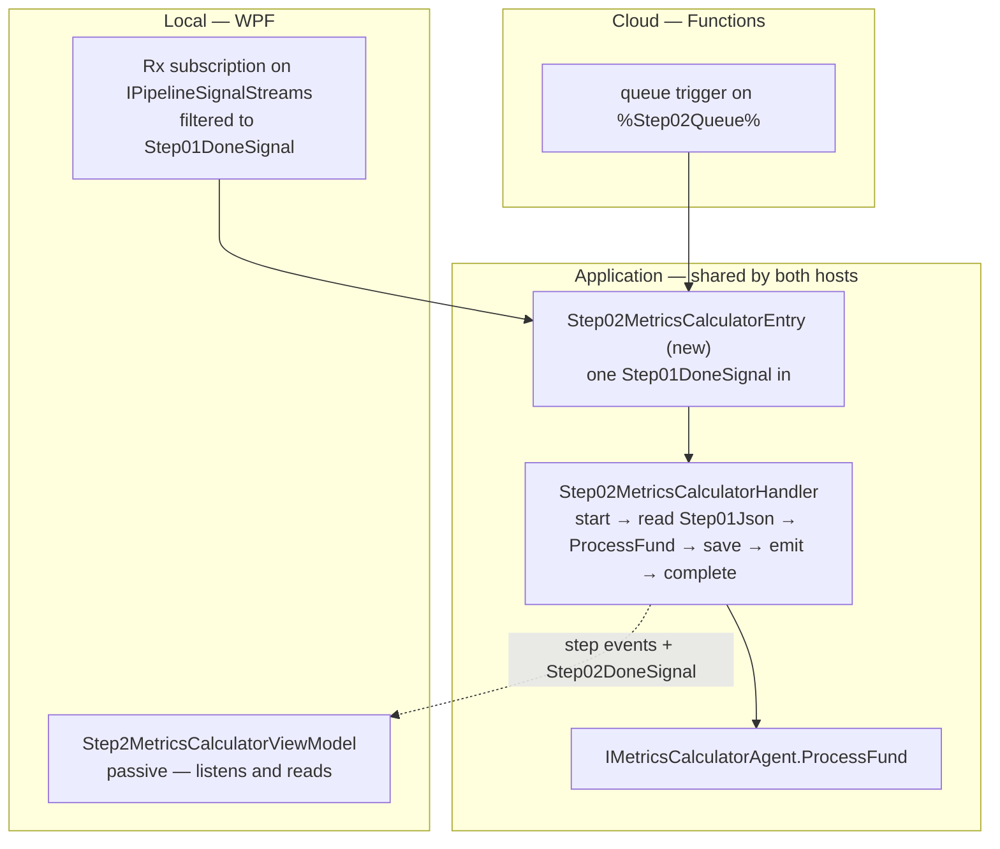
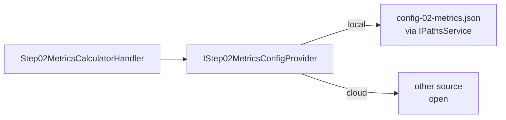
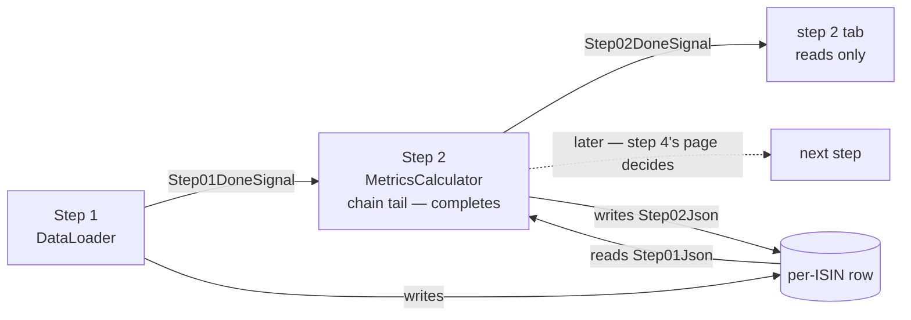

<!--
  Authoring rules: see README.md in this folder.
  STATUS: design only. Nothing here is implemented.
-->

# Step 2 — MetricsCalculator

> **Related:**
>
> - The cross-cutting design this follows from:
>   [event-driven-orchestration-plan.md](./event-driven-orchestration-plan.md)
> - The step this one follows, and the pattern it copies:
>   [01-dataloader.md](./01-dataloader.md)
> - What this step does **today** — I/O schemas, failure modes, test
>   fixtures:
>   [02-metricscalculator.md](../../FikaFinans.InfrastructureV2.Tests/docs/02-metricscalculator.md)

`StepId.MetricsCalculator`, implemented by `MetricsCalculatorAgent`
behind `IMetricsCalculatorAgent`, surfaced in the desktop app as
`Step2MetricsCalculatorViewModel`. This page covers only what the move to
signal-driven, per-fund processing changes.

## What step 2 needs from step 1

How step 1 produces any of this is on
[01-dataloader.md](./01-dataloader.md). This section only states what
step 2 takes from it.

### Trigger

[`Step01DoneSignal`](../../FikaFinans.Application/Pipeline/Signals/Step01DoneSignal.cs)
— one per fund, emitted after `Step01Json` is written.

| Field | Step 2 uses it to |
| --- | --- |
| `Isin` | name the fund — log lines, step events, the row the output lands on |
| `NavDate` | carry the trading date forward onto its own done-signal |
| `RunId` | read `Step01Json` for this run only — and tell a late signal from a live one |

### Input — `Step01Json` on the fund's row

One `FundRecord`, read back by run id. `ProcessFund` reads part of it
and copies the rest through untouched:

| Part of the record | Read | What for |
| --- | --- | --- |
| `NavBuckets` — last three | `Return2wPct` | `windows_positive_count`, `windows_total` |
| `NavBuckets` — latest | `CurrentDrawdownPct`, `AnnVolatility2wPct`, `Sharpe2w`, `PeriodEnd` | the 2-week metrics; `PeriodEnd` for the stale-snapshot check |
| `Snapshot` | every field — 12-week and 1-year Sharpe, volatility, compound return, max drawdown, `AsOfDate` | the rolling metrics; `null` when step 1 had no snapshot |
| `Metadata.TotalFee` | yes | `total_fee_pct`, net-of-fee return |
| `Isin`, rest of `Metadata`, `CurrentlyHeld`, `CurrentValueKr`, `CostBasisKr`, `Layer` | no | copied through — append-only |

**Run-level envelope** — cash available, frozen positions, run-level
warnings. Step 2 reads none of it and carries it through; how it is
stored on the row is still open (see "What the row does not carry").

Two expectations on step 1, both already met by its page:

- **Missing is `null`, never zero.** A missing snapshot, a NaN Sharpe or
  too little history arrives as `null`; step 2's data-quality flags
  depend on telling those apart.
- **One fund per run.** Step 1 mints a run id per fund, so a read by run
  id returns exactly this fund. Step 2's read relies on it.

## Names

Every new type carries the step number, the way step 1's do. All
*(new)*:

| Role | Step 1 (exists) | Step 2 *(new)* |
| --- | --- | --- |
| Handler interface | `IStep01DataLoader` | `IStep02MetricsCalculator` |
| Handler | `Step01DataLoaderHandler` | `Step02MetricsCalculatorHandler` |
| Entry point — runs the phases per signal | `PipelineFrontDoor` | `IStep02MetricsCalculatorEntry` + `Step02MetricsCalculatorEntry` |
| Done-signal | `Step01DoneSignal` | `Step02DoneSignal` |
| Config provider | — step 1 has no config | `IStep02MetricsConfigProvider` + `JsonBackedStep02MetricsConfigProvider` |
| Cloud function | `Step01DataLoaderFunction` *(sketch)* | `Step02MetricsCalculatorFunction` |
| Row — start | `StartStep01Async` — formerly `ClaimAsync` | `StartStep02Async` |
| Row — complete | `CompleteStep01Async` — only while step 1 is the chain tail | `CompleteStep02Async` |
| Row — fail | `FailStep01Async` | `FailStep02Async` |

The last three are methods on `IIsinProgressStore`, one set per step,
for the same reason `IPipelineSignals` has one overload per step: a step
that is not wired to the row does not compile. Save and the run-wide read
stay shared, keyed by `StepId`.

`PipelineFrontDoor` keeps its name — it is the pipeline's entry, not
only step 1's. `JsonBacked…` follows `RepositoryBackedIsinProgressStore`
and `MarkdownBackedPortfolioStructureProvider`.

## Sketch — the same step, two hosts

Illustrative only. Names marked *(new)* do not exist yet; queue names are
owned by [backend-nav-sync-plan.md](../backend-nav-sync-plan.md).

### What is the same in both hosts

Same rule as step 1: the step depends on interfaces, only the
registration differs.

| Interface | Current | WPF | Cloud |
| --- | --- | --- | --- |
| `IPipelineSignalStreams` | `LocalRxPipelineSignalBus` — only step 1's tab subscribes | same bus — also the step 2 subscription | — nothing subscribes |
| `IPipelineSignals` | `LocalRxPipelineSignalBus`, step 1's overload only | same bus, plus step 2's overload | queue publisher *(new)* |
| `IIsinProgressStore` | `RepositoryBackedIsinProgressStore` over SQLite — claim, save, run-wide read | same class — claim renamed to step 1's start, plus start / complete / fail per step and a stuck-row query | the same class over Tables |
| `IStepEventPublisher` | `LocalRxStepEventBus` | unchanged | still open — the parent plan's run-lifecycle question |
| `IStep02MetricsConfigProvider` | — none; the agent's `Run` and `StreamingPipelineGateway.LoadMetricsConfig` each read the file | `JsonBackedStep02MetricsConfigProvider` — `config-02-metrics.json` via `IPathsService` | another source — which one is still open |

No fetch seam. Step 2 never talks to YieldRaccoon — everything it needs
is already on the row. That makes it the cheapest step in the chain to
move, and a good place to prove the row-read pattern before steps that
also have LLM calls to worry about.

### Handler shape

Same rule as step 1 — one signal in, constructor for stable
dependencies, no transport types. Same phase split, so the caller can
order "write, then emit" itself:

| Step 1 phase | Step 2 equivalent | Difference |
| --- | --- | --- |
| `BeginProcessingAsync` — **starts** step 1 on the row, which also clears it | start step 2 on the row — refused unless it still carries the signal's run id → stop | starts without clearing — see "Start, do not claim" below |
| `LoadFundAsync` — fetch identity, holdings, pins | read `Step01Json` by the signal's run id and take this fund's record out; none → throw | one store read instead of three fetches |
| `AssembleAgentInputAsync` — compute buckets, snapshot | load the step 2 config through the config provider | config only; the record is already assembled |
| `RunAgentAsync` — `IDataLoaderAgent.RunInMemory` | `IMetricsCalculatorAgent.ProcessFund` | already on the interface, already pure |
| `PersistAsync` — `Step01Json` | `Step02Json` | same store call, different `StepId` |
| `EmitDoneAsync` — `Step01DoneSignal` | step 2's done-signal | new signal type, new overload |
| `ReadOutputAsync` | same, `StepId.MetricsCalculator` | none |

**Decided: six phases, same as step 1.** The middle three are only a
lookup, a config read and a pure call, so they could be merged — but
keeping the shape means the entry point is a near-copy of
`PipelineFrontDoor`, the step files diff cleanly against each other,
and steps 4–8, which add LLM calls, inherit a split they will need.

### Where the code lives

**Step 2 is triggered by `Step01DoneSignal` — in both hosts, always.**
Everything that runs on that signal lives in Application and is shared;
only the few lines that connect a transport to it differ per host.



| Piece | Current | WPF | Cloud |
| --- | --- | --- | --- |
| The calculation — `ProcessFund` | `MetricsCalculatorAgent`, called by `PipelineRunner` | same agent, called by the handler | same agent — shared |
| The phases | — no handler; `PipelineRunner` calls the agent inline | `Step02MetricsCalculatorHandler`, Application, beside step 1's | same class — shared |
| Runs the phases in order, the front door's twin | — | `Step02MetricsCalculatorEntry`, Application, beside `PipelineFrontDoor` | same class — shared |
| Signal → entry point | — no signal; Run All drives step 2 through `PipelineRunner` | Rx subscription in `MainWindowViewModel` — wiring only | `Step02MetricsCalculatorFunction`, queue trigger — wiring only |
| The tab | reads via `IsinProgressOutputLoader` with a disk fallback; button runs the agent | passive — listens, reads through the handler; debug button kept | — no UI |

The entry point is a twin of `PipelineFrontDoor`, not an extension of
it: one signal type in, one step's phases out, a fresh handler per
signal from a factory. That keeps step 1's front door untouched.

### Local

The subscription sits next to step 1's, in `MainWindowViewModel`, and
copies it — off the Rx callback, every exception caught so the stream
survives:

```text
// sketch
pipelineSignals.Signals                          // IPipelineSignalStreams
    .OfType<Step01DoneSignal>()
    .Subscribe(done => RunStep02Async(step02Entry, done));  // (new)
```

Wiring only. `MainWindowViewModel` holds it because that is where step
1's wiring already is; the parent plan's "extract the coordinator" slice
moves both later, together. No coalescing buffer here — unlike
`NavChangeSignal`, a done-signal is emitted once per run per fund.

**No step ViewModel runs step 2.** `Step1DataLoaderViewModel` already
subscribes to this stream, but only to know which run id to read for
display. That is a read, so the parent plan's "single-consumer by
convention" rule — which binds the *work* subscriber — is not broken by
it.

### Cloud

The step-2 queue already appears in step 1's sketch as the output
binding. Step 2 is its trigger:

```text
// sketch
// in Step02MetricsCalculatorFunction (new)
[Function("Step02MetricsCalculator")]
public Task Run(
    [QueueTrigger("%Step02Queue%")] Step01DoneSignal signal,
    CancellationToken ct)
    => _step02Entry.HandleAsync(signal, ct);   // IStep02MetricsCalculatorEntry (new)
```

The same entry point the local subscription calls — so the cloud adds a
trigger, not a second copy of the step.

The return-value-as-send question from step 1 applies unchanged.
Whichever wins there, step 2 takes.

## Input trigger

`Step01DoneSignal` — fund identifier, trading date, run id. No payload.

| | Current | WPF | Cloud |
| --- | --- | --- | --- |
| Producer | — no signal; step 2 runs after step 1 inside the same `PipelineRunner` pass, or from the tab's button | `Step01DataLoaderHandler.EmitDoneAsync` → `IPipelineSignals` | the same handler, queue-backed publisher |
| Transport | the fund record, in memory | `LocalRxPipelineSignalBus` | `%Step02Queue%` |
| How the step is reached | `PipelineRunner` calls `ProcessFund` per fund | subscribe to `IPipelineSignalStreams.Signals`, filter to step 1 | **nothing subscribes** — the Functions host invokes the step per message |

Delivery is at-least-once, as for step 1. Two cases matter:

| Arrives | Row says | Action |
| --- | --- | --- |
| Duplicate of a signal already handled | same run id, `Step02Json` populated | run again — the column is latest-only, overwrite is safe |
| Late — a newer run has started step 1 on the fund since | a **different** run id | drop it — step 2's start refuses it. Its `Step01Json` was cleared by the newer start; there is nothing to read and nothing to write |

The second row is new with step 2. Step 1 never has it, because step 1
mints the run id. Every later step inherits it.

### Start, do not claim

Step 1's start — `IIsinProgressStore.StartStep01Async`, formerly
`ClaimAsync` — is the lock, and it **clears
every step column**: that is how a new run starts clean. Step 2 calling
it would wipe the `Step01Json` it is about to read.

Step 2 has its own start, `StartStep02Async`. It is a check and
a mark, never a clear:

| Does | Why |
| --- | --- |
| Refuses unless the row is in flight **and** names the signal's run id | the late-signal drop — no row, or a newer run's start, both answer "not mine" |
| Moves `CurrentStep` to 2 | a fund that dies inside step 2 is then found by step 2's tab, not step 1's — see "Stuck rows" |
| Leaves the step columns and `ProcessingStartedAt` alone | `Step01Json` is step 2's input; step 1's start time is what the session-start check reads |

Refused → log and return false, the way step 1's refused start does.
The lock step 1 took still covers the whole chain for that fund; step 2
only records that the chain has reached it.

The read of `Step01Json` comes in the next phase, `LoadFundAsync`, so
the first phase stays a pure gate — exactly step 1's shape. A null read
after a granted start is not a late signal: step 1 wrote no record — its
save leaves the column null when the agent dropped the fund.

**Decided: a missing record fails the fund.** The read throws, and like
any other phase failure the entry point fails step 2: `LastError` shows
why, the anchor stays put, and the next signal retries. Keeping the read
out of the first phase is what makes that work — the entry point only
fails what happens after a granted start. If dropped funds turn out to
be routine (outside the company filter, say), completing with nothing
written is the alternative.

### Manual trigger — WPF only

The tab keeps its "Run this step" debug button, and the GUI does not
change. It stays a desktop affordance with no cloud counterpart.

It behaves as step 1's does today: the button calls
`IMetricsCalculatorAgent.Run`, which reads step 1's output from disk.
Not the signal path, and not meant to be — it is for debugging the
calculation in isolation. Both buttons move together when the parent
plan's "unify the run paths" slice routes them through the runner.

## Input data — what the step reads

| Input data | Current | WPF | Cloud |
| --- | --- | --- | --- |
| **Step 1's fund record** — identity, buckets, snapshot, holding, layer | `01-dataloader-{iso_week}-{run_id}.json` (button) or the in-memory record (runner) | `Step01Json` on this fund's row, matched by run id | same, Tables |
| **Config** — stale-snapshot window, fee horizon | `config-02-metrics.json` via `IPathsService`, falling back to defaults when absent — read separately by the agent's `Run` and by `StreamingPipelineGateway.LoadMetricsConfig` | through the config provider, JSON-backed — same file | through the same provider, other source |

### Config through a seam

**Decided: the step reads its config through
`IStep02MetricsConfigProvider`, never a file.** The same move as step 1's fetch seams — the
handler knows it needs a `MetricsCalculatorConfig`, not that it lives
in a JSON file under the inputs folder.



| | Current | WPF | Cloud |
| --- | --- | --- | --- |
| Implementation | none — the agent's `Run` and `StreamingPipelineGateway.LoadMetricsConfig` each open the file | `JsonBackedStep02MetricsConfigProvider` — the file the tab's config editor already edits | not chosen — app settings, a table row and blob storage are all plausible |
| Source of truth | `config-02-metrics.json` | unchanged | the open question already on step 1's page |
| Missing config | silent fallback to defaults, decided twice | decided once, in the provider | decided once, in the provider — fall back or fail |

The provider is the step's only way to its config. The tab's config
editor keeps writing the same file, so locally nothing visible changes.
The agent's own `Run` still reads the file directly — that is the debug
button's path, which this page leaves alone.

The provider also owns the missing-config policy. Today's silent
fallback to defaults is harmless on a desktop; in a host with no file it
is a silent misconfiguration. Whether the cloud implementation falls
back or fails is its call — but it is one place to decide it, not two.

Steps 4, 9 and 10 have config files of their own and inherit this
pattern.

### The existing read is enough — a run is one fund

`IIsinProgressStore.ReadStepOutputAsync(step, runId)` gathers every row
naming a run id. Step 1 mints a fresh run id per fund
(`IPipelineRunIdFactory.NewRunId(isin, navDate)`), so under per-fund
processing that is always exactly one row — the answer's fund list has
one entry, and it is this fund's.

**Decided: reuse it, no change to the read.** The cost is a partition scan
where a point read by ISIN would do. At the local universe size that is
nothing; a point read can be added later if it ever shows up in cloud
cost or latency.

### What the row does not carry

`Step01Json` holds one `FundRecord`. The `DataLoaderOutput` envelope
around it — frozen positions, cash available, run-level data-quality
warnings, ISO week, company — never reaches the row;
`SaveStepOutputAsync` picks the fund's record out and drops the rest.

Step 2's calculation does not care: `ProcessFund` takes a `FundRecord`
and nothing else. But the consumers further down do — step 10's cash
floor needs cash available, and frozen positions must never be proposed
for sale.

**Decided: carry the envelope on the row**, so every step reads it the
same way it reads the fund record, and step 2 passes it through
untouched — the append-only rule, applied to the envelope too.

The cost, accepted:

| Cost | Why it is acceptable |
| --- | --- |
| Portfolio-wide data duplicated on every fund's row | the universe is small; a few fields per row |
| Two rows can disagree — each holds cash and positions as of its own run | each row records what *that* run saw, which is the right audit trail; a consumer wanting the current picture takes the most recent row |

#### Open — how the envelope is stored

Two shapes, neither chosen:

| | Whole one-fund output in each step column | Separate envelope column |
| --- | --- | --- |
| What `Step{N}Json` holds | the step's full `DataLoaderOutput` — envelope plus its single fund record | the fund record only, as today |
| Where the envelope lives | inside every step column — each step's copy | one new column on `IsinProgressEntity`, written by step 1, cleared at step 1's start |
| Store change | save stops picking the record out; the read hands back the envelope too | new column in the SQLite row and the Tables entity, plus a migration and a read path |
| Can a later step add to the envelope | yes — it rewrites its own copy | only by writing the shared column |
| Rests on | a run being one fund — which holds today | nothing extra |

The first is smaller and stores what the step actually produced,
verbatim. The second keeps the step columns as they are and stores the
envelope once. Decide before step 2 is built, since step 2 is the first
step to read the envelope back.

### The config has fields that move to step 1

`MetricsCalculatorConfig` mixes two kinds of setting:

| Field | Used by | After the redesign |
| --- | --- | --- |
| `StaleSnapshotWarnDays`, `FeeDeductionHorizonWeeks` | `ComputeMetrics` | still step 2 |
| `MinBucketDays`, `DropPartialBuckets` | nothing in step 2's code — the bucketing is the producer's today | describe what `SliceIntoWindows` does, which step 1's page moves **into step 1** |
| `PrimarySharpeHorizonWeeks`, `TreatNanSharpeAsZeroForRules`, `WarnOnBucketsTotalLt`, `DataQualityFlagsEnabled` | not read by `ComputeMetrics` | unchanged — not this page's concern |

Once step 1 computes buckets itself, the bucketing rules are step 1's
input, sitting in step 2's file. Whatever step 1 ends up reading them
from, it reads through a config provider like step 2's, never the file.
Which provider, and whether the two fields move, is step 1's bucketing
port to decide — step 2 does not read them either way.

## Pre-processing — assemble the agent input

Nothing to assemble. Step 1 already produced the record `ProcessFund`
takes, and the only other input is the config.

Compare step 1, whose pre-processing was a whole calculator port. That
asymmetry is the point of the chain: every fetch and every join happens
once, at the front, and later steps only read.

## Agent work

Code, not an LLM. Contract:
[02-metricscalculator.md](../../FikaFinans.InfrastructureV2.Tests/docs/02-metricscalculator.md).

The call is
[`IMetricsCalculatorAgent.ProcessFund(fund, config)`](../../FikaFinans.Application/Pipeline/Agents/IMetricsCalculatorAgent.cs),
implemented by
[`MetricsCalculatorAgent`](../../FikaFinans.Infrastructure/Pipeline/Agents/MetricsCalculatorAgent.cs).

Unlike step 1, **nothing stands in the way**:

| Step 1 had | Step 2 has |
| --- | --- |
| the in-memory call missing from the interface | `ProcessFund` already on it |
| `TextReader` inputs | a typed `FundRecord` |
| a universe to join across | one fund, no cross-fund reads |

`ProcessFund` is pure — no I/O, no clock, returns an enriched copy with
`Metrics` set and every earlier field preserved. The append-only rule
holds without any change. `Run` and `RunInMemory` stay for the
universe-wide button and tests; the per-fund step does not call them.

### One flag that may lose its meaning

`snapshot_stale_vs_summary` compares the snapshot's as-of date with the
latest bucket's end date. Today those come from two separate producer
files, which can be exported at different times — so they can drift.

After step 1's redesign both are computed from the same mirrored series
in the same run. The drift the flag detects stops being possible, unless
the two calculators are ever fed different slices of the series. Keep
the flag — the contract is unchanged and it costs nothing — but it is
worth knowing it will read `false` by construction.

## Post-processing — write and emit

One write, then one signal. Same order as step 1, same reason.

| Written | Current | WPF | Cloud |
| --- | --- | --- | --- |
| This fund's enriched record | `Step02Json` via `StreamingPipelineGateway`'s block write (runner), or the `02-metrics-{iso_week}-{run_id}.json` file (button) | `IIsinProgressStore.SaveStepOutputAsync` with `StepId.MetricsCalculator` → `Step02Json`, `CurrentStep` advances to 2 — SQLite | same call — Azure Tables |
| Row freed | `ReleaseIsinProgressAsync` once, at the end of the whole `PipelineRunner` pass; **nothing** on the signal path | `CompleteStep02Async` on success, `FailStep02Async` on failure — step 2 is the chain tail, see "Complete and fail" | same |

No NAV rows, no mirror — step 2 writes only its column.

`SaveStepOutputAsync` takes a `DataLoaderOutput` and picks this fund's
record out. **Decided: reuse it** — step 2 wraps its one enriched record
in a one-fund envelope, which is what step 1's output already is under
per-fund processing. If the envelope ends up stored whole in each step
column (see "How the envelope is stored"), the save stops picking the
record out; the call stays.

### Complete and fail — the chain tail frees the row

Step 1's claim sets the row to processing, and on the signal path
nothing sets it back. `ReleaseIsinProgressAsync` exists, but only the
universe-wide `PipelineRunner` calls it. Two consequences, live today:

| Case | What happens |
| --- | --- |
| Step 1 succeeds | row stays in flight forever — the next NAV signal for that fund is refused at the claim, and the dedup anchor never advances |
| Step 1 fails | same — its comment says the janitor will reset it, but no janitor exists |

A step ends one of two ways, the same two `StepEventKind` already
reports — succeeded or failed. Each step gets its own method for each on
`IIsinProgressStore`:

| Method | Called by | Row after |
| --- | --- | --- |
| `CompleteStep{N}Async` | the chain tail only, once its emit is done | free; `LatestProcessedNavDate` advanced to the run's trading date; `LastError` cleared |
| `FailStep{N}Async` | any step, from any phase that throws | free; anchor **not** advanced; `LastError` set — the next signal retries the fund |

**Decided: only the step currently last on the signal path completes.**
A step that is not the tail has nothing to complete — its save has
already moved `CurrentStep` on — so it has a fail method and no complete
method.

The tail moves as the chain grows: step 1 today, step 2 once it lands
— and step 2 stays the tail until a later step consumes its
done-signal. So in the change that wires step 2, `CompleteStep01Async`
is removed and `CompleteStep02Async` takes over — one step completes,
never two.

**Fix step 1 first**, as its own small change: it is broken today
whether or not step 2 exists. The gateway's `ReleaseIsinProgressAsync`
is no help — it is universe-shaped (the whole step 1 output plus a
failed set) and lives on the old path.

### Stuck rows — restart when the tab opens (WPF only)

A crash or app shutdown mid-run still leaves a row in flight, because no
code gets to complete or fail the step. The "janitor" step 1's comments promise —
a background job that resets rows stuck too long — does not exist.

**Decided, local only: each step tab restarts its own stuck funds when
it opens** — the rows whose `CurrentStep` is that tab's step. Step 2's
tab restarts funds that died in step 2, step 1's those that died in
step 1. That split holds because every step's start moves
`CurrentStep` to its own number — without step 2's start, a fund dying
inside step 2 would still read as step 1. For each such row still in
flight:

| Check | Then |
| --- | --- |
| step 1 started it **before this app session started** | its run is dead — nothing from an earlier process can still be running. Fail the step through that step's `FailStep{N}Async`, recording it as abandoned, then publish a fresh `NavChangeSignal` for its ISIN and trading date through `INavSignalPublisher` |
| started during this session | leave it — it may genuinely be running right now |

The reset is a fail on purpose: it does exactly what a reset must —
frees the row, keeps the anchor, records why — so it needs no method of
its own.

The restart goes back through the front door like any other signal, so
it always starts at step 1, whichever step the run died in. The dedup
anchor is untouched by the reset.

**A deliberate exception** to the rule on step 1's page that opening a
view is only a read. It is limited to rows the session-start check
proves dead, so a view still never starts work that is already
underway.

The fail must land before the signal: step 1's start refuses a row
still in flight, so a re-published signal against a row not yet failed
would just be dropped. Finding the rows needs a store query step 2 does not
otherwise use — every in-flight row at a given step.

Cloud is not covered — decided when the cloud host is built.

### Emit

`Step02DoneSignal` — fund identifier, trading date, run id, no payload.
Same shape as step 1's, implementing `IStepDoneSignal`. Named by the
producing step's number, as decided on step 1's page.

Its overload is on `IPipelineSignals` and implemented on
`LocalRxPipelineSignalBus` — the overloads-not-generic choice means any
other implementation fails to build until it adds one too.

Nothing changes on `IPipelineSignalStreams` — it already carries every
`IStepDoneSignal`.

### Who consumes it

**Decided: nobody, yet.** Step 2 emits its done-signal and nothing
consumes it for work. Step 2 is the chain tail, so it is also the step
that completes the run and frees the row (see "Complete and fail"
above).

Why not wire step 4 now: step 3 (MacroAnalyst) is a universe-wide
barrier, and step 4 is the next per-fund consumer of step 2's output —
but whether step 4 hangs off step 2 directly depends on how the barrier
question resolves. Step 4's page decides what it listens to; step 2
only publishes.

The signal is still worth emitting with no work consumer: step 2's tab
listens to it to know which run id to read, the same way step 1's tab
does.



## What a frontend reads when the user opens the view

Same as step 1: opening the tab is a read of `Step02Json`, never a
trigger — with the one exception of restarting funds proven dead (see
"Stuck rows").

`Step2MetricsCalculatorViewModel.LoadOutputAsync` today goes through
`IsinProgressOutputLoader` with a column selector, then falls back to
step 2's JSON file on disk. Step 1's ViewModel has already moved off
both onto its handler's `ReadOutputAsync`, and it follows the step
rather than running it — subscribing to step events for its `StepId` and
to its own done-signal to know which run id to read.

**TODO:** the same move for step 2 — the tab becomes **passive**, a copy
of step 1's:

| The tab | Does |
| --- | --- |
| Listens to step events | filtered to `StepId.MetricsCalculator`, projected onto status, duration, error |
| Listens to `Step02DoneSignal` | to learn the run id, then reads that run's output |
| Reads | through the step 2 handler's `ReadOutputAsync`, never the repository directly |
| Runs | **nothing** on a signal — only the debug button, as above |

`IsinProgressOutputLoader` and the disk fallback leave the tab. No XAML
changes. The three view states from step 1's page — populated, in
flight, not processed — apply unchanged.

## TODO summary

In implementation order — one change per row, each reviewed and
committed before the next starts.

| # | Work | Touches |
| --- | --- | --- |
| 1 | Rename `ClaimAsync` to `StartStep01Async` — no behaviour change | `IIsinProgressStore`, `RepositoryBackedIsinProgressStore`, `Step01DataLoaderHandler` |
| 2 | `CompleteStep01Async` + `FailStep01Async` — complete advances the anchor, fail does not | `IIsinProgressStore`, `RepositoryBackedIsinProgressStore` |
| 3 | Step 1 completes after its emit and fails from any phase that throws, so a fund is not locked after one signal | `Step01DataLoaderHandler`, `PipelineFrontDoor` |
| 4 | `Step02DoneSignal` and its overload | `Pipeline/Signals`, `LocalRxPipelineSignalBus` |
| 5 | `IStep02MetricsConfigProvider` in Application, `JsonBackedStep02MetricsConfigProvider` in Infrastructure | Application, Infrastructure, `InfrastructureModule` |
| 6 | `StartStep02Async`, `CompleteStep02Async`, `FailStep02Async` | `IIsinProgressStore`, `RepositoryBackedIsinProgressStore` |
| 7 | `IStep02MetricsCalculator` + `Step02MetricsCalculatorHandler`, in step 1's shape — first phase starts step 2 then reads `Step01Json`; save wraps the record in a one-fund envelope. Not wired yet | Application, `Pipeline/Steps` |
| 8 | `IStep02MetricsCalculatorEntry` + `Step02MetricsCalculatorEntry`, the front door's twin; registration — handler per-dependency, entry point single-instance, like step 1's | Application, `Pipeline`, `InfrastructureModule` |
| 9 | Subscription `Step01DoneSignal` → entry point, beside step 1's — and, in the same change, step 2 takes completion over: `CompleteStep01Async` removed | `MainWindowViewModel`, both handlers, `IIsinProgressStore` |
| 10 | Step 2's tab goes passive — listens, reads, keeps its debug button | `Step2MetricsCalculatorViewModel`, no XAML |
| 11 | Each step tab restarts its own stuck funds on open — `CurrentStep` is its step, step 1 started before this session; failed first through that step's fail, then re-published as `NavChangeSignal`. Needs an in-flight-rows-by-step query | step 1 and step 2 tabs, `IIsinProgressStore`, `INavSignalPublisher` |
| — | Carry the envelope on the row — shape still open, see "How the envelope is stored" | `IIsinProgressStore` and its storage, both handlers |

The per-fund read was dropped: the run-wide read already returns one
fund.

None of it touches `MetricsCalculatorAgent`. The agent is done.

## Open questions

Raised by this page; they belong in the parent plan's Open Questions,
not settled here.

- **Where the local wiring ends up.** Step 2's subscription sits beside
  step 1's in `MainWindowViewModel` for now. Both move out together in
  the "extract the coordinator" slice; step 2 adds nothing that slice
  did not already have to move.
- **Crash recovery in cloud.** Local restarts on tab open; cloud has no
  tab and needs a timeout-based reset. Decided when the cloud host is
  built.
- **How the envelope is stored on the row** — whole one-fund output in
  each step column, or a separate envelope column. Options laid out
  under "What the row does not carry".
- **Which row step 10 trusts for the envelope.** Every row carries its
  own run's cash and positions. Step 10 runs on a timer across the
  universe, so it must pick one — most recent run is the obvious answer,
  but it is step 10's page to decide.
- **Where the bucketing config lives** once step 1 owns the bucketing —
  through a config provider either way; which one is step 1's call.
- **Who consumes step 2's done-signal.** Nobody for now; step 2 is the
  tail. Step 4 is the natural consumer if step 3 resolves as a barrier
  off the per-fund chain — step 4's page owns the decision.
- **The cloud config source.** The seam is decided (config provider);
  what sits behind it in cloud is not — app settings, a table row, or
  blob. Also whether the cloud implementation falls back to defaults or
  fails when nothing is there.
