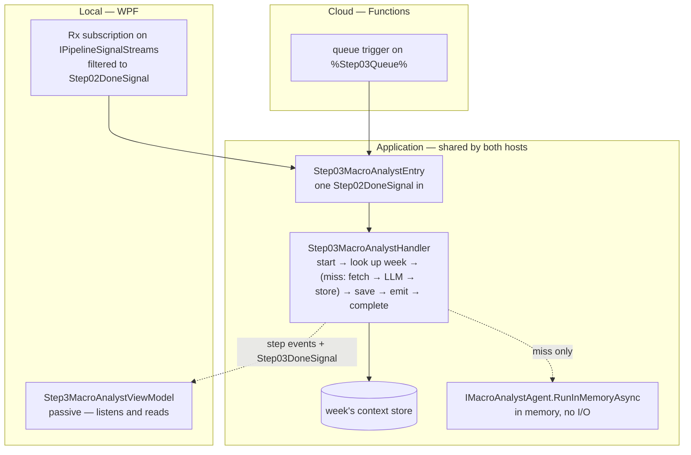
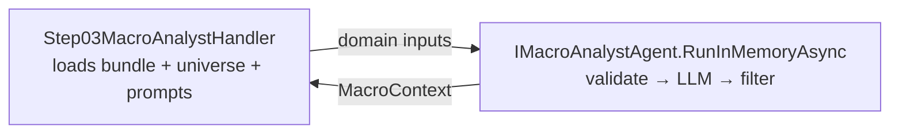
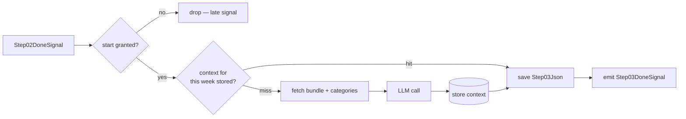
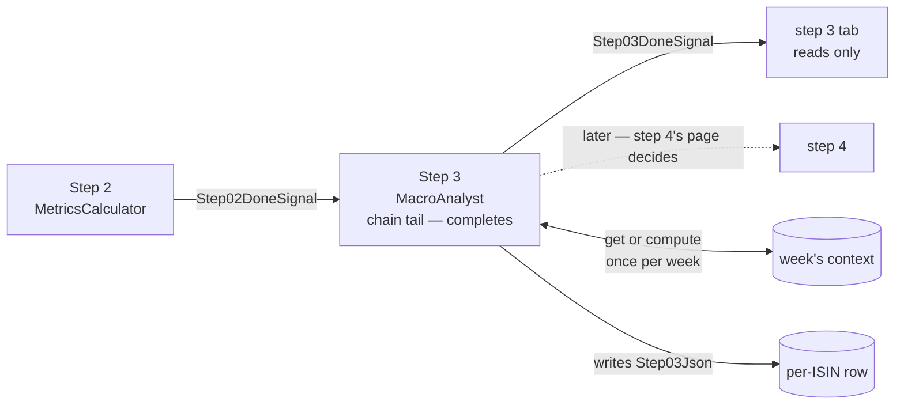

<!--
  Authoring rules: see README.md in this folder.
  STATUS: design only, 2026-10-11. Nothing on this page is implemented. The
  shape of the step is decided — per-fund hop, per-week work (B), see "Not a
  barrier any more"; the rest of the open questions are at the end. Decided:
  the agent's logic and contract do not change; the handler loads, the agent
  computes in memory, and RunInMemoryAsync moves onto IMacroAnalystAgent with
  a typed IsoWeek — the same split as step 2.
-->

# Step 3 — MacroAnalyst

> **Related:**
>
> - The cross-cutting design this follows from:
>   [event-driven-orchestration-plan.md](./event-driven-orchestration-plan.md)
> - The step this one follows, and the pattern it copies:
>   [02-metricscalculator.md](./02-metricscalculator.md)
> - How the three analytics reports reach this step — file, live API or
>   cache:
>   [analytics-json-migration-plan.md](../analytics-json-migration-plan.md)
> - What this step does **today** — I/O schemas, failure modes, prompts,
>   evaluation rubric:
>   [03-macroanalyst.md](../../FikaFinans.InfrastructureV2.Tests/docs/03-macroanalyst.md)

`StepId.MacroAnalyst`, implemented by `MacroAnalystAgent` behind
`IMacroAnalystAgent`, surfaced in the desktop app as
`Step3MacroAnalystViewModel`. This page covers only what the move to
signal-driven, per-fund processing changes.

Step 3 is the first step that does not fit the pattern steps 1 and 2
set. They take one fund and produce one fund. Step 3 takes a **week** —
three analytics reports and the list of fund categories — and produces
one `MacroContext` that every fund in that week shares. Most of this
page is about what that mismatch means once runs are per fund.

## Constraint — the handler loads, the agent computes

**Decided: same split as step 2.** The handler loads everything the
agent needs; the agent computes in memory and reads nothing. The
agent's logic and its contract in
[03-macroanalyst.md](../../FikaFinans.InfrastructureV2.Tests/docs/03-macroanalyst.md)
do not change — the prompts, the retry, the input validation and the
universe filter stay inside it, exactly as they are.

| | Today | After |
| --- | --- | --- |
| `IMacroAnalystAgent` | declares only `RunAsync(isoWeek, runId)` — file in, file out | **also declares `RunInMemoryAsync`**, the call the handler makes — as `IMetricsCalculatorAgent.RunInMemory` is for step 2 |
| `RunInMemoryAsync` | public on the concrete class only; ISO week as a `string` | on the interface; ISO week typed as `IsoWeek`, as step 2's call takes it |
| `RunAsync` | reads the files, calls `RunInMemoryAsync`, writes the output | unchanged — the debug button and Run All still use it |
| Inputs to the in-memory call | the three analytics runs, a whole `DataLoaderOutput` — read only for its categories and its week | unchanged — the handler must supply a universe `DataLoaderOutput`; see "The category universe" |
| `ValidateInputs` — FK chain, `Failed` status, analytics week **equal to** the `DataLoaderOutput`'s week | in the agent | unchanged — the step decides only which week to ask for; see "Which week" |
| Prompts — system, user template, retry | read by the **constructor** from `_paths.MacroAnalystPromptsDir`, which also writes the embedded defaults there when missing | **an input to `RunInMemoryAsync`**, loaded by the handler through a prompts provider — see "No `_paths` behind the in-memory call" |

The handler lives in Application and sees only the interface, so the
in-memory call has to be on it.

### No `_paths` behind the in-memory call

**Decided: `RunInMemoryAsync` is fully in-memory — it uses nothing
`_paths` provides, directly or indirectly.** The agent may keep
`IPathsService` as a dependency; `RunAsync` needs it. What is ruled out
is the in-memory call *using* it.

Today the call does not touch `_paths`, but it is not free of it: the
three prompt templates it uses are fields, filled by the constructor
from `MacroAnalystPromptsDir`. Its output therefore depends on a folder
read, even though no file is opened during the call.

Same answer as step 2's config: **the prompts become an input**, and the
handler loads them through a provider, never a path. Everything the
call uses then arrives as a parameter, apart from the LLM client.

| | Today | After |
| --- | --- | --- |
| Where the prompts come from for the in-memory call | constructor fields, read from the folder | a parameter of `RunInMemoryAsync` — the three templates together, as one value |
| Who loads them on the signal path | the agent's constructor | the handler, through `IStep03MacroAnalystPromptsProvider` — placeholder, the twin of `IStep02MetricsConfigProvider` |
| Who loads them for `RunAsync` | the constructor | `RunAsync` itself, at call time — same folder, same embedded-default extraction; it is the file path anyway |
| Constructor | takes `_paths`, reads (and may write) the prompt folder | still takes `_paths` — the agent may depend on it; the prompt read moves to `RunAsync`, the only caller left that needs it |
| Constructor's optional template parameters | three `string?` — all or none, else all three load from the folder | **removed** — tests pass prompts to `RunInMemoryAsync` directly |
| Type of the prompts | three loose strings | one record holding all three, named per role — `Step03MacroAnalystPrompts` *(new)* — step number and name, like the other step 3 types — in Application beside `MetricsCalculatorConfig` |

**Decided: the prompts are typed, as one value.** They only make sense
together — the constructor already treats them as all-or-nothing — and
three strings in a row are easy to swap without the compiler noticing.
Named members fix that; one value is also what the provider returns and
what the call takes, as `MetricsCalculatorConfig` is for step 2. One
type per prompt string would add nothing the named members do not
already give.

After the change, `_paths` is used by `RunAsync` alone. A test of
`RunInMemoryAsync` hands in every input itself, so nothing on disk can
change its result.

**Tests for `RunInMemoryAsync` go in a new file**, beside the existing
`MacroAnalystAgentTests` and `MacroAnalystAgentIntegrationTests` in
`FikaFinans.InfrastructureV2.Tests/Agents/03-macroanalyst/`.

The prompt text, the placeholders it substitutes and the retry
behaviour do not change; only where the three strings arrive from.

## Not a barrier any more

[pipeline-step-flow-plan.md](../pipeline-step-flow-plan.md) classifies
step 3 as a **universe-wide barrier**: the stream buffers every fund
out of step 2, runs one LLM call, then fans back out. `PipelineRunner`
still does exactly that for Run All.

Under signal-driven processing that barrier has nothing to wait for.
NAV signals arrive one fund at a time, on whatever day each fund's NAV
moves. There is no moment when "the universe has finished step 2" —
there is only the next fund.

It also never needed one. Read what step 3 actually takes:

| Input | Depends on |
| --- | --- |
| The three analytics reports | the ISO week — published once a week by KanelBrief |
| The fund category list | the universe's identity data — changes when a fund is added or recategorised |
| Any one fund's record, metrics, or step 2 output | **nothing** — step 3 reads none of it |

So the output is a function of the week (and the category list), not
of the funds that happen to be in flight. A barrier was the Rx way to
make sure step 1 had loaded the universe's categories before step 3
ran. That job can be done by a read instead of a wait.

The two existing plans disagree on where step 3 sits, which is the
open "barrier steps versus the queue chain" question in the parent plan:

| Plan | Says |
| --- | --- |
| [backend-nav-sync-plan.md](../backend-nav-sync-plan.md) | per-fund hop — `step02-done` triggers step 3, `step03-done` triggers step 4 |
| [pipeline-step-flow-plan.md](../pipeline-step-flow-plan.md) | universe-wide barrier — one shared analysis, not one per fund |

Both are half right: step 3 is a hop in the per-fund chain, but its
*work* is per week.

### Three shapes

| | A — weekly job, outside the chain | B — per-fund hop, per-week work | C — fan-in barrier |
| --- | --- | --- | --- |
| What triggers it | the week's analytics bundle arriving, a timer, or the button | `Step02DoneSignal`, like any other hop | "every fund finished step 2" |
| LLM calls per week | one | one — the first fund of the week computes, the rest read | one |
| Per-fund chain | step 2 → step 4; steps 5 and 6 look the context up | step 2 → step 3 → step 4, as the queue layout already says | step 2 → wait → step 3 → step 4 |
| Bundle not there yet | steps 5 and 6 find nothing — fund fails at step 5 | fund fails at step 3, retried on the next signal | — |
| `Step03Json` | stays null | the fund record, passed through from `Step02Json` — the chain's rule | — |
| Fits signal-driven runs | yes | yes | **no** — there is never an "every fund" |
| Needs a trigger nobody has | yes — bundle arrival has no signal today, locally or in cloud | no | — |

**Decided (2026-10-11): B.** The LLM call runs when first needed, not
on a schedule. This answers the parent plan's barrier question for step
3 only; step 9 still needs its own answer.

Why B over A:

- **It keeps the chain linear.** The queue layout in
  [backend-nav-sync-plan.md](../backend-nav-sync-plan.md) already has
  `step02-done` and `step03-done`; B fills them in as drawn. A deletes
  a hop and makes steps 5 and 6 depend on a side input arriving on
  time.
- **It needs no new trigger.** A needs something to notice the weekly
  bundle — a timer, a webhook, a refresh job. None exists, and the
  analytics plan leaves that choice open. B runs when the first fund
  of the week needs the context.
- **It keeps every column filled.** Step 4 reads `Step03Json`, as every
  step reads its predecessor's column. Under A that column would stay
  empty and step 4 would be the one step reading two columns back.
- **It copies step 2.** Handler, entry point, start / complete / fail,
  done-signal, orphaned-run recovery — the same pieces, so the step
  files keep diffing cleanly against each other.

What B costs, and A does not: a get-or-compute that must not compute
twice. See "Get or compute" under Agent work.

C is listed only to rule it out.

**The rest of this page builds on B.** A few sections still note where
A would have differed, for the record.

## What step 3 needs from step 2

### Trigger

[`Step02DoneSignal`](../../FikaFinans.Application/Pipeline/Signals/Step02DoneSignal.cs)
— one per fund, emitted after `Step02Json` is written.

| Field | Step 3 uses it to |
| --- | --- |
| `Isin` | name the fund — log lines, step events, the row `Step03Json` lands on |
| `NavDate` | pick the week whose context applies; carry the trading date forward onto its own done-signal |
| `RunId` | gate the start — and tell a late signal from a live one |

### Input — `Step02Json` on the fund's row

One `FundRecord`, read back by run id, the same read step 2 makes of
`Step01Json`. Step 3 **reads none of it** and writes it to `Step03Json`
unchanged — the append-only chain in
[pipeline-plan.md](../../FikaFinans.InfrastructureV2.Tests/docs/pipeline-plan.md):
each step reads its predecessor's output and adds fields, and step 3
has no per-fund field to add. Step 4 then reads `Step03Json`, as the
step-output rule in
[backend-nav-sync-plan.md](../backend-nav-sync-plan.md) has every step
read its predecessor's column.

Everything the agent needs lives outside the row (see "Input data").
That is why its work can be shared: two funds in the same week give the
agent identical inputs.

## Names

Every new type carries the step number, as steps 1 and 2 do. All
*(new)* unless marked otherwise:

| Role | Step 2 (exists) | Step 3 *(new)* |
| --- | --- | --- |
| Handler interface | `IStep02MetricsCalculator` | `IStep03MacroAnalyst` |
| Handler | `Step02MetricsCalculatorHandler` | `Step03MacroAnalystHandler` |
| Entry point | `IStep02MetricsCalculatorEntry` + `Step02MetricsCalculatorEntry` | `IStep03MacroAnalystEntry` + `Step03MacroAnalystEntry` |
| Done-signal | `Step02DoneSignal` | `Step03DoneSignal` |
| Config provider | `IStep02MetricsConfigProvider` + `JsonBackedStep02MetricsConfigProvider` | `IStep03MacroAnalystPromptsProvider` + `FileBackedStep03MacroAnalystPromptsProvider` — placeholders; step 3 has no config file, its prompts play the same role |
| What the provider returns | `MetricsCalculatorConfig` | `Step03MacroAnalystPrompts` — the three prompt templates as one record |
| Analytics input | — | a loader for the three reports, as the typed runs the agent takes — the analytics plan's source, name not chosen there; `IWeeklyAnalyticsReportsProvider` returning `WeeklyAnalyticsReports` — built in row 1, named after the schema's "three weekly analytics reports" |
| Universe for the agent | — | no new type — a "list every fund" read on the existing `IFundMetadataProvider`; the handler wraps it in a `DataLoaderOutput` |
| Agent call | `IMetricsCalculatorAgent.RunInMemory` | `IMacroAnalystAgent.RunInMemoryAsync` — exists on the class, moves onto the interface |
| Week's context, stored | — | `IMacroContextStore` — placeholder |
| Cloud function | `Step02MetricsCalculatorFunction` *(sketch)* | `Step03MacroAnalystFunction` |
| Row — start | `StartStep02Async` | `StartStep03Async` |
| Row — complete | `CompleteStep02Async` — **removed** when step 3 takes the tail | `CompleteStep03Async` |
| Row — fail | `FailStep02Async` | `FailStep03Async` |
| Row — orphaned list | `ListOrphanedStep02Async` | `ListOrphanedStep03Async` |

The placeholders are named only so the page can refer to them. Each is
a seam whose shape is still open.

## Sketch — the same step, two hosts

Illustrative only. Names marked *(new)* do not exist yet; queue names are
owned by [backend-nav-sync-plan.md](../backend-nav-sync-plan.md).

### What is the same in both hosts

| Interface | Current | WPF | Cloud |
| --- | --- | --- | --- |
| `IPipelineSignalStreams` | `LocalRxPipelineSignalBus` — step 2's work subscription and both tabs' reads | same bus — plus the step 3 subscription | — nothing subscribes |
| `IPipelineSignals` | steps 1 and 2's overloads | plus step 3's | queue publisher *(new)* |
| `IIsinProgressStore` | start / complete / fail / orphaned for steps 1–2 | plus step 3's; step 2 loses its complete | the same class over Tables |
| `IStepEventPublisher` | `LocalRxStepEventBus` | unchanged | still open — the parent plan's run-lifecycle question |
| Analytics source *(new)* | — none; the agent reads three files through `IPathsService` | file-backed — the same three files | KanelBrief HTTP API, live or cached — the analytics plan's open A/B |
| `IFundMetadataProvider` — the all-funds read | — none; step 1's universe-wide output file | `YieldRaccoonSqliteMetadataProvider`, plus a list query | REST-backed provider *(new)* — needs a YieldRaccoon list endpoint |
| `IMacroAnalystAgent` | `RunAsync` only, called by `PipelineRunner` and the tab | plus `RunInMemoryAsync`, called by the handler | same |
| Prompts provider *(new)* | — none; the agent's constructor reads `MacroAnalystPromptsDir` | file-backed — the same folder via `IPathsService`, embedded defaults extracted when missing | another source — embedded defaults, app settings or blob; open |
| Context store *(new)* | — none; the agent writes `03-macro-{iso_week}-{run_id}.json` | SQLite | Tables or blob — open |
| `IMacroLlmClient` | `FoundryMacroLlmClient` over `AIProjectClient` | unchanged | unchanged — same Foundry project, managed identity instead of `az login` |

Step 3 is the first step with an LLM in the signal path. The client
is already host-neutral: it takes an `AIProjectClient` and a model id,
creates an ephemeral agent, sends one Responses call, and deletes the
agent. Nothing about it is WPF-shaped.

### Handler shape

Same six phases as steps 1 and 2, same split so the entry point orders
"write, then emit" itself:

| Step 2 phase | Step 3 equivalent | Difference |
| --- | --- | --- |
| `BeginProcessingAsync` — start step 2 on the row | start step 3 on the row — refused unless it still names the signal's run id | none |
| `LoadFundAsync` — read `Step01Json` | read `Step02Json` by run id, as step 2 reads `Step01Json` — **and look up the week's context** in the store | the read is the same; the lookup is new, and a hit skips the next two phases |
| `AssembleAgentInputAsync` — load the config | on a miss: load the week's three analytics runs, every fund's metadata (wrapped as the universe `DataLoaderOutput`), and the prompts through the provider | the prompts are step 3's config read; two more reads beside it |
| `RunAgentAsync` — `IMetricsCalculatorAgent.RunInMemory` | on a miss: `IMacroAnalystAgent.RunInMemoryAsync`, then store the result | an LLM call; one per week, not one per fund |
| `PersistAsync` — `Step02Json` | `Step03Json` — the fund record from `Step02Json`, unchanged | same store call, same payload shape, nothing added |
| `EmitDoneAsync` — `Step02DoneSignal` | `Step03DoneSignal` | new signal type, new overload |
| `CompleteAsync` / `FailAsync` | same, step 3's row methods | the tail moves here |
| `ReadOutputAsync` | the week's context, not the fund's column | a per-week read — see the tab section |

A hit makes phases 3 and 4 no-ops. Keeping them as phases anyway means
the entry point stays a near-copy of step 2's, and the miss path — the
one that costs money — is still split where a failure can be named.

### Where the code lives



| Piece | Current | WPF | Cloud |
| --- | --- | --- | --- |
| The analysis | `MacroAnalystAgent.RunAsync`, called once per Run All by `PipelineRunner` | the same agent's `RunInMemoryAsync`, through the interface, on a miss | same — shared |
| The phases | — no handler | `Step03MacroAnalystHandler`, Application, beside step 2's | same class |
| Runs the phases in order | — | `Step03MacroAnalystEntry` | same class |
| Signal → entry point | — Run All drives step 3 through `PipelineRunner` | Rx subscription in `MainWindowViewModel` — wiring only | `Step03MacroAnalystFunction`, queue trigger — wiring only |
| The tab | button runs the agent; reads `03-macro-…json` from disk | passive — listens, reads through the handler; debug button kept | — no UI |

### Local

Beside step 2's subscription in `MainWindowViewModel`, copying it:

```text
// sketch
pipelineSignals.Signals                          // IPipelineSignalStreams
    .OfType<Step02DoneSignal>()
    .Subscribe(done => RunStep03Async(step03Entry, done));   // (new)
```

Wiring only, same as step 2's. Moves out with the rest in the parent
plan's "extract the coordinator" slice.

### Cloud

```text
// sketch
[Function("Step03MacroAnalyst")]                 // (new)
public Task Run(
    [QueueTrigger("%Step03Queue%")] Step02DoneSignal signal,
    CancellationToken ct)
    => _step03Entry.HandleAsync(signal, ct);     // IStep03MacroAnalystEntry (new)
```

The return-value-as-send question from step 1 applies unchanged.

## Input trigger

`Step02DoneSignal` — fund identifier, trading date, run id. No payload.

| | Current | WPF | Cloud |
| --- | --- | --- | --- |
| Producer | — no signal; step 3 runs between step 2 and the per-fund block inside `PipelineRunner`, or from the tab's button | `Step02MetricsCalculatorHandler.EmitDoneAsync` → `IPipelineSignals` | the same handler, queue-backed publisher |
| Transport | `MacroContext` in memory | `LocalRxPipelineSignalBus` | `%Step03Queue%` |
| How the step is reached | `PipelineRunner` calls `RunAsync` once, universe-wide | subscribe to `IPipelineSignalStreams.Signals`, filter to step 2 | **nothing subscribes** — the Functions host invokes per message |

Delivery is at-least-once. Step 2's two cases carry over unchanged:

| Arrives | Row says | Action |
| --- | --- | --- |
| Duplicate of a signal already handled | same run id, `Step03Json` populated | run again — the lookup hits, the column is overwritten with the same thing |
| Late — a newer run has started step 1 since | a different run id | drop it — step 3's start refuses it |

A duplicate is cheaper here than in step 2: the context is already
stored, so the replay is a lookup, never a second LLM call.

### Start, do not claim

Same rule as step 2's `StartStep02Async`: a check and a mark, never a
clear.

| Does | Why |
| --- | --- |
| Refuses unless the row is in flight **and** names the signal's run id | the late-signal drop |
| Moves `CurrentStep` to 3 | a run orphaned in step 3 is recovered by step 3's tab |
| Leaves the step columns and `ProcessingStartedAt` alone | `Step01Json` and `Step02Json` are later steps' inputs; the start time is what the session-start check reads |

The lookup comes in the next phase, so the first phase stays a pure
gate — and the entry point only fails what happens after a granted
start, exactly as in step 2.

### Manual trigger — WPF only

The tab keeps its "Run this step" debug button. Today it calls
`IMacroAnalystAgent.RunAsync`, which reads step 1's
`01-dataloader-{iso_week}-{run_id}.json` for the categories and the
three analytics files for the reports, and writes
`03-macro-{iso_week}-{run_id}.json`.

That still works after Run All. It does **not** work after a
signal-driven run: the signal path writes no step 1 file, so the button
finds nothing to read. Same limitation step 2's button has, same cure —
the parent plan's "unify the run paths" slice routes both through the
runner.

**Decided (2026-10-11): the button neither reads nor writes the
store.** It calls `RunAsync`, file in and file out, and nothing else —
the same rule step 2's page already set for its button ("for debugging
the calculation in isolation"), and the parent plan's "a debug button
is also allowed debug semantics". A run that reused a cached context
would not be debugging the LLM call; a run that replaced it would
change what every later fund reads. A manual "recompute this week" is
not this button's job.

## Input data — what the step reads

| Input data | Current | WPF | Cloud |
| --- | --- | --- | --- |
| **The week's analytics reports** — weekly summary, substitution chain, rotation targets | three files via `IPathsService` (`AnalyticsWeeklySummaryJson` and siblings), fixed names, latest copy only — read inside `RunAsync` | the loader, asked for a week — file-backed, same files, deserialised into `WeeklySummaryRun`, `SubstitutionChainRun`, `OpportunityScanRun`; returns them only when the weekly summary's `periodIsoWeek` is the week asked for, otherwise none | the loader, asked for a week — KanelBrief REST API, live or cached |
| **A universe `DataLoaderOutput`** — the agent reads every fund's `Metadata.Category` from it, and checks its `IsoWeek` | step 1's universe-wide output file | built by the handler from every fund's metadata — YieldRaccoon SQLite, see below | same, from YieldRaccoon's API — endpoint not built yet |
| **Prompts** — system, user template, retry | three files in `MacroAnalystPromptsDir`, extracted from embedded resources on first use — read by the agent's constructor | through the prompts provider, file-backed — same folder, same files, so editing a prompt still works | through the prompts provider — source open |
| **Foundry project + model id** | settings, `az login` | unchanged | app settings, managed identity |
| **The fund's record** — `Step02Json` | the in-memory record, inside `PipelineRunner` | read by run id, passed through to `Step03Json` unchanged | same, Tables |

**The loader takes the week.** In cloud the reports come from a REST
call, which has to name the week it wants; the file-backed loader takes
the same parameter so the handler asks both the same way. The handler
passes the fund's week — the one it derives from the trading date. The
files hold one week only, so locally any other week is "none".

The loader **only loads** — the week it was asked for is its one
check, and only against the weekly summary. The FK-chain, status and same-week checks
stay in `MacroAnalystAgent.ValidateInputs`, which runs inside
`RunInMemoryAsync` on every call.
[analytics-json-migration-plan.md](../analytics-json-migration-plan.md)
proposes moving those checks out of the agent and into the source; that
would change the agent, so this page does not depend on it. A
file-backed loader is all step 3 needs to go signal-driven locally.

### The category universe

Today the categories come for free: step 1 loaded the whole universe,
so its output already lists every fund. Under per-fund processing step
1's output holds **one** fund. There is no row, column or store in
FikaFinans that knows all the categories:

| Where they might be | Holds categories? |
| --- | --- |
| `Step01Json` on each progress row | yes — but one fund per row, cleared at every step 1 start, and only for funds that have run |
| `FundEntity` (`IFundsRepository`) | no — name, ISIN, currency |
| `IFundMetadataProvider` | yes, per fund — but it is asked for one ISIN at a time; nothing lists the universe |
| YieldRaccoon's database / API | yes — it is where the metadata comes from |

The universe filter matters: it is what stops the LLM inventing a
category no fund has, and it is applied twice — in the prompt and again
after the response. Without it, steps 5 and 6 would be matching funds
against themes like "AI Hardware" that exist in no fund's metadata.

Because the agent's logic does not change, the categories have to arrive the
way it reads them today: as a `DataLoaderOutput` whose `Funds` cover
every category, and whose `IsoWeek` is the week being analysed. So the
question is not "where is a category list" but **"where is a universe
`DataLoaderOutput`"**.

**Decided (2026-10-11): step 3 reads every fund's metadata from
YieldRaccoon itself, on a miss.** The same source step 1 reads, through
the same seam — `IFundMetadataProvider` gets a "list every fund in the
company filter" read beside its one-ISIN read. The handler wraps the
result in a `DataLoaderOutput` stamped with the week, the way the
agent's tests already build one by hand (`MakeDataLoaderOutput` in
`MacroAnalystAgentTests`).

| | Local | Cloud |
| --- | --- | --- |
| Where it is read | YieldRaccoon's SQLite file (`NavSyncOptions.YieldRaccoonDbPath`, set in Settings → NavSync), opened read-only | YieldRaccoon's backend API |
| What is read | every `FundProfiles` row whose `CompanyName` matches the company filter — empty filter means all | a fund-profile list endpoint, filtered by company |
| Implementation | `YieldRaccoonSqliteMetadataProvider` — the registered provider; the list read is the one-ISIN query without the ISIN | a REST-backed provider *(new)* |
| Exists today | the table and the mapping — only the list query is new | **no** — the backend has no read endpoints yet; step 1's one-ISIN read waits on the same gap, so both land together |

Two consequences, accepted:

- **Current state, not the week's.** `FundProfiles` holds one row per
  fund with no history, so the categories are the funds as they are
  now. Right for a run raised by today's NAV; it only matters for
  replaying an old week.
- **One read per week, not per fund.** It runs only on a miss, beside
  the LLM call it feeds.

Not passed from step 1: step 1 sees one fund per run, so it has only
that fund's category. Making it carry the universe would move the same
list read into step 1 and run it on every NAV signal instead of once a
week.

Rejected, for the record:

| Alternative | Why not |
| --- | --- |
| Gather the latest `Step01Json` from every progress row | covers only funds whose row still holds a record; a step 1 start clears it, and a fund that has never run is missing — the gaps move with timing |
| A FikaFinans-kept universe snapshot, refreshed by step 1 | complete only once every fund has run once; a new store written on every step 1 run |
| Synthetic records carrying only a category | a `DataLoaderOutput` that is not one — fragile if the agent ever reads more |

### Which week's context a fund uses

Today the week is chosen in the run bar, and the agent **halts** when
the bundle's `periodIsoWeek` does not equal step 1's `iso_week` —
"bundle drift". That rule assumed both were picked together.

Under signals, the week comes from the trading date
(`IsoWeek.FromDate(navDate)`, as step 2 already does). The bundle for a
week is published once, part-way through or after it. So a Monday NAV
signal arrives before its own week's bundle exists.

**The agent's rule stays.** It computes only when the bundle's week
equals the universe output's week. The step stamps that output with the
trading date's week — never with the bundle's, which would pass the
check by defeating it. So a context is only ever **computed** for an
exact match.

What the step can still choose is what a fund does when no context for
its week can be computed yet — a policy on the lookup, not on the agent:

| Policy | Monday's fund |
| --- | --- |
| Exact week only | fails at step 3 with "no analytics bundle for 2026-W41"; retried on its next signal — which may be days away |
| Fall back to the newest **stored** context of an earlier week | runs on last week's context; the agent never sees a mismatched pair |
| Wait | no way to wait on a queue hop without holding a Function |

**Decided (2026-10-11): fall back to an earlier week.** The fallback
keeps the chain moving and is honest about it, without touching the
agent. It is decided once, in the step, not in each consumer.

In order, for a fund whose week is W:

| # | Finds | Does |
| --- | --- | --- |
| 1 | a stored context for W | uses it — the normal hit |
| 2 | the loader has reports for W | computes W's context — the normal miss |
| 3 | no reports for W, and a context for an earlier week is stored | uses the newest stored one |
| 4 | no reports for W, nothing earlier stored | fails the fund — nothing honest to use |

Whenever the context used is not W's, the step logs which week it is.
The fund record has no field for it, and step 3 adds none — the
context carries its own `IsoWeek` and source run ids. Once W's reports land, the
next fund of week W misses at row 1, finds them at row 2, and
computes — so the fallback ends by itself.

Revised 2026-10-11, when the loader started taking the week: an earlier
draft had a row between 3 and 4 that computed a context for whatever
week the loaded reports held. A loader asked for W cannot say which
earlier week it has, so that row went. The cost is the very first week
only — with nothing stored yet, funds fail until W's reports land.

## Pre-processing — assemble the agent input

Only on a miss. Three reads — the three analytics runs, every fund's
metadata, and the prompts — and one wrap: the metadata goes into a
`DataLoaderOutput` stamped with the week. Nothing to join beyond that;
the agent takes them as they come.

Compare step 2, which had nothing to assemble, and step 1, which had a
whole calculator port. Step 3's cost is not here; it is the LLM call.

## Agent work

An LLM. Contract, prompts and evaluation rubric:
[03-macroanalyst.md](../../FikaFinans.InfrastructureV2.Tests/docs/03-macroanalyst.md).

Same split as step 2 — see the constraint at the top. The handler
loads; the agent computes. The call already exists:
`RunInMemoryAsync` takes the three analytics runs, a `DataLoaderOutput`
and the week, and returns a `MacroContext`. It opens no file itself —
but its prompts come from the constructor's folder read, so it is not
yet free of `_paths`.

| | Step 2 | Step 3 |
| --- | --- | --- |
| In-memory call | `IMetricsCalculatorAgent.RunInMemory` — on the interface | `IMacroAnalystAgent.RunInMemoryAsync` — **moves onto the interface** |
| Week | `IsoWeek` | `IsoWeek` — typed, instead of today's `string` |
| Inputs | domain records + config | the three analytics runs, a universe `DataLoaderOutput`, the week + **the prompts** |
| Loaded by | the handler — config through `IStep02MetricsConfigProvider` | the handler — prompts through the prompts provider |
| Uses `_paths` | no — only `Run` does | no — only `RunAsync` does, after the prompts move; the agent still holds it |



Three changes to the agent's surface, none to its logic:

- **On the interface.** The handler lives in Application and sees only
  `IMacroAnalystAgent`, the same reason step 2's call is on its
  interface.
- **`IsoWeek`, not `string`.** Matches step 2's call and the handler,
  which already holds the week typed. `RunAsync` keeps its string
  parameter for the debug button and converts once before calling in.
- **Prompts as a parameter.** `RunInMemoryAsync` takes the three
  templates instead of reading constructor fields, so the call is fully
  in-memory; `RunAsync` loads the prompts at call time. The agent keeps
  `IPathsService`. See "No `_paths` behind the in-memory call".

The prompts, the retry, the validation, the universe filter and the
clamp all stay inside the agent, exactly where they are. A
`MacroAnalystValidationException` from the agent is a phase failure
like any other: the step fails the fund and the row records the message.

### Get or compute

The step's only new logic, and the place B costs more than A.



Three things it has to get right:

| | Risk | Local | Cloud |
| --- | --- | --- | --- |
| **Compute once** | ten funds of a new week arrive together, all miss, ten LLM calls | in-process single-flight around the miss, keyed by week | concurrent Functions on separate instances — the storage contract has no concurrency token; open |
| **Fail cheaply** | the bundle is late or the LLM is down; every fund of the week misses, retries, and pays again | same | same — and multiplied by the host's concurrency |
| **Know when to recompute** | KanelBrief republishes a correction; a fund is recategorised | keyed by the bundle's run ids, a correction is a miss — by week alone, it is not | same |

The first is a cost problem, not a correctness one: two computes of the
same inputs give two valid contexts and last write wins. But two
contexts for one week means two funds may be aligned against
different theme lists — worth avoiding even when it is only wasted
tokens.

The second is the one to watch on cost. A failed miss today halts one
Run All; under signals it repeats per fund. Whether a failure is
remembered for a while — a negative entry, a backoff — is open.

**Under A**, all three move into the weekly job, and the per-fund chain
only ever reads.

### What the context is keyed by

**Decided (2026-10-11): by the run ids it was built from — the weekly
summary's `runId` at the head.** Not a new choice; it is what the
existing documents already say:

- [analytics-json-schema.md](../../FikaFinans.InfrastructureV2.Tests/docs/inputs/analytics-json-schema.md)
  — `runId` is the unique identifier of a run, and the three reports
  for a week form a chain hanging off `WeeklySummaryRun.runId`. That one
  GUID identifies the bundle.
- [the step 3 contract](../../FikaFinans.InfrastructureV2.Tests/docs/03-macroanalyst.md)
  — `source_run_ids` exists so any output traces back to the exact
  upstream runs. `MacroContext.SourceRunIds` already carries all three.

The ISO week is stored beside it, for the lookup and the earlier-week
fallback — a week can have more than one context if KanelBrief
republishes, and the newest bundle's wins.

| | Consequence |
| --- | --- |
| KanelBrief republishes a corrected report | new `runId` — the next fund misses and recomputes |
| A fund changes category | not a new key — the change is picked up with next week's bundle |
| Every step 3 run | reads the bundle's identity first, to know which key to look up — a small read, not the whole bundle's use |

## Post-processing — write and emit

On a miss, two writes; on a hit, one. Then one signal.

| Written | When | Current | WPF | Cloud |
| --- | --- | --- | --- | --- |
| The week's `MacroContext` | miss only | `03-macro-{iso_week}-{run_id}.json` on disk, plus held in memory for the per-fund block | the context store, SQLite | the context store — Tables or blob |
| This fund's `Step03Json` | every time | — always null; `IsinProgressEntity`'s remarks say so | `IIsinProgressStore`, `StepId.MacroAnalyst` | same — Tables |
| Row freed | on success / failure | nothing on the signal path | `CompleteStep03Async` / `FailStep03Async` — step 3 becomes the tail | same |

The context does **not** go on the progress row. It is per week, and
the row is per fund and cleared at every step 1 start — the same
reason the parent plan keeps the mirrored NAV history off it.

### What `Step03Json` holds

**Decided (2026-10-11): the fund record from `Step02Json`, unchanged.**
Already documented, not a new choice:

- [pipeline-plan.md](../../FikaFinans.InfrastructureV2.Tests/docs/pipeline-plan.md)
  — the append-only chain: each step reads its predecessor's output and
  adds fields, never modifying earlier ones.
- [backend-nav-sync-plan.md](../backend-nav-sync-plan.md) §"Step
  Outputs" — each step writes its own column on the fund's row, and the
  next step reads it.

Step 3 adds nothing to `FundRecord` — the contract's macro fields are
per week, not per fund — so its column is a pass-through.
`SaveStepOutputAsync` takes it as it is, the same one-fund envelope step
2 saves. No second save shape on the store.

The context is not copied onto the row and the row does not reference
it. Which context steps 5 and 6 match a fund against is their pages'
decision.

### Complete and fail — the tail moves

Step 2 is the tail today. Wiring step 3 moves it, in the same change,
exactly as step 2 took it from step 1:

| Before | After |
| --- | --- |
| `CompleteStep02Async` frees the row and advances the anchor | removed — step 2 has a fail and no complete |
| — | `CompleteStep03Async` frees the row and advances the anchor |
| — | `FailStep03Async` — any phase that throws after a granted start |

A failure in step 3 fails the **fund**, not the week. The row records
why — "no analytics bundle for 2026-W41", say — and the next signal for
that fund retries.

### Orphaned runs

Same rule as steps 1 and 2, local only: step 3's tab recovers the runs
orphaned at step 3 the first time it is opened in a session —
`ListOrphanedStep03Async` on the store, `FailOrphanedRunsAsync` on the
handler. Recovery publishes nothing; the next NAV sync reprocesses the
fund from step 1.

One case is new: a process that ends **during the LLM call** leaves no
context stored. Nothing to clean up — the next fund of that week
misses and computes it.

### Emit

`Step03DoneSignal` — fund identifier, trading date, run id, no payload.
Same shape as steps 1 and 2's, implementing `IStepDoneSignal`, with its
overload on `IPipelineSignals` and `LocalRxPipelineSignalBus`.

### Who consumes it

**Nobody, yet** — the same answer step 2 gave. Step 4 (SignalScorer)
does not use the macro context at all; it scores step 2's metrics. Under
B it still hangs off step 3, because the chain is linear; under A it
would hang off step 2. Step 4's page decides.



## What a frontend reads when the user opens the view

Same rule as steps 1 and 2: opening the tab is a read, never a trigger
— with the orphaned-run exception.

What the tab shows changes, though. Steps 1 and 2 show one run's fund
records. Step 3's natural view is the **week's context** — regime,
catalysts, themes — which is the same for every fund in the week.

| The tab | Does |
| --- | --- |
| Listens to step events | filtered to `StepId.MacroAnalyst` — status, duration, error, as step 2's tab |
| Listens to `Step03DoneSignal` | to learn the run, then reads the context that run used |
| Reads | through the step 3 handler's read, never the store directly |
| Runs | nothing on a signal — only the debug button |

`Step3MacroAnalystViewModel` reads the disk file today and has no step
event subscription. Going passive is the same change step 2's tab got:
the projection already lives on `StepViewModel`. No XAML changes.

## Proposed implementation order

Rows 1 and 2a done; the rest not started. One change per row, each reviewed and
committed before the next, as for step 2. Rows 1–4 do not depend on the open questions; the
rest do.

| # | Work | Touches | Blocked on |
| --- | --- | --- | --- |
| 1 | ✅ Analytics loader, file-backed — reads the three files into the typed runs; no validation, the agent keeps it. `IWeeklyAnalyticsReportsProvider.GetAsync(IsoWeek)` returning `WeeklyAnalyticsReports`, or nothing when any of the three files is missing or the files hold another week | Application, Infrastructure, `InfrastructureModule` | — |
| 2a | ✅ The prompts record, the prompts provider in Application, and its file-backed implementation in Infrastructure — takes over the folder read and embedded-default extraction from the agent's constructor. Read fresh on every call; an empty prompt file throws. The agent keeps its own copy of the extraction until 2b | Application, Infrastructure, `InfrastructureModule` | — |
| 2b | `RunInMemoryAsync` onto `IMacroAnalystAgent`: week typed as `IsoWeek`, prompts as a parameter, nothing from `_paths` used. `RunAsync` converts its string and loads the prompts at call time; the agent keeps `IPathsService`; the constructor's three template parameters are removed. No logic change. Tests for the in-memory call in a **new file** | `IMacroAnalystAgent`, `MacroAnalystAgent`, a new test file in `Agents/03-macroanalyst/` | 2a |
| 3 | `Step03DoneSignal` and its overload | `Pipeline/Signals`, `LocalRxPipelineSignalBus` | — |
| 4 | "List every fund" read on `IFundMetadataProvider`, SQLite implementation — the one-ISIN query without the ISIN, same company filter, same mapping | `IFundMetadataProvider`, `YieldRaccoonSqliteMetadataProvider`, `YieldRaccoonCsvBackedMetadataProvider` (must implement it too), their tests | — |
| 5 | Context store — local implementation, keyed per the decision | Application, Infrastructure | key choice |
| 6 | `StartStep03Async`, `CompleteStep03Async`, `FailStep03Async`, `ListOrphanedStep03Async` — `Step03Json` uses the existing save, no new shape | `IIsinProgressStore`, `RepositoryBackedIsinProgressStore` | — |
| 7 | `IStep03MacroAnalyst` + handler, with get-or-compute and local single-flight. Not wired | Application, `Pipeline/Steps` | rows 1–6; "Which week" |
| 8 | `IStep03MacroAnalystEntry` + entry point; registration as step 2's | Application, `InfrastructureModule` | row 7 |
| 9 | Subscription `Step02DoneSignal` → entry point; step 3 takes completion — `CompleteStep02Async` removed | `MainWindowViewModel`, both handlers, `IIsinProgressStore` | row 8 |
| 10 | Step 3's tab goes passive — listens, reads the week's context, keeps the debug button; recovers orphaned runs on first open | `Step3MacroAnalystViewModel`, no XAML | row 9 |

Row 9 is the first that spends money on a signal. Until then, nothing
calls the LLM except the button and Run All.

Row 2b is the only one that touches the agent, and only its surface.
If a later row turns out to need a change to the agent's logic or
contract, it stops and the change is raised here as a question first.

## Open questions

Raised by this page; they belong in the parent plan's Open Questions,
not settled here.

- **The shape of step 3.** ✅ **Resolved 2026-10-11 — B**, per-fund hop
  doing per-week work. This answers the parent plan's "barrier steps
  versus the queue chain" question for step 3 only; step 9 needs its own
  answer, and it is a harder one — its passes genuinely compare funds
  with each other.
- **Where the universe `DataLoaderOutput` comes from.** ✅ **Resolved
  2026-10-11** — a "list every fund" read on `IFundMetadataProvider`,
  YieldRaccoon SQLite locally. Still open on the producer's side: the
  list endpoint in YieldRaccoon's backend for cloud.
- **What a fund does before its week's bundle exists.** ✅ **Resolved
  2026-10-11** — fall back to an earlier week's stored context, logged;
  fail when none is stored. Revised the same day when the loader started
  taking the week; see "Which week's context a fund uses".
- **What the context is keyed by.** ✅ **Resolved 2026-10-11** — the
  run ids it was built from, weekly summary's `runId` at the head, as
  the analytics schema and the step 3 contract already document.
- **Compute once in cloud.** Local single-flight is in-process. Two
  Functions can miss together; the Tables-shaped storage contract has
  no concurrency token. Accept the occasional double call, or add a
  lease.
- **Failure cost.** A missing bundle or an LLM outage fails every fund
  of the week, each retrying the call. Remember the failure for a while,
  or accept the cost.
- **What `Step03Json` holds.** ✅ **Resolved 2026-10-11** — the fund
  record from `Step02Json`, unchanged, per the append-only chain and the
  step-output rule. Raised for step 5's page instead: which context steps
  5 and 6 match a fund against, since the row does not say.
- **Where the context is stored.** A new store in both hosts — SQLite
  locally; Tables or blob in cloud. Its lifetime is per week and must
  outlive every run, like the NAV mirror's.
- **Where the prompts live in cloud.** The seam is decided — the prompts
  provider. What sits behind it in cloud is not: app settings, blob, or
  the embedded defaults, which lose the editability the local folder
  gives. Also whether a missing prompt falls back to the embedded
  default or fails, decided once in the provider as step 2's config
  provider does.
- **Whether the debug button can replace the stored context.** ✅
  **Resolved 2026-10-11** — no; it stays file in, file out, as step 2's
  button does.
- **The analytics source's backing** — live API or cache — stays with
  [analytics-json-migration-plan.md](../analytics-json-migration-plan.md).
  Step 3 needs only a loader. That plan's move of validation out of the
  agent conflicts with the constraint here that validation stays in the agent; which wins
  is that plan's call, and step 3 works either way.
