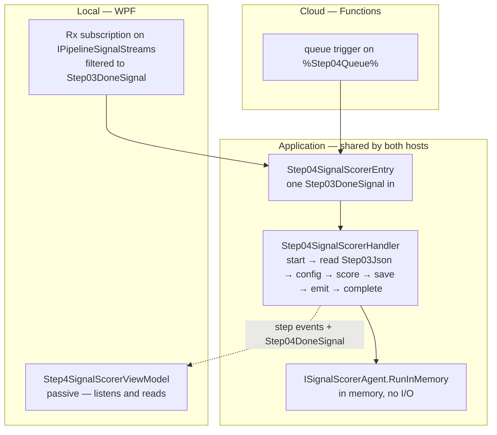
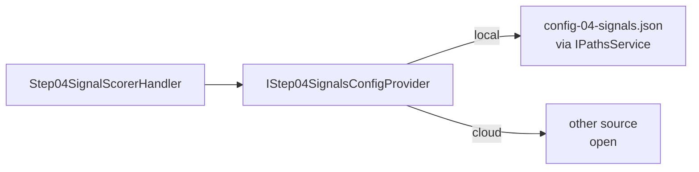
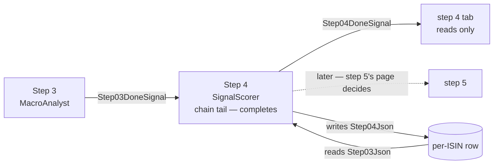

<!--
  Authoring rules: see README.md in this folder.
  STATUS: in progress, 2026-10-13 — rows 1–6 of the implementation order built. Follows step 3's decision B
  (per-fund hop, linear chain), so the trigger and the input column are
  not new choices. Decided: the agent gains a domain-input RunInMemory,
  as step 2's; an empty sell-trigger list falls back to the defaults.
  Choices still marked "Proposed" copy steps 2 and 3 and await review;
  the open questions are at the end.
-->

# Step 4 — SignalScorer

> **Related:**
>
> - The cross-cutting design this follows from:
>   [event-driven-orchestration-plan.md](./event-driven-orchestration-plan.md)
> - The step this one follows:
>   [03-macroanalyst.md](./03-macroanalyst.md)
> - The step whose pattern it copies — code, one config file, no LLM:
>   [02-metricscalculator.md](./02-metricscalculator.md)
> - What this step does **today** — rules, vocabulary, failure modes, test
>   fixtures:
>   [04-signalscorer.md](../../FikaFinans.InfrastructureV2.Tests/docs/04-signalscorer.md)

`StepId.SignalScorer`, implemented by `SignalScorerAgent` behind
`ISignalScorerAgent`, surfaced in the desktop app as
`Step4SignalScorerViewModel`. This page covers only what the move to
signal-driven, per-fund processing changes.

Step 4 is step 2 again: deterministic code, one config file, one fund in
and one fund out. Nothing to fetch, no LLM, no week-wide state. The work
is already per-fund — `PipelineRunner` calls `ProcessFund` once per fund
— so the move is mostly wiring.

## What step 4 needs from step 3

### Trigger

[`Step03DoneSignal`](../../FikaFinans.Application/Pipeline/Signals/Step03DoneSignal.cs)
— one per fund, emitted after `Step03Json` is written.

| Field | Step 4 uses it to |
| --- | --- |
| `Isin` | name the fund — log lines, step events, the row `Step04Json` lands on |
| `NavDate` | stamp the week on its output; carry the trading date forward onto its own done-signal |
| `RunId` | read `Step03Json` for this run only — and tell a late signal from a live one |

**Not a new choice.** Step 3's page chose B — a per-fund hop in a linear
chain — and said step 4 "still hangs off step 3" under it. Step 4 does
not use the macro context, but it listens to step 3 because the chain is
linear, not because it needs step 3's work.

### Input — `Step03Json` on the fund's row

One `FundRecord`, read back by run id. Step 3 wrote it as a pass-through
of `Step02Json`, so it is step 2's enriched record unchanged.

| Part of the record | Read | What for |
| --- | --- | --- |
| `Metrics` | yes — window counts, current drawdown, 2-week and 12-week Sharpe, the NaN-Sharpe flag | every buy and sell rule |
| everything else — identity, metadata, buckets, snapshot, holding, layer | no | copied through — append-only |

Reading `Step03Json` rather than reaching back to `Step02Json` is the
step-output rule step 3's page already relied on: every step reads its
predecessor's column. The two columns hold the same record today; the rule
keeps step 4 working if step 3 ever adds a field.

A record with no `Metrics` is **not** a failure: the agent already
answers it with `Neutral` / `neutral_no_data`. A **missing record** —
`Step03Json` null after a granted start — is, as it is for step 2.

## Names

Every new type carries the step number, as steps 1–3 do. All *(new)*:

| Role | Step 2 (exists) | Step 4 *(new)* |
| --- | --- | --- |
| Handler interface | `IStep02MetricsCalculator` | `IStep04SignalScorer` |
| Handler | `Step02MetricsCalculatorHandler` | `Step04SignalScorerHandler` |
| Entry point | `IStep02MetricsCalculatorEntry` + `Step02MetricsCalculatorEntry` | `IStep04SignalScorerEntry` + `Step04SignalScorerEntry` |
| Done-signal | `Step02DoneSignal` | `Step04DoneSignal` |
| Config provider | `IStep02MetricsConfigProvider` + `JsonBackedStep02MetricsConfigProvider` | `IStep04SignalsConfigProvider` + `JsonBackedStep04SignalsConfigProvider` — "Signals" after `config-04-signals.json`, as "Metrics" is after `config-02-metrics.json` |
| What the provider returns | `MetricsCalculatorConfig` | `SignalScorerConfig` — exists |
| Agent call | `IMetricsCalculatorAgent.RunInMemory` | `ISignalScorerAgent.RunInMemory` — domain inputs, onto the interface; see "Agent work" |
| Cloud function | `Step02MetricsCalculatorFunction` *(sketch)* | `Step04SignalScorerFunction` |
| Row — start | `StartStep02Async` | `StartStep04Async` |
| Row — complete | — | `CompleteStep04Async`; `CompleteStep03Async` **removed** when step 4 takes the tail |
| Row — fail | `FailStep02Async` | `FailStep04Async` |
| Row — orphaned list | `ListOrphanedStep02Async` | `ListOrphanedStep04Async` |

## Sketch — the same step, two hosts

Illustrative only. Names marked *(new)* do not exist yet; queue names are
owned by [backend-nav-sync-plan.md](../backend-nav-sync-plan.md).

### What is the same in both hosts

| Interface | Current | WPF | Cloud |
| --- | --- | --- | --- |
| `IPipelineSignalStreams` | `LocalRxPipelineSignalBus` — steps 2 and 3's work subscriptions, the tabs' reads | same bus — plus the step 4 subscription | — nothing subscribes |
| `IPipelineSignals` | overloads for steps 1–3 | plus step 4's | queue publisher *(new)* |
| `IIsinProgressStore` | start / fail / orphaned for steps 1–3, complete for step 3 | plus step 4's; step 3 loses its complete | the same class over Tables |
| `IStepEventPublisher` | `LocalRxStepEventBus` | unchanged | still open — the parent plan's run-lifecycle question |
| Config provider *(new)* | — none; the agent's `Run` and `StreamingPipelineGateway.LoadSignalConfig` each read the file | JSON-backed — `config-04-signals.json` via `IPathsService` | another source — open, the same question step 2 left |
| `ISignalScorerAgent` | `Run` (button) and `ProcessFund` (runner) | plus the domain-input `RunInMemory`, called by the handler | same |

No fetch seam, no LLM client, no context store. Step 4 never leaves the
row and the config.

### Handler shape

Same phases as steps 1–3, same split so the entry point orders "write,
then emit" itself:

| Step 2 phase | Step 4 equivalent | Difference |
| --- | --- | --- |
| `BeginProcessingAsync` — start step 2 on the row | start step 4 on the row — refused unless it still names the signal's run id | none |
| `LoadFundAsync` — read `Step01Json` | read `Step03Json` by run id; none → throw | different column |
| `AssembleAgentInputAsync` — load the config | load the config through the step 4 provider | none |
| `RunAgentAsync` — `IMetricsCalculatorAgent.RunInMemory` | `ISignalScorerAgent.RunInMemory` | same shape — domain inputs in, one-fund output out |
| `PersistAsync` — `Step02Json` | `Step04Json` — the scored record in a one-fund envelope | same store call |
| `EmitDoneAsync` — `Step02DoneSignal` | `Step04DoneSignal` | new signal type, new overload |
| `CompleteAsync` / `FailAsync` | same, step 4's row methods | the tail moves here |
| `ReadOutputAsync` | same, `StepId.SignalScorer` | none |
| `ComputeOutputAsync` — the debug run | same, reading `Step03Json` | none |

### Where the code lives



| Piece | Current | WPF | Cloud |
| --- | --- | --- | --- |
| The scoring | `SignalScorerAgent.ProcessFund`, called per fund by `PipelineRunner` | the same agent's domain-input `RunInMemory`, from the handler — it calls `ProcessFund` per fund | same — shared |
| The phases | — no handler | `Step04SignalScorerHandler`, Application, beside steps 2 and 3's | same class |
| Runs the phases in order | — | `Step04SignalScorerEntry` | same class |
| Signal → entry point | — Run All only | Rx subscription in `MainWindowViewModel` — wiring only | `Step04SignalScorerFunction`, queue trigger — wiring only |
| The tab | button runs the agent's `Run`; reads via `IsinProgressOutputLoader` with a disk fallback | passive — listens, reads through the handler; debug button through the handler | — no UI |

### Local

Beside step 3's subscription in `MainWindowViewModel`, copying it:

```text
// sketch
pipelineSignals.Signals                          // IPipelineSignalStreams
    .OfType<Step03DoneSignal>()
    .Subscribe(done => RunStep04Async(step04Entry, done));   // (new)
```

Wiring only. Moves out with the rest in the parent plan's "extract the
coordinator" slice. The remark on `RunFrontDoorAsync` that steps 4–10
run only through Run All becomes steps 5–10.

### Cloud

```text
// sketch
[Function("Step04SignalScorer")]                 // (new)
public Task Run(
    [QueueTrigger("%Step04Queue%")] Step03DoneSignal signal,
    CancellationToken ct)
    => _step04Entry.HandleAsync(signal, ct);     // IStep04SignalScorerEntry (new)
```

The return-value-as-send question from step 1 applies unchanged.

## Input trigger

`Step03DoneSignal` — fund identifier, trading date, run id. No payload.

| | Current | WPF | Cloud |
| --- | --- | --- | --- |
| Producer | — no signal; step 4 runs inside `PipelineRunner`'s per-fund block, or from the tab's button | `Step03MacroAnalystHandler.EmitDoneAsync` → `IPipelineSignals` | the same handler, queue-backed publisher |
| Transport | the fund record, in memory | `LocalRxPipelineSignalBus` | `%Step04Queue%` |
| How the step is reached | `PipelineRunner` calls `ProcessFund` per fund | subscribe to `IPipelineSignalStreams.Signals`, filter to step 3 | **nothing subscribes** — the Functions host invokes per message |

Delivery is at-least-once. Step 2's two cases carry over unchanged:

| Arrives | Row says | Action |
| --- | --- | --- |
| Duplicate of a signal already handled | same run id, `Step04Json` populated | run again — scoring is deterministic, the overwrite writes the same thing |
| Late — a newer run has started step 1 since | a different run id | drop it — step 4's start refuses it |

### Start, do not claim

Same rule as `StartStep02Async` and `StartStep03Async`: a check and a
mark, never a clear.

| Does | Why |
| --- | --- |
| Refuses unless the row is in flight **and** names the signal's run id | the late-signal drop |
| Moves `CurrentStep` to 4 | a run orphaned in step 4 is recovered by step 4's tab |
| Leaves the step columns and `ProcessingStartedAt` alone | `Step03Json` is this step's input; the start time is what the session-start check reads |

### Manual trigger — WPF only

**Proposed: the debug button goes through the handler, as steps 2 and 3's
now do.** Today it calls `ISignalScorerAgent.Run`, which reads step 2's
`02-metrics-{iso_week}-{run_id}.json` and writes
`04-signal-{iso_week}-{run_id}.json`. After a signal-driven run there is
no step 2 file, so the button finds nothing.

Steps 2 and 3 already moved off that path: step 2's button calls the
handler's `ComputeOutputAsync`, step 3's calls `ComputeContextAsync`.
Both compute with the same loads as the signal path and store nothing.
Step 4 copies step 2's:

| | The button |
| --- | --- |
| Reads | `Step03Json` for the run bar's run id, and the config through the provider |
| Computes | the same agent call the signal path makes |
| Writes | nothing — no column, no file. Shown as "Debug run, not stored" |

Not storing is the rule both earlier pages set: the button debugs the
scoring in isolation. With the button off it, the agent's `Run` is left
to Run All's file path only.

## Input data — what the step reads

| Input data | Current | WPF | Cloud |
| --- | --- | --- | --- |
| **Step 3's fund record** — metrics plus every earlier field | the in-memory record (runner) or `02-metrics-…json` (button) | `Step03Json` on this fund's row, matched by run id | same, Tables |
| **Config** — buy thresholds, sell triggers, NaN handling | `config-04-signals.json` via `IPathsService`, read twice: by the agent's `Run` and by `StreamingPipelineGateway.LoadSignalConfig` | through the config provider, JSON-backed — same file | through the same provider, other source |

The macro context is **not** an input. The rules read metrics only;
`Forming`, the one label that needs macro alignment, is assigned by step
5, not here — the contract's sequencing note.

### Config through a seam

**Proposed: the step reads its config through `IStep04SignalsConfigProvider`,
never a file** — step 2's pattern, which step 2's page already said steps
4, 9 and 10 inherit. The tab's config editor keeps writing the same file,
so locally nothing visible changes.



### The two loaders disagree today

Not only on where the file is read — on what it means:

| Case | Agent's `Run` (button) | `LoadSignalConfig` (Run All) |
| --- | --- | --- |
| File missing | defaults | defaults |
| `sell_weakness_any_of` empty or absent | **replaced with the three default triggers** | kept empty — **no sell rule can ever fire**, so no fund is ever `Weakness` |
| File unreadable | throws | throws |

So the same file can score a fund `Weakness` from the button and
`Neutral` from Run All. The provider is the one place to decide it.

A corner case, not a live bug: every config that ships — the embedded
default, the test fixture, `SellTrigger.Defaults` — lists the same three
triggers, so both loaders agree on all of them. Only a hand-edited empty
list tells them apart. Neither the contract nor any test defines that
case; the only test of `LoadSignalConfig` checks the list is not null.

**Decided (2026-10-13): the provider keeps the button's rule** — an empty
list falls back to the defaults, a missing file falls back to the
defaults. The contract defines the sell rule as "any one of three
triggers", so an empty list is outside it, and silently disabling every
exit is the more dangerous reading. A provider test pins it. If switching
sells off is ever wanted, it should be a named setting, not an empty
list.

Whether a **missing file** in cloud falls back or fails is the same open
question step 2 left for its provider.

## Pre-processing — assemble the agent input

Nothing to assemble — the config read and nothing else. The record
arrives scored-ready: step 2 computed the metrics, step 3 passed them
through.

## Agent work

Code, not an LLM. Contract:
[04-signalscorer.md](../../FikaFinans.InfrastructureV2.Tests/docs/04-signalscorer.md).

The rules, the rule-fired taxonomy, the NaN-Sharpe handling and the
`missing_for_upgrade` hint do not change.

**Decided (2026-10-13): a domain-input `RunInMemory` on
`ISignalScorerAgent`, as step 2 has.** Company, ISO week, run id, the
fund records and the config in; a `DataLoaderOutput` out, stamped with
them. No paths, no file I/O.

Why the agent builds the output, not the handler — the precedent across
the existing handlers:

| Step | What the agent returns | Who builds the output the save takes |
| --- | --- | --- |
| 1 | the fund records | the agent — `IDataLoaderAgent.RunInMemory` |
| 2 | the fund records | the agent — `IMetricsCalculatorAgent.RunInMemory` |
| 3 | a `MacroContext`, not a fund | the handler — its pass-through record never reaches the agent, so it has no choice |
| 4 | the fund records | **the agent**, as steps 1 and 2 |

Step 3 is the exception, forced by its shape. Step 4 produces the fund
records itself, so it follows steps 1 and 2 — and its handler stays a
near-copy of step 2's.

The new call adds no behaviour: it runs `ProcessFund` over each record
and wraps the results. `ProcessFund` already is pure, per-fund and
append-only — every earlier field copied, `Signal`, `RuleFired` and
`CriteriaEvaluation` added — and stays on the interface for
`PipelineRunner`. The older `RunInMemory` over a whole
`DataLoaderOutput` stays on the concrete class for `Run` and its tests.

| | Step 2 | Step 4 |
| --- | --- | --- |
| In-memory call | `IMetricsCalculatorAgent.RunInMemory` | `ISignalScorerAgent.RunInMemory` — **new on the interface** |
| Inputs | company, week, run id, fund records, config | same, with `SignalScorerConfig` |
| Uses `_paths` | no — only `Run` does | no — only `Run` does |
| Returns | a `DataLoaderOutput` the handler saves as is | same |

The portfolio-wide fields of the output — frozen positions, cash — are
left empty, as step 2's are: how the envelope rides on the row is still
open on step 2's page.

Tests for the new call go in a **new file**, beside
`SignalScorerAgentTests` in
`FikaFinans.InfrastructureV2.Tests/Agents/04-signalscorer/` — the same
split step 3 made.

### One failure mode the contract has and the code does not

The contract lists "config_version mismatch → halt, write
`04-error-{iso_week}-{run_id}.json`". Nothing implements it:
`SignalScorerConfig` has no version, and `IPathsService.SignalScorerError`
has no caller. This page does not add it — it would be a contract change,
and under signals an error **file** has nowhere to go; a failure lands on
the row as `LastError`, as every other step's does.

## Post-processing — write and emit

One write, then one signal.

| Written | Current | WPF | Cloud |
| --- | --- | --- | --- |
| This fund's scored record | `Step04Json` via `StreamingPipelineGateway`'s block write (runner), or `04-signal-…json` (button) | `IIsinProgressStore.SaveStepOutputAsync` with `StepId.SignalScorer` → `Step04Json` | same — Tables |
| Row freed | once, at the end of the Run All pass | `CompleteStep04Async` / `FailStep04Async` — step 4 becomes the tail | same |

The scored record adds three small fields to step 3's; the size question
step 2's page raised for Tables (`NavBuckets` already past the 32K
character cap) applies unchanged and is not made worse here.

### Complete and fail — the tail moves

Same move as steps 2 and 3 made, in the same change as the wiring:

| Before | After |
| --- | --- |
| `CompleteStep03Async` frees the row and advances the anchor | removed, with step 3's `CompleteAsync` — step 3 has a fail and no complete |
| — | `CompleteStep04Async` frees the row and advances the anchor |
| — | `FailStep04Async` — any phase that throws after a granted start |

### Orphaned runs

Same rule as steps 1–3, local only: step 4's tab recovers the runs
orphaned at step 4 the first time it is opened in a session —
`ListOrphanedStep04Async` on the store, `FailOrphanedRunsAsync` on the
handler. Recovery publishes nothing; the next NAV sync reprocesses the
fund from step 1. Nothing new: no LLM, no shared state to half-write.

### Emit

`Step04DoneSignal` — fund identifier, trading date, run id, no payload.
Same shape as steps 1–3's, implementing `IStepDoneSignal`, with its
overload on `IPipelineSignals` and `LocalRxPipelineSignalBus`.

### Who consumes it

**Nobody, yet** — step 4 is the tail until step 5 is wired. Step 5
(MacroAligner) is the natural consumer: it needs the signal from step 4
and the week's context from step 3's store. Which context it matches
against is step 5's page, as step 3's page already said.



### Readers of the step 4 file

Two places still read `04-signal-{iso_week}-{run_id}.json` from disk:
`MacroAlignerAgent.Run` and `FundDetailViewModel`. A signal-driven run
writes no file, so both see nothing for it — the same limitation every
earlier step's file readers have, fixed by the parent plan's "unify the
run paths" slice, not here. Step 5's page owns MacroAligner's read.

## What a frontend reads when the user opens the view

Same rule as steps 1–3: opening the tab is a read, never a trigger — with
the orphaned-run exception.

| The tab | Does |
| --- | --- |
| Listens to step events | filtered to `StepId.SignalScorer` — status, duration, error |
| Listens to `Step04DoneSignal` | to learn the run id, then reads that run's output |
| Reads | through the step 4 handler's `ReadOutputAsync`, never the store directly |
| Runs | nothing on a signal — only the debug button, through the handler |
| Config editor | kept — `HasConfig` stays true, it edits the file the provider reads |

`Step4SignalScorerViewModel` today holds the agent, `IPathsService` and
`IIsinProgressRepository`, and reads through `IsinProgressOutputLoader`
with a disk fallback. Going passive is step 2's change: the projection
already lives on `StepViewModel`; the loader stays for steps 5–9. No XAML
changes.

## Proposed implementation order

One change per row, each reviewed and committed before the next, as for
steps 2 and 3. Rows 1–4 do not depend on the open questions.

| # | Work | Touches | Blocked on |
| --- | --- | --- | --- |
| 1 | ✅ `Step04DoneSignal` and its overload | `Pipeline/Signals`, `LocalRxPipelineSignalBus` | — |
| 2 | ✅ `IStep04SignalsConfigProvider` in Application, `JsonBackedStep04SignalsConfigProvider` in Infrastructure — read fresh on every call; missing file and empty or null sell list fall back to defaults, warned; malformed or `null` JSON throws. Run All's `LoadSignalConfig` and the agent's `Run` left alone | Application, Infrastructure, `InfrastructureModule` | — |
| 3 | ✅ `StartStep04Async`, `CompleteStep04Async`, `FailStep04Async`, `ListOrphanedStep04Async` — `Step04Json` uses the existing save. Two complete tests for now; the rest move from step 3 in row 7 | `IIsinProgressStore`, `RepositoryBackedIsinProgressStore` | — |
| 4 | ✅ Domain-input `RunInMemory` onto `ISignalScorerAgent` — company, week, run id, fund records, config; `ProcessFund` per record, wrapped. No rule change. Tests in a **new file**, `SignalScorerAgentRunInMemoryTests`, beside `SignalScorerAgentTests` | `ISignalScorerAgent`, `SignalScorerAgent`, a new test file in `Agents/04-signalscorer/` | — |
| 5 | ✅ `IStep04SignalScorer` + `Step04SignalScorerHandler`, step 2's shape. Not wired. Load reads `Step03Json`; the agent phase calls row 4's `RunInMemory`; `CompleteAsync` copied from step 3's for when step 4 is the tail; `ReadOutputAsync` and `ComputeOutputAsync` included | Application, `Pipeline/Steps` | rows 1–4 |
| 6 | ✅ `IStep04SignalScorerEntry` + `Step04SignalScorerEntry`; registration as steps 2 and 3's — handler per dependency, entry point single instance. The entry point already completes last; nothing calls it until row 7 | Application, `InfrastructureModule` | row 5 |
| 7 | Subscription `Step03DoneSignal` → entry point; step 4 takes completion — `CompleteStep03Async` removed, with step 3's `CompleteAsync`; the store's complete tests move to step 4 | `MainWindowViewModel`, both handlers, `IIsinProgressStore` | row 6 |
| 8 | Step 4's tab goes passive — listens, reads through the handler, debug button through `ComputeOutputAsync`, config editor kept; recovers orphaned runs on first open | `Step4SignalScorerViewModel`, no XAML | row 7 |

Row 7 is cheap to switch on: no LLM behind it, so a signal costs
milliseconds, not money.

Row 4 is the only one that touches the agent, and only its surface. If a
later row turns out to need a change to the scoring rules or the
contract, it stops and the change is raised here as a question first.

## Open questions

Raised by this page; they belong in the parent plan's Open Questions,
not settled here.

- **The agent's surface.** ✅ **Resolved 2026-10-13** — a domain-input
  `RunInMemory` on `ISignalScorerAgent`, copying step 2: in both steps
  whose agent produces the fund records, the agent builds the output.
  Step 3's handler-side wrap is forced by its shape, not a precedent.
- **An empty sell-trigger list.** ✅ **Resolved 2026-10-13** — falls
  back to the three defaults, in the provider. Run All keeps its own
  reading until it moves to the provider; no shipped config is affected.
- **The cloud config source** — app settings, a table row or blob, and
  whether a missing config falls back or fails. The same question step 2
  left; one answer should cover steps 2, 4, 9 and 10.
- **The contract's "config_version mismatch" halt.** Described, never
  implemented, and an error file has no place on the signal path. Drop it
  from the contract, or add a version to `SignalScorerConfig` and fail
  the fund on mismatch — a contract change either way, so not this
  page's.
- **Who consumes step 4's done-signal.** Nobody for now; step 4 is the
  tail. Step 5's page owns the decision, and with it which week's macro
  context a fund is aligned against.
- **Carried over unchanged:** where the local wiring ends up, orphaned-run
  recovery in cloud, step outputs too large for Tables, how an entry point
  gets a fresh handler per signal, how the envelope is stored on the row
  — all on step 2's page.
