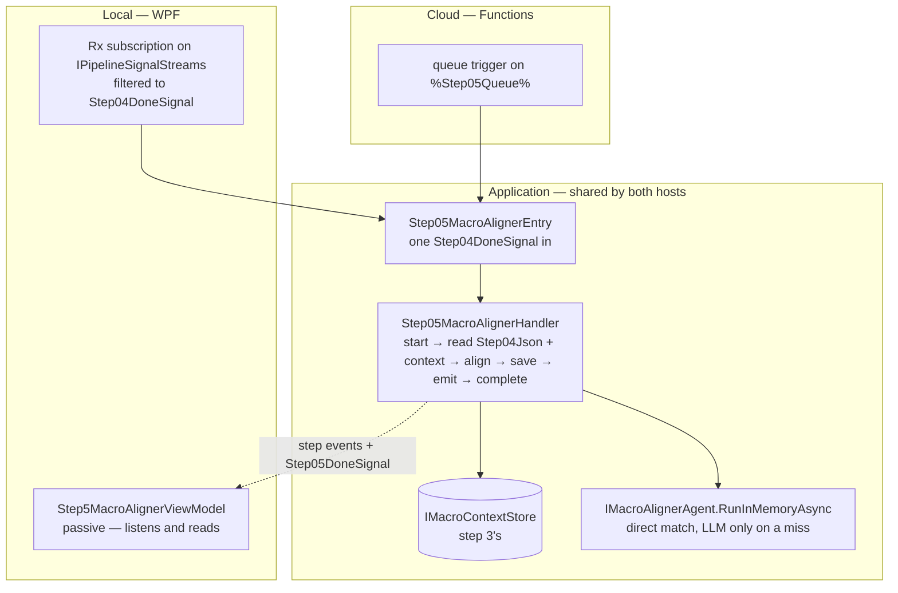
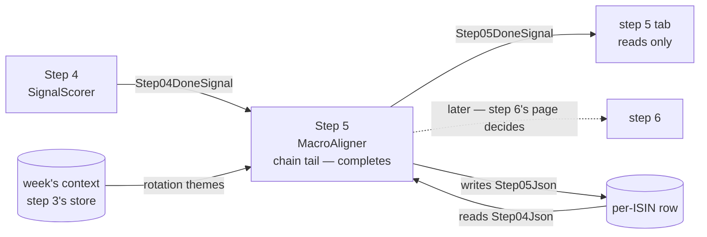

<!--
  Authoring rules: see README.md in this folder.
  STATUS: design, 2026-10-17 — nothing built. Follows step 4's chain: the
  trigger and the input column are not new choices. Choices marked
  "Proposed" wait for confirmation; the open questions are at the end.
-->

# Step 5 — MacroAligner

> **Related:**
>
> - The cross-cutting design this follows from:
>   [event-driven-orchestration-plan.md](./event-driven-orchestration-plan.md)
> - The step this one follows, and the pattern it copies:
>   [04-signalscorer.md](./04-signalscorer.md)
> - The step whose stored context it reads:
>   [03-macroanalyst.md](./03-macroanalyst.md)
> - What this step does **today** — matching rules, promotion, prompts,
>   failure modes, evaluation rubric:
>   [05-macroaligner.md](../../FikaFinans.InfrastructureV2.Tests/docs/05-macroaligner.md)

`StepId.MacroAligner`, implemented by `MacroAlignerAgent` behind
`IMacroAlignerAgent`, surfaced in the desktop app as
`Step5MacroAlignerViewModel`. This page covers only what the move to
signal-driven, per-fund processing changes.

Step 5 is the first step with **two** inputs from different places: the
fund's scored record from step 4, and the week's rotation themes from the
context step 3 stored. It is hybrid — a direct category match in code,
and an LLM call only when a fund's category matches no theme directly.
The work is already per-fund: `PipelineRunner` calls `ProcessFundAsync`
once per fund.

## What step 5 needs from step 4

### Trigger

[`Step04DoneSignal`](../../FikaFinans.Application/Pipeline/Signals/Step04DoneSignal.cs)
— one per fund, emitted after `Step04Json` is written.

| Field | Step 5 uses it to |
| --- | --- |
| `Isin` | name the fund — log lines, step events, the row `Step05Json` lands on |
| `NavDate` | pick the week whose context applies; carry the trading date forward onto its own done-signal |
| `RunId` | read `Step04Json` for this run only — and tell a late signal from a live one |

Not a new choice: the chain is linear (step 3's decision B), and step
4's page named step 5 as its consumer.

### Input — `Step04Json` on the fund's row

One `FundRecord`, read back by run id.

| Part of the record | Read | What for |
| --- | --- | --- |
| `Metadata.Category` | yes | the direct match, and the LLM's question |
| `Signal`, `CriteriaEvaluation.MissingForUpgrade` | yes | the Neutral → Forming promotion |
| everything else | no | copied through — append-only |

Step 5 writes `Signal` when it promotes — the one place in the chain a
later step changes an earlier step's field. The contract allows exactly
that one change, Neutral → Forming, and nothing else; this page does not
widen it.

## What step 5 needs from step 3

The rotation themes — `MacroContext.RotationThemes` — from the context
step 3 stored in `IMacroContextStore`. Step 3's page left this choice
here: *"Which context steps 5 and 6 match a fund against is their pages'
decision."*

### Which context a fund is aligned against

The row does not say which context step 3 used: `Step03Json` is a
pass-through, and the done-signal carries no payload. Three ways to find
it:

| | A — newest stored up to the fund's week | B — step 3 records the key | C — repeat step 3's lookup |
| --- | --- | --- | --- |
| How | `IMacroContextStore.GetNewestAsync(week)` | step 3 writes the context's weekly summary `runId` somewhere step 5 can read | load the reports for the week, look up by their `runId`, fall back as step 3 does |
| Matches what step 3 used | almost always — see below | always | always, if the reports have not changed since |
| Changes step 3 | no | **yes** — a new field on `FundRecord` or a new row column | no |
| Already used | by step 3's tab, `ReadContextAsync` — the same read | — | — |
| Cost | one store read | one store read | the reports read plus a store read, per fund |

A differs from step 3's pick in one case: step 3 found the reports for an
earlier week R with a stored context, while a context for a later week
(still up to the fund's week) is also stored. Step 3 used R's; the newest
read returns the later one. That needs two contexts with different weeks
to exist for one fund's run — possible after a backfill, not in the
normal weekly flow.

**Proposed: A.** No change to step 3, one read, and the same answer the
step 3 tab already shows for the week. The edge case is logged when the
context's week is not the fund's week, as step 3 logs its own fallback.
If it ever matters, B is the fix, raised then as a step 3 change.

No context stored up to the week → **the fund fails**, "no macro context
for 2026-W41 or earlier". Step 3 would already have failed that fund, so
it should not arise.

## Names

Every new type carries the step number. All *(new)*:

| Role | Step 4 (exists) | Step 5 *(new)* |
| --- | --- | --- |
| Handler interface | `IStep04SignalScorer` | `IStep05MacroAligner` |
| Handler | `Step04SignalScorerHandler` | `Step05MacroAlignerHandler` |
| Entry point | `IStep04SignalScorerEntry` + `Step04SignalScorerEntry` | `IStep05MacroAlignerEntry` + `Step05MacroAlignerEntry` |
| Done-signal | `Step04DoneSignal` | `Step05DoneSignal` |
| Config provider | `IStep04SignalsConfigProvider` | — step 5 has no config; its prompt is a constant in the LLM client |
| Context read | — | `IMacroContextStore` — exists, step 3's |
| Agent call | `ISignalScorerAgent.RunInMemory` | `IMacroAlignerAgent.RunInMemoryAsync` — domain inputs, onto the interface; see "Agent work" |
| Cloud function | `Step04SignalScorerFunction` *(sketch)* | `Step05MacroAlignerFunction` |
| Row — start | `StartStep04Async` | `StartStep05Async` |
| Row — complete | `CompleteStep04Async` — **removed** when step 5 takes the tail | `CompleteStep05Async` |
| Row — fail | `FailStep04Async` | `FailStep05Async` |
| Row — orphaned list | `ListOrphanedStep04Async` | `ListOrphanedStep05Async` |

## Sketch — the same step, two hosts

Illustrative only. Names marked *(new)* do not exist yet; queue names are
owned by [backend-nav-sync-plan.md](../backend-nav-sync-plan.md).

### What is the same in both hosts

| Interface | Current | WPF | Cloud |
| --- | --- | --- | --- |
| `IPipelineSignalStreams` | `LocalRxPipelineSignalBus` — steps 2–4's work subscriptions, the tabs' reads | same bus — plus the step 5 subscription | — nothing subscribes |
| `IPipelineSignals` | overloads for steps 1–4 | plus step 5's | queue publisher *(new)* |
| `IIsinProgressStore` | start / fail / orphaned for steps 1–4, complete for step 4 | plus step 5's; step 4 loses its complete | the same class over Tables |
| `IMacroContextStore` | step 3 writes it; step 3's tab reads it | step 5 reads it too | the same store over Tables — step 3's page |
| `IThemeAdjacencyLlmClient` | `FoundryThemeAdjacencyLlmClient` over `AIProjectClient` | unchanged | unchanged — managed identity instead of `az login` |
| `IMacroAlignerAgent` | `RunAsync` (button) and `ProcessFundAsync` (runner) | plus the domain-input `RunInMemoryAsync`, called by the handler | same |

No config provider and no fetch seam. The LLM client is host-neutral
already, like step 3's.

### Handler shape

Same phases as steps 2–4:

| Step 4 phase | Step 5 equivalent | Difference |
| --- | --- | --- |
| `BeginProcessingAsync` | start step 5 on the row | none |
| `LoadFundAsync` — read `Step03Json` | read `Step04Json` by run id — **and the context** for the trading date's week | a second read, from step 3's store |
| `AssembleAgentInputAsync` — load the config | nothing — no config | a no-op phase, kept for the shape |
| `RunAgentAsync` | `IMacroAlignerAgent.RunInMemoryAsync` with the context's themes | may call the LLM |
| `PersistAsync` | `Step05Json` | same store call |
| `EmitDoneAsync` | `Step05DoneSignal` | new signal type, new overload |
| `CompleteAsync` / `FailAsync` | step 5's row methods | the tail moves here |
| `ReadOutputAsync` | same, `StepId.MacroAligner` | none |
| `ComputeOutputAsync` — the debug run | same, reading `Step04Json` and the context | may call the LLM |

Keeping an empty assemble phase follows step 3, whose assemble is a
no-op on a hit: the entry point stays a near-copy, and a config added
later has a phase waiting for it.

### Where the code lives



### Local

```text
// sketch
pipelineSignals.Signals                          // IPipelineSignalStreams
    .OfType<Step04DoneSignal>()
    .Subscribe(done => RunStep05Async(step05Entry, done));   // (new)
```

### Cloud

```text
// sketch
[Function("Step05MacroAligner")]                 // (new)
public Task Run(
    [QueueTrigger("%Step05Queue%")] Step04DoneSignal signal,
    CancellationToken ct)
    => _step05Entry.HandleAsync(signal, ct);     // IStep05MacroAlignerEntry (new)
```

## Input trigger

`Step04DoneSignal` — fund identifier, trading date, run id. No payload.

| | Current | WPF | Cloud |
| --- | --- | --- | --- |
| Producer | — no signal; step 5 runs inside `PipelineRunner`'s per-fund block, or from the tab's button | `Step04SignalScorerHandler.EmitDoneAsync` → `IPipelineSignals` | the same handler, queue-backed publisher |
| Transport | the fund record, in memory | `LocalRxPipelineSignalBus` | `%Step05Queue%` |
| How the step is reached | `PipelineRunner` calls `ProcessFundAsync` per fund | subscribe, filter to step 4 | **nothing subscribes** — the Functions host invokes per message |

Delivery is at-least-once, and the same two cases as before apply:

| Arrives | Row says | Action |
| --- | --- | --- |
| Duplicate | same run id, `Step05Json` populated | run again — a direct match gives the same answer; an LLM call may be paid again and may answer differently |
| Late | a different run id | drop it — step 5's start refuses it |

A duplicate is the first in the chain that is not free *and* not
deterministic: it can repay an LLM call, and the LLM can change its mind.
Last write wins, as for every other step column.

### Start, do not claim

Same as steps 2–4: a check and a mark, never a clear. Moves
`CurrentStep` to 5.

### Manual trigger — WPF only

**Proposed: the debug button goes through the handler**, as steps 2–4's
do — `ComputeOutputAsync` reads `Step04Json` for the run bar's run and
the context for its week, runs the agent, stores nothing. Unlike steps 2
and 4, it **can spend money**: a fund with no direct match calls the LLM.

## Input data — what the step reads

| Input data | Current | WPF | Cloud |
| --- | --- | --- | --- |
| **Step 4's fund record** | the in-memory record (runner) or `04-signal-…json` (button) | `Step04Json`, by run id | same, Tables |
| **The week's rotation themes** | the in-memory `MacroContext` (runner) or `03-macro-…json` (button) | `IMacroContextStore.GetNewestAsync(week)` — see "Which context" | same store, Tables |
| **The adjacency prompt** | a constant in `FoundryThemeAdjacencyLlmClient` | unchanged | unchanged |
| **Foundry project + model id** | settings, `az login` | unchanged | app settings, managed identity |

No prompts provider: the adjacency prompt never lived in a file, so there
is no `_paths` behind it to remove — unlike step 3's.

## Pre-processing — assemble the agent input

Nothing to assemble. The record arrives scored, the themes arrive with
the context.

## Agent work

Hybrid. Contract:
[05-macroaligner.md](../../FikaFinans.InfrastructureV2.Tests/docs/05-macroaligner.md).
The matching rules, the tie-break, the promotion and the "no demotion"
rule do not change.

**Proposed: a domain-input `RunInMemoryAsync` on `IMacroAlignerAgent`**
— company, week, run id, fund records, the active themes in; a
`DataLoaderOutput` out. The rule step 4's page set: in every step whose
agent produces the fund records, the agent builds the output. It loops
the existing `ProcessFundAsync` and wraps the results; the older
`RunInMemoryAsync(DataLoaderOutput, MacroContext)` stays on the class for
`RunAsync`.

| | Step 4 | Step 5 |
| --- | --- | --- |
| In-memory call | `ISignalScorerAgent.RunInMemory` | `IMacroAlignerAgent.RunInMemoryAsync` — async, the LLM |
| Inputs | company, week, run id, records, config | company, week, run id, records, **themes** |
| Uses `_paths` | no | no — only `RunAsync` does |
| Returns | a one-fund `DataLoaderOutput` | same — with the per-fund warnings in its `DataQuality.Warnings` |

### Where the warnings go

`ProcessFundAsync` returns warnings beside the record — empty category,
unknown theme id from the LLM. Today they land in the output's
`DataQuality.Warnings`. On the signal path that envelope does not reach
the row — the open "how the envelope is stored" question on step 2's
page. Until that is answered, **the handler logs each warning**, so a
fund aligned `None` because of a bad LLM answer is visible somewhere.

### The LLM call per signal

The cost question this step adds. Today Run All calls the LLM once per
non-matching fund per Run All. Under signals it is once per non-matching
fund **per NAV signal** — and NAV signals arrive daily.

| | Today | Per signal, no change |
| --- | --- | --- |
| Calls | non-matching funds × Run Alls | non-matching funds × NAV signals |
| Time per call | create the Foundry agent, one response, delete — step 3 measured 14 s + 11 s + 3 s | same |
| What the answer depends on | the fund's category and the week's themes | same |

The verdict is a function of **(context, category)** — nothing per fund,
nothing per day. Several funds share a category, and a category's answer
holds until the next week's context. That is step 3's shape again:
per-fund hop, work that could be shared.

Options, none chosen — see the open questions:

| | No cache | In-process cache | Stored verdicts |
| --- | --- | --- | --- |
| Calls | every signal, every non-matching fund | once per (context, category) per app session | once per (context, category) |
| Survives a restart / a cloud instance | — | no | yes |
| New code | none | a small cache in the handler's registration | a store beside `IMacroContextStore`, Tables-shaped |

Whatever is chosen, **a failed call must not be cached.** Today the
client cannot tell a failure from a real `None`: a timeout, invalid JSON
and a genuine "no adjacency" all return `NoneVerdict`. Caching that would
pin a Foundry outage as "no alignment" for the whole week. A cache needs
the client to say which it was — a change to `IThemeAdjacencyLlmClient`.

### LLM failure does not fail the fund

The contract says invalid or failed LLM answers default to `None` with a
warning. So an LLM outage does not fail step 5 — the fund completes with
`macro_alignment = None` and, by the warnings rule above, a log line.
Unlike step 3, where an LLM failure fails the fund. This page keeps the
contract as it is.

## Post-processing — write and emit

| Written | Current | WPF | Cloud |
| --- | --- | --- | --- |
| This fund's aligned record | `Step05Json` via the gateway's block write (runner), or `05-macro-align-…json` (button) | `SaveStepOutputAsync` with `StepId.MacroAligner` → `Step05Json` | same — Tables |
| Row freed | once, at the end of the Run All pass | `CompleteStep05Async` / `FailStep05Async` — step 5 becomes the tail | same |

### Complete and fail — the tail moves, and step 4 changes

Same move as before — **and it changes step 4's code**, the way wiring
step 4 changed step 3's. Called out here so it is not a surprise:

| Before | After |
| --- | --- |
| `CompleteStep04Async` frees the row and advances the anchor | removed, with step 4's `CompleteAsync`; step 4's entry point stops calling it |
| — | `CompleteStep05Async`, called by step 5's entry point after its emit |
| — | `FailStep05Async` |

Step 4 keeps its done-signal and its `Succeeded` step event; only the row
release moves. **Proposed: that change is its own commit**, separate
from step 5's wiring.

### Orphaned runs

Same rule as steps 1–4, local only: step 5's tab recovers the runs
orphaned at step 5 when first opened in a session. A process ending
during the LLM call leaves nothing half-written — the column is written
after the call returns.

### Emit

`Step05DoneSignal` — fund identifier, trading date, run id, no payload.

### Who consumes it

**Nobody, yet.** Step 6 (CatalystTagger) is the natural consumer: it
reads step 5's record and the same week's context, for catalysts instead
of themes. Step 6's page decides.



### Readers of the step 5 file

`CatalystTaggerAgent.Run` and `FundDetailViewModel` read
`05-macro-align-{iso_week}-{run_id}.json` from disk. A signal-driven run
writes no file — the same limitation every earlier step's file readers
have. Step 6's page owns CatalystTagger's read.

## What a frontend reads when the user opens the view

Same as step 4's tab — **shaped like step 3's**: no `IPathsService`, no
config editor.

| The tab | Does |
| --- | --- |
| Listens to step events | filtered to `StepId.MacroAligner` |
| Listens to `Step05DoneSignal` | to learn the run id, then reads that run's output |
| Reads | through the step 5 handler's `ReadOutputAsync` |
| Runs | nothing on a signal — only the debug button, through the handler |

`Step5MacroAlignerViewModel` today holds the agent, `IPathsService` and
`IIsinProgressRepository`, and reads through `IsinProgressOutputLoader`
with a disk fallback. All of that leaves the tab. No XAML changes.

## Proposed implementation order

One change per row, each reviewed and committed before the next.

| # | Work | Touches | Blocked on |
| --- | --- | --- | --- |
| 1 | ✅ `Step05DoneSignal` and its overload | `Pipeline/Signals`, `LocalRxPipelineSignalBus` | — |
| 2 | ✅ Domain-input `RunInMemoryAsync` onto `IMacroAlignerAgent` — `ProcessFundAsync` per record, wrapped, warnings into the output. No rule change. Tests in a new file beside `MacroAlignerAgentTests` | `IMacroAlignerAgent`, `MacroAlignerAgent`, a new test file | the agent-surface proposal |
| 3 | ✅ `StartStep05Async`, `CompleteStep05Async`, `FailStep05Async`, `ListOrphanedStep05Async` | `IIsinProgressStore`, `RepositoryBackedIsinProgressStore` | — |
| 4 | ✅ `IStep05MacroAligner` + handler, step 4's shape. Not wired. Load reads `Step04Json` and the context — newest up to the week, fail when none; the agent phase passes the context's themes; warnings logged; `CompleteAsync`, `ReadOutputAsync`, `ComputeOutputAsync` included | Application, `Pipeline/Steps` | rows 1–3; "Which context" |
| 5 | `IStep05MacroAlignerEntry` + entry point; registration as step 4's | Application, `InfrastructureModule` | row 4 |
| 6a | **Step 4 gives up the tail** — `CompleteStep04Async`, step 4's `CompleteAsync` and the entry's call removed; complete tests move to step 5 | step 4's handler, entry point and tests, `IIsinProgressStore` | row 5 |
| 6b | Subscription `Step04DoneSignal` → step 5's entry point | `MainWindowViewModel` | 6a |
| 7 | Step 5's tab goes passive, shaped like step 3's | `Step5MacroAlignerViewModel`, no XAML | row 6b |
| — | Adjacency verdict cache — **not scheduled**, waits on the open question | the handler's registration or a new store; `IThemeAdjacencyLlmClient` | the cache question |

Rows 6a and 6b go in back to back: between them, a fund's run would
finish at step 4 and step 5 would never be reached — harmless, since
nothing triggers step 5 until 6b.

Row 6b is the first that spends money per signal at step 5.

## Open questions

Raised by this page; they belong in the parent plan's Open Questions,
not settled here.

- **Which context a fund is aligned against.** Proposed: A, the newest
  stored up to the fund's week — no step 3 change. B, step 3 recording
  the key, is exact but changes step 3.
- **The agent's surface.** Proposed: a domain-input `RunInMemoryAsync`,
  following step 4's rule.
- **Caching adjacency verdicts.** None, in-process, or stored — keyed by
  (context, category). Either cache needs the LLM client to tell a
  failure from a real `None` first.
- **Where the warnings go** once the envelope question on step 2's page
  is answered. Logged until then.
- **Should an LLM outage fail the fund?** The contract says no — default
  to `None`. Kept; raised because a week of outage would quietly mark
  every non-matching fund unaligned.
- **Who consumes step 5's done-signal.** Step 6's page.
- **Carried over unchanged:** the cloud host, orphaned-run recovery in
  cloud, step outputs too large for Tables, the fresh-handler factory,
  how the envelope is stored — all on step 2's page.
