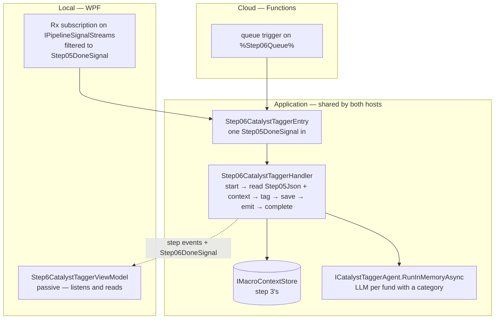
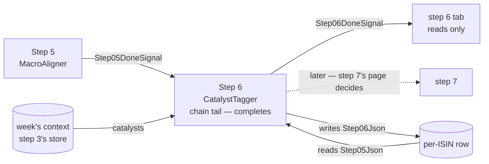

<!--
  Authoring rules: see README.md in this folder.
  STATUS: design only, 2026-10-18 — nothing in "Proposed implementation
  order" is built. Follows step 5's chain, so the trigger and the input
  column are not new choices. Decided 2026-10-18: the same context read
  as step 5 (A); a domain-input RunInMemoryAsync that filters catalysts,
  as step 5's; the catalyst LLM client gains step 5's client's logging
  before the chain reaches it; step 6 becomes the chain tail in its own
  commit; the debug button goes through the handler. The open questions
  are at the end.
-->

# Step 6 — CatalystTagger

> **Related:**
>
> - The cross-cutting design this follows from:
>   [event-driven-orchestration-plan.md](./event-driven-orchestration-plan.md)
> - The step this one follows, and the pattern it copies:
>   [05-macroaligner.md](./05-macroaligner.md)
> - The step whose stored context it reads:
>   [03-macroanalyst.md](./03-macroanalyst.md)
> - What this step does **today** — exposure vocabulary, tie-break,
>   prompts, failure modes, evaluation rubric:
>   [06-catalysttagger.md](../../FikaFinans.InfrastructureV2.Tests/docs/06-catalysttagger.md)

`StepId.CatalystTagger`, implemented by `CatalystTaggerAgent` behind
`ICatalystTaggerAgent`, surfaced in the desktop app as
`Step6CatalystTaggerViewModel`. This page covers only what the move to
signal-driven, per-fund processing changes.

Step 6 is step 5 again, with the context's **catalysts** in place of its
rotation themes: two inputs, the fund's record from the step before and
the week's context from step 3's store. One difference sets it apart —
**it has no code-only path.** Step 5 calls the LLM only when a fund's
category matches no theme; step 6 calls it for every fund with a
category, whenever the week has any catalyst. The work is already
per-fund: `PipelineRunner` calls `ProcessFundAsync` once per fund.

## What step 6 needs from step 5

### Trigger

[`Step05DoneSignal`](../../FikaFinans.Application/Pipeline/Signals/Step05DoneSignal.cs)
— one per fund, emitted after `Step05Json` is written.

| Field | Step 6 uses it to |
| --- | --- |
| `Isin` | name the fund — log lines, step events, the row `Step06Json` lands on |
| `NavDate` | pick the week whose context applies; carry the trading date forward onto its own done-signal |
| `RunId` | read `Step05Json` for this run only — and tell a late signal from a live one |

Not a new choice: the chain is linear (step 3's decision B), and step
5's page named step 6 as its natural consumer.

### Input — `Step05Json` on the fund's row

One `FundRecord`, read back by run id.

| Part of the record | Read | What for |
| --- | --- | --- |
| `Metadata.Category` | yes | the short-circuit when empty, and the LLM's question |
| `Metadata.Name` | yes | the LLM's question — step 5 sends the category only |
| everything else | no | copied through — append-only |

Step 6 writes `Catalyst` and nothing else. Unlike step 5 it changes no
earlier step's field; the macro alignment it is handed is not read.

## What step 6 needs from step 3

The catalysts — `MacroContext.Catalysts` — from the context step 3
stored in `IMacroContextStore`. Step 3's page left the choice to steps 5
and 6; step 5 took it.

### Which context a fund is tagged against

The same three ways step 5's page laid out — A, the newest stored up to
the fund's week; B, step 3 records the key; C, repeat step 3's lookup.
Nothing about catalysts changes that comparison.

**Decided: A, as step 5.** One read, no change to step 3, and step 5
and step 6 then see the same context for a fund. They could differ only
if a newer context for the week is stored in the seconds between the two
reads — a KanelBrief republish landing mid-chain. Logged the same way
when the context's week is not the fund's week.

No context stored up to the week → **the fund fails**, as at step 5.
Steps 3 and 5 would already have failed it.

### Catalysts with no affected categories

The contract skips them defensively. Today two places apply that filter
— `PipelineRunner`, before the per-fund loop, and the agent's universe
`RunInMemoryAsync`. `ProcessFundAsync` does not; it trusts its caller.

**Decided: the new domain-input call filters**, as the agent's current
universe call does, so the rule stays inside the agent and the handler
passes the context's list as stored.

## Names

Every new type carries the step number. All *(new)*:

| Role | Step 5 (exists) | Step 6 *(new)* |
| --- | --- | --- |
| Handler interface | `IStep05MacroAligner` | `IStep06CatalystTagger` |
| Handler | `Step05MacroAlignerHandler` | `Step06CatalystTaggerHandler` |
| Entry point | `IStep05MacroAlignerEntry` + `Step05MacroAlignerEntry` | `IStep06CatalystTaggerEntry` + `Step06CatalystTaggerEntry` |
| Done-signal | `Step05DoneSignal` | `Step06DoneSignal` |
| Config provider | — | — no config; "None for v1" in the contract, its prompt is a constant in the LLM client |
| Context read | `IMacroContextStore` | same — step 3's |
| Agent call | `IMacroAlignerAgent.RunInMemoryAsync` | `ICatalystTaggerAgent.RunInMemoryAsync` — domain inputs, onto the interface; see "Agent work" |
| Cloud function | `Step05MacroAlignerFunction` *(sketch)* | `Step06CatalystTaggerFunction` |
| Row — start | `StartStep05Async` | `StartStep06Async` |
| Row — complete | `CompleteStep05Async` — **removed** when step 6 takes the tail | `CompleteStep06Async` |
| Row — fail | `FailStep05Async` | `FailStep06Async` |
| Row — orphaned list | `ListOrphanedStep05Async` | `ListOrphanedStep06Async` |

## Sketch — the same step, two hosts

Illustrative only. Names marked *(new)* do not exist yet; queue names are
owned by [backend-nav-sync-plan.md](../backend-nav-sync-plan.md).

### What is the same in both hosts

| Interface | Current | WPF | Cloud |
| --- | --- | --- | --- |
| `IPipelineSignalStreams` | `LocalRxPipelineSignalBus` — steps 2–5's work subscriptions, the tabs' reads | same bus — plus the step 6 subscription | — nothing subscribes |
| `IPipelineSignals` | overloads for steps 1–5 | plus step 6's | queue publisher *(new)* |
| `IIsinProgressStore` | start / fail / orphaned for steps 1–5, complete for step 5 | plus step 6's; step 5 loses its complete | the same class over Tables |
| `IMacroContextStore` | step 3 writes it; step 3's tab and step 5 read it | step 6 reads it too | the same store over Tables |
| `IFundCatalystLlmClient` | `FoundryFundCatalystLlmClient` over `AIProjectClient` — **no logger** | gains one; see "Agent work" | unchanged — managed identity instead of `az login` |
| `ICatalystTaggerAgent` | `RunAsync` (button, runner's single step) and `ProcessFundAsync` (runner) | plus the domain-input `RunInMemoryAsync`, called by the handler | same |

No config provider and no fetch seam.

### Handler shape

Step 5's, with catalysts for themes:

| Step 5 phase | Step 6 equivalent | Difference |
| --- | --- | --- |
| `BeginProcessingAsync` | start step 6 on the row | none |
| `LoadFundAsync` — `Step04Json` and the context | `Step05Json` by run id, and the context | none beyond the column |
| `AssembleAgentInputAsync` — no-op | no-op | none |
| `RunAgentAsync` — the context's themes | `ICatalystTaggerAgent.RunInMemoryAsync` with the context's catalysts | calls the LLM for every fund with a category |
| `PersistAsync` | `Step06Json` | same store call |
| `EmitDoneAsync` | `Step06DoneSignal` | new signal type, new overload |
| `CompleteAsync` / `FailAsync` | step 6's row methods | the tail moves here |
| `ReadOutputAsync` | same, `StepId.CatalystTagger` | none |
| `ComputeOutputAsync` — the debug run | same, reading `Step05Json` and the context | spends money on more funds than step 5's |

### Where the code lives



### Local

```text
// sketch
pipelineSignals.Signals                          // IPipelineSignalStreams
    .OfType<Step05DoneSignal>()
    .Subscribe(done => RunStep06Async(step06Entry, done));   // (new)
```

### Cloud

```text
// sketch
[Function("Step06CatalystTagger")]               // (new)
public Task Run(
    [QueueTrigger("%Step06Queue%")] Step05DoneSignal signal,
    CancellationToken ct)
    => _step06Entry.HandleAsync(signal, ct);     // IStep06CatalystTaggerEntry (new)
```

## Input trigger

`Step05DoneSignal` — fund identifier, trading date, run id. No payload.

| | Current | WPF | Cloud |
| --- | --- | --- | --- |
| Producer | — no signal; step 6 runs inside `PipelineRunner`'s per-fund block, or from the tab's button | `Step05MacroAlignerHandler.EmitDoneAsync` → `IPipelineSignals` | the same handler, queue-backed publisher |
| Transport | the fund record, in memory | `LocalRxPipelineSignalBus` | `%Step06Queue%` |
| How the step is reached | `PipelineRunner` calls `ProcessFundAsync` per fund | subscribe, filter to step 5 | **nothing subscribes** — the Functions host invokes per message |

Delivery is at-least-once:

| Arrives | Row says | Action |
| --- | --- | --- |
| Duplicate | same run id, `Step06Json` populated | run again — **always** repays the LLM call when the week has catalysts, and may answer differently |
| Late | a different run id | drop it — step 6's start refuses it |

Step 5's duplicate was free when the fund matched a theme directly. Step
6's never is. Last write wins, as for every other step column.

### Start, do not claim

Same as steps 2–5: a check and a mark, never a clear. Moves
`CurrentStep` to 6.

### Manual trigger — WPF only

**Decided: the debug button goes through the handler**, as steps 2–5's
do — `ComputeOutputAsync` reads `Step05Json` for the run bar's run and
the context for its week, runs the agent, stores nothing. It spends
money on every fund with a category, not only the unmatched ones.

## Input data — what the step reads

| Input data | Current | WPF | Cloud |
| --- | --- | --- | --- |
| **Step 5's fund record** | the in-memory record (runner) or `05-macro-align-…json` (button) | `Step05Json`, by run id | same, Tables |
| **The week's catalysts** | the in-memory `MacroContext` (runner) or `03-macro-…json` (button) | `IMacroContextStore.GetNewestAsync(week)` — see "Which context" | same store, Tables |
| **The classification prompt** | a constant in `FoundryFundCatalystLlmClient` | unchanged | unchanged |
| **Foundry project + model id** | settings, `az login` | unchanged | app settings, managed identity |

No prompts provider, no `_paths` behind the prompt — as step 5.

## Pre-processing — assemble the agent input

Nothing to assemble. The record arrives aligned, the catalysts arrive
with the context.

## Agent work

LLM, short-circuited. Contract:
[06-catalysttagger.md](../../FikaFinans.InfrastructureV2.Tests/docs/06-catalysttagger.md).
The vocabulary, the tie-break (Direct over Indirect, then intensity,
then weeks active) and the hallucination guard do not change.

**Decided: a domain-input `RunInMemoryAsync` on `ICatalystTaggerAgent`**
— company, week, run id, fund records, the catalysts in; a
`DataLoaderOutput` out. Step 5's shape exactly: loop the existing
`ProcessFundAsync`, wrap the results, warnings into the output. The
older `RunInMemoryAsync(DataLoaderOutput, MacroContext)` stays on the
class for `RunAsync`, which `PipelineRunner` still calls.

| | Step 5 | Step 6 |
| --- | --- | --- |
| In-memory call | `IMacroAlignerAgent.RunInMemoryAsync` | `ICatalystTaggerAgent.RunInMemoryAsync` |
| Inputs | company, week, run id, records, themes | company, week, run id, records, **catalysts** |
| Filters its list | no | **yes** — catalysts with no affected categories |
| Uses `_paths` | no | no — only `RunAsync` does |
| Returns | a one-fund `DataLoaderOutput`, warnings in `DataQuality.Warnings` | same |

### Where the warnings go

As step 5: the envelope does not reach the row, so **the handler logs
each warning**. Today the only one step 6 produces is "empty category".

### The LLM client is silent — fix before the chain reaches it

`FoundryFundCatalystLlmClient` was written before step 5's client was
given its logging, and it shows:

| | Step 5's client | Step 6's client today |
| --- | --- | --- |
| Logger | yes — Warn per failure with its reason, Debug per verdict with the rationale | **none** |
| Timeout, exception, incomplete status, unparsed answer | Warn, then `None` | empty list, no trace |
| Hallucinated catalyst name | Warn, then `None` | dropped, no trace — the contract says warn |
| Second failed parse after the retry | — | empty list, no trace — the contract says warn |
| The caller's cancellation | rethrown | **swallowed** — a shutdown mid-call reads as "no catalyst" |
| Agent left behind on a failed delete | Warn | swallowed |

The agent cannot tell an empty list from a real "no exposure", so today
a Foundry outage tags every fund `null` and leaves nothing in any log.
Under signals that runs daily, unwatched.

**Decided: the client gets step 5's client's treatment, as its own row
before the wiring** — a logger in its registration, a Debug line per
call, a Warn line per failure reason, a Debug line per verdict with its
rationale, a Warn when the agent is not deleted, the caller's
cancellation rethrown. Logging and cancellation only: what the client
returns does not change, so the contract holds. Putting the warnings
into the agent's output instead would need the interface to say which
failure it was — the same `IFundCatalystLlmClient` change step 5's
cache question needs, and not made here.

The handler logs as step 5's does: a line per phase, one line per fund
with its catalyst, exposure and the context's week, and a Warn per
warning in the output. Between the two, a fund tagged `null` because
Foundry failed is told apart in the log from one the LLM judged
unexposed.

### The LLM call per signal

The cost question, sharper than step 5's:

| | Step 5 | Step 6 |
| --- | --- | --- |
| Calls per signal | 0 or 1 — only on a missed direct match | 1 for every fund with a category, if the week has a catalyst |
| Calls per fund per week, daily NAV | up to ~5, for the unmatched | ~5 for nearly every fund |
| Time per call | measured 2026-10-18: create the Foundry agent, one response, delete — 5 s + 4 s + 3 s | the same three phases; not measured; one more response on a failed parse |
| What the answer depends on | (context, category) | (context, **fund name**, category) |

The verdict depends on the fund's name as well as its category, so a
cache could not share an answer between funds the way step 5's could.
It would still collapse the daily repeats: one call per fund per
context, not per NAV signal. The two no-cache cuts step 5's page listed
— delete the agent off the critical path, or reuse one agent per prompt
version — apply here unchanged.

Options, none chosen — the open question joins step 5's:

| | No cache | In-process cache | Stored verdicts |
| --- | --- | --- | --- |
| Calls | every signal, every fund with a category | once per (context, fund) per app session | once per (context, fund) |
| Survives a restart / a cloud instance | — | no | yes |
| New code | none | a small cache in the handler's registration | a store beside `IMacroContextStore`, Tables-shaped |

The same rule as step 5: **a failed call must not be cached**, and the
client cannot say which it was yet.

### LLM failure does not fail the fund

The contract: an invalid answer after one retry → `catalyst = null` with
a warning. So an outage does not fail step 6 — the fund completes with
no catalyst. Kept, as step 5 kept its own.

## Post-processing — write and emit

| Written | Current | WPF | Cloud |
| --- | --- | --- | --- |
| This fund's tagged record | `Step06Json` via the gateway's block write (runner), or `06-catalyst-…json` (button) | `SaveStepOutputAsync` with `StepId.CatalystTagger` → `Step06Json` | same — Tables |
| Row freed | once, at the end of the Run All pass | `CompleteStep06Async` / `FailStep06Async` — step 6 becomes the tail | same |

### Complete and fail — the tail moves, and step 5 changes

The same move as every step before — **and it changes step 5's code**:

| Before | After |
| --- | --- |
| `CompleteStep05Async` frees the row and advances the anchor | removed, with step 5's `CompleteAsync`; step 5's entry point stops calling it |
| — | `CompleteStep06Async`, called by step 6's entry point after its emit |
| — | `FailStep06Async` |

Step 5 keeps its done-signal and its `Succeeded` step event; only the row
release moves. **Decided: that change is its own commit**, as step 5's
was.

### Orphaned runs

Same rule as steps 1–5, local only: step 6's tab recovers the runs
orphaned at step 6 when first opened in a session. A process ending
during the LLM call leaves nothing half-written — the column is written
after the call returns. Today's swallowed cancellation would break that
promise in one case: a shutdown mid-call returns "no catalyst" and the
handler carries on toward its write. The client fix above closes it.

### Emit

`Step06DoneSignal` — fund identifier, trading date, run id, no payload.

### Who consumes it

**Nobody, yet.** Step 7 (ThesisValidator) is the natural consumer: it
reads step 6's record alone — no context — and calls the LLM to refine
the thesis. Step 7's page decides.



### Readers of the step 6 file

`ThesisValidatorAgent.RunAsync` and `FundDetailViewModel` read
`06-catalyst-{iso_week}-{run_id}.json` from disk. A signal-driven run
writes no file — the same limitation every earlier step's file readers
have. Step 7's page owns ThesisValidator's read.

## What a frontend reads when the user opens the view

Same as step 5's tab:

| The tab | Does |
| --- | --- |
| Listens to step events | filtered to `StepId.CatalystTagger` |
| Listens to `Step06DoneSignal` | to learn the run id, then reads that run's output |
| Reads | through the step 6 handler's `ReadOutputAsync` |
| Runs | nothing on a signal — only the debug button, through the handler |

`Step6CatalystTaggerViewModel` today holds the agent, `IPathsService`
and `IIsinProgressRepository`, reads through `IsinProgressOutputLoader`
with a disk fallback, and checks for a missing agent to say "Configure
Foundry credentials". All of that leaves the tab. No XAML changes.

## Proposed implementation order

One change per row, each reviewed and committed before the next.

| # | Work | Touches | Blocked on |
| --- | --- | --- | --- |
| 1 | ✅ `Step06DoneSignal` and its overload | `Pipeline/Signals`, `LocalRxPipelineSignalBus` | — |
| 2 | ✅ Domain-input `RunInMemoryAsync` onto `ICatalystTaggerAgent` — `ProcessFundAsync` per record, empty-category catalysts filtered, wrapped, warnings into the output. No rule change. Tests in a new file beside `CatalystTaggerAgentTests` | `ICatalystTaggerAgent`, `CatalystTaggerAgent`, a new test file | — |
| 3 | ✅ `FoundryFundCatalystLlmClient` gets a logger, as `FoundryThemeAdjacencyLlmClient` has — Debug per call and per verdict, Warn per failure reason and per undeleted agent, the caller's cancellation rethrown. Return values unchanged | the client, its registration, its integration test's construction | — |
| 4 | ✅ `StartStep06Async`, `CompleteStep06Async`, `FailStep06Async`, `ListOrphanedStep06Async` | `IIsinProgressStore`, `RepositoryBackedIsinProgressStore` | — |
| 5 | ✅ `IStep06CatalystTagger` + handler, step 5's shape. Not wired. Load reads `Step05Json` and the context — newest up to the week, fail when none; the agent phase passes the context's catalysts; warnings logged; `CompleteAsync`, `ReadOutputAsync`, `ComputeOutputAsync` included | Application, `Pipeline/Steps` | rows 1, 2, 4; "Which context" |
| 6 | ✅ `IStep06CatalystTaggerEntry` + entry point; registration as step 5's | Application, `InfrastructureModule` | row 5 |
| 7a | ✅ **Step 5 gives up the tail** — `CompleteStep05Async`, step 5's `CompleteAsync` and the entry's call removed; complete tests move to step 6 | step 5's handler, entry point and tests, `IIsinProgressStore` | row 6 |
| 7b | ✅ Subscription `Step05DoneSignal` → step 6's entry point | `MainWindowViewModel` | 7a, row 3 |
| 8 | Step 6's tab goes passive, shaped like step 5's | `Step6CatalystTaggerViewModel`, no XAML | row 7b |
| — | Verdict cache — **not scheduled**, waits on the open question | the handler's registration or a new store; `IFundCatalystLlmClient` | the cache question |

Rows 7a and 7b go in back to back: between them a fund's run would
finish at step 5 and step 6 would never be reached — harmless, since
nothing triggers step 6 until 7b.

Row 7b is the first that spends money per signal at step 6, and more of
it than step 5's — hence row 3 before it: the first unattended run
should leave a trace when Foundry fails.

## Open questions

Raised by this page; they belong in the parent plan's Open Questions,
not settled here.

- **Caching catalyst verdicts.** None, in-process, or stored — keyed by
  (context, fund). Joins step 5's adjacency cache question; both need
  the client to tell a failure from a real "none" first.
- **Should a fund's catalyst be recomputed on every NAV signal at all?**
  The inputs — name, category, the week's catalysts — do not change
  within a week. A narrower question than the cache: whether step 6
  could reuse the run's earlier `Step06Json` for the same context.
- **Where the warnings go** once the envelope question on step 2's page
  is answered. Logged until then.
- **Should an LLM outage fail the fund?** The contract says no. Kept;
  raised because step 6 has no code path to fall back on — an outage
  untags the whole universe, not only the unmatched funds.
- **Who consumes step 6's done-signal.** Step 7's page.
- **Carried over unchanged:** the cloud host, orphaned-run recovery in
  cloud, step outputs too large for Tables, the fresh-handler factory,
  how the envelope is stored — all on step 2's page; which context if A
  ever disagrees with step 3 — step 5's page.
