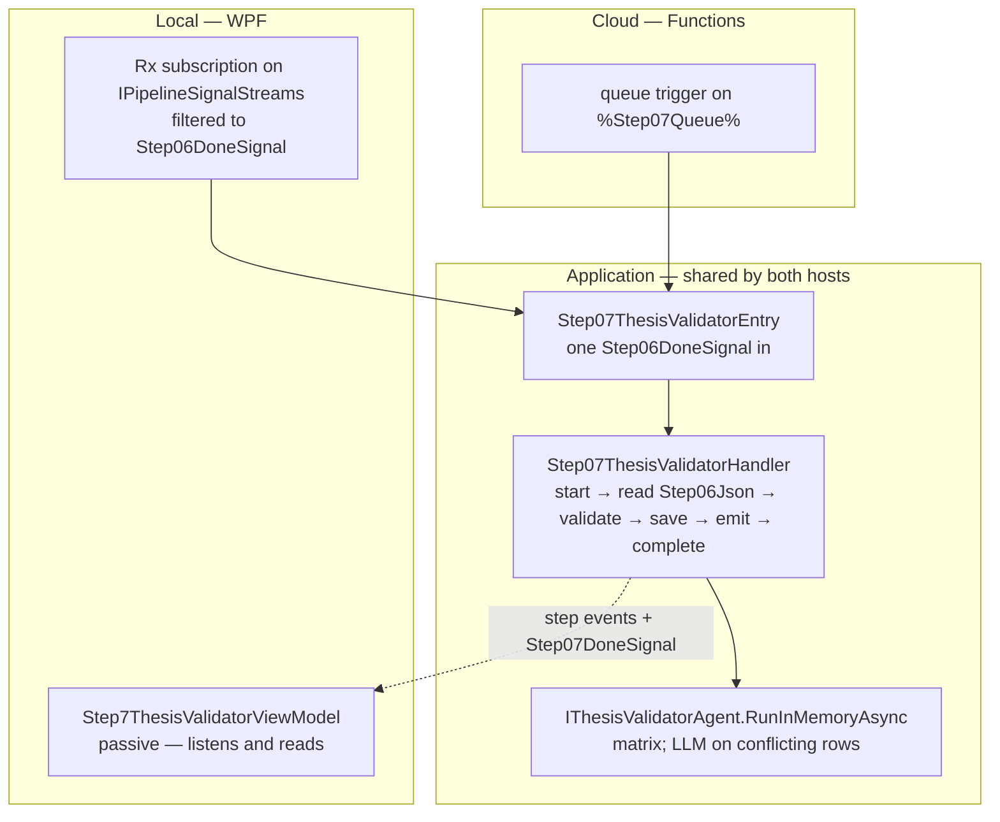
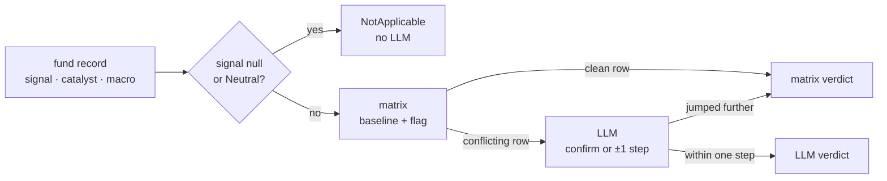
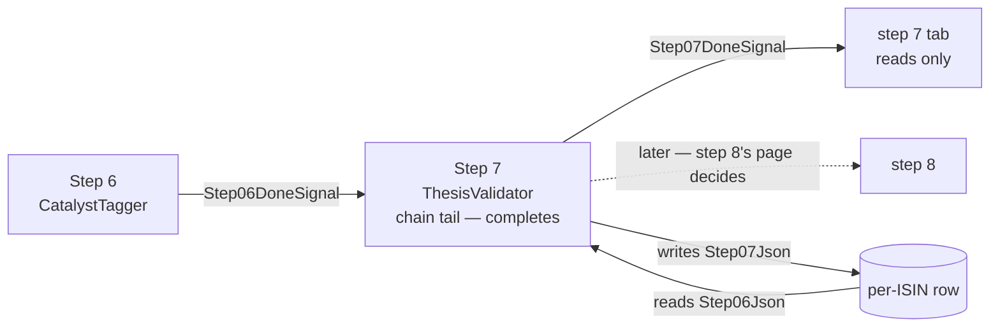

<!--
  Authoring rules: see README.md in this folder.
  STATUS: design only, 2026-10-18 — nothing on this page is built. Follows
  step 6's chain, so the trigger and the input column are not new choices.
  Decided 2026-10-18: a domain-input RunInMemoryAsync, as steps 5 and 6;
  the refinement LLM client gains step 6's client's logging before the
  chain reaches it; an outage stays stamped llm_refinement for now; step 7
  becomes the chain tail in its own commit; the debug button goes through
  the handler. The open questions are at the end.
-->

# Step 7 — ThesisValidator

> **Related:**
>
> - The cross-cutting design this follows from:
>   [event-driven-orchestration-plan.md](./event-driven-orchestration-plan.md)
> - The step this one follows, and the pattern it copies:
>   [06-catalysttagger.md](./06-catalysttagger.md)
> - The step whose hybrid shape it shares — code first, the LLM on a few
>   rows: [05-macroaligner.md](./05-macroaligner.md)
> - What this step does **today** — the decision matrix, the one-step
>   rule, prompts, failure modes, evaluation rubric:
>   [07-thesisvalidator.md](../../FikaFinans.InfrastructureV2.Tests/docs/07-thesisvalidator.md)

`StepId.ThesisValidator`, implemented by `ThesisValidatorAgent` behind
`IThesisValidatorAgent`, surfaced in the desktop app as
`Step7ThesisValidatorViewModel`. This page covers only what the move to
signal-driven, per-fund processing changes.

Step 7 is the simplest LLM step so far. It has **one input** — the
fund's record from step 6 — and no context, no config and no prompts
provider. It is **hybrid like step 5**: a code matrix decides every fund,
and the LLM is asked only on the conflicting rows, where it may confirm
the matrix or move it one step. The work is already per-fund:
`PipelineRunner` calls `ProcessFundAsync` once per fund.

## What step 7 needs from step 6

### Trigger

[`Step06DoneSignal`](../../FikaFinans.Application/Pipeline/Signals/Step06DoneSignal.cs)
— one per fund, emitted after `Step06Json` is written.

| Field | Step 7 uses it to |
| --- | --- |
| `Isin` | name the fund — log lines, step events, the row `Step07Json` lands on |
| `NavDate` | the week stamped on the output; carry the trading date forward onto its own done-signal |
| `RunId` | read `Step06Json` for this run only — and tell a late signal from a live one |

Not a new choice: the chain is linear (step 3's decision B), and step
6's page named step 7 as its natural consumer. With this page, step 6's
"who consumes it" question is answered.

### Input — `Step06Json` on the fund's row

One `FundRecord`, read back by run id.

| Part of the record | Read | What for |
| --- | --- | --- |
| `Signal` | yes | the matrix's first key; null or Neutral short-circuits to NotApplicable |
| `Catalyst` | yes | present or not — the matrix's second key; its fields go into the LLM's question |
| `MacroAlignment` | yes | the matrix's third key; null counts as None |
| `Metadata.Name`, `Metadata.Category`, `RuleFired`, `CurrentlyHeld` | yes | the LLM's question only |
| everything else | no | copied through — append-only |

Step 7 writes `ThesisValidity`, `ThesisRationale` and `ThesisMethod`, and
nothing else.

### Nothing from step 3

Unlike steps 5 and 6, step 7 does not read the week's context. The
catalyst and the macro alignment arrive already resolved on the record,
so the "which context" question does not come up here.

## Names

Every new type carries the step number. All *(new)*:

| Role | Step 6 (exists) | Step 7 *(new)* |
| --- | --- | --- |
| Handler interface | `IStep06CatalystTagger` | `IStep07ThesisValidator` |
| Handler | `Step06CatalystTaggerHandler` | `Step07ThesisValidatorHandler` |
| Entry point | `IStep06CatalystTaggerEntry` + `Step06CatalystTaggerEntry` | `IStep07ThesisValidatorEntry` + `Step07ThesisValidatorEntry` |
| Done-signal | `Step06DoneSignal` | `Step07DoneSignal` |
| Config provider | — | — no config; "None for v1" in the contract |
| Context read | `IMacroContextStore` | — none |
| Agent call | `ICatalystTaggerAgent.RunInMemoryAsync` | `IThesisValidatorAgent.RunInMemoryAsync` — domain inputs, onto the interface; see "Agent work" |
| Cloud function | `Step06CatalystTaggerFunction` *(sketch)* | `Step07ThesisValidatorFunction` |
| Row — start | `StartStep06Async` | `StartStep07Async` |
| Row — complete | `CompleteStep06Async` — **removed** when step 7 takes the tail | `CompleteStep07Async` |
| Row — fail | `FailStep06Async` | `FailStep07Async` |
| Row — orphaned list | `ListOrphanedStep06Async` | `ListOrphanedStep07Async` |

## Sketch — the same step, two hosts

Illustrative only. Names marked *(new)* do not exist yet; queue names are
owned by [backend-nav-sync-plan.md](../backend-nav-sync-plan.md).

### What is the same in both hosts

| Interface | Current | WPF | Cloud |
| --- | --- | --- | --- |
| `IPipelineSignalStreams` | `LocalRxPipelineSignalBus` — steps 2–6's work subscriptions, the tabs' reads | same bus — plus the step 7 subscription | — nothing subscribes |
| `IPipelineSignals` | overloads for steps 1–6 | plus step 7's | queue publisher *(new)* |
| `IIsinProgressStore` | start / fail / orphaned for steps 1–6, complete for step 6 | plus step 7's; step 6 loses its complete | the same class over Tables |
| `IThesisRefinementLlmClient` | `FoundryThesisRefinementLlmClient` over `AIProjectClient` — **no logger** | gains one; see "Agent work" | unchanged — managed identity instead of `az login` |
| `IThesisValidatorAgent` | `RunAsync` (button, runner's single step) and `ProcessFundAsync` (runner) | plus the domain-input `RunInMemoryAsync`, called by the handler | same |

No config provider, no context store, no fetch seam.

### Handler shape

Step 6's, with one input instead of two:

| Step 6 phase | Step 7 equivalent | Difference |
| --- | --- | --- |
| `BeginProcessingAsync` | start step 7 on the row | none |
| `LoadFundAsync` — `Step05Json` and the context | `Step06Json` by run id | **no context read** — so no "no context, the fund fails" branch |
| `AssembleAgentInputAsync` — no-op | no-op | none |
| `RunAgentAsync` — the context's catalysts | `IThesisValidatorAgent.RunInMemoryAsync` | calls the LLM only on the matrix's conflicting rows |
| `PersistAsync` | `Step07Json` | same store call |
| `EmitDoneAsync` | `Step07DoneSignal` | new signal type, new overload |
| `CompleteAsync` / `FailAsync` | step 7's row methods | the tail moves here |
| `ReadOutputAsync` | same, `StepId.ThesisValidator` | none |
| `ComputeOutputAsync` — the debug run | same, reading `Step06Json` | spends money only on conflicting rows |

### Where the code lives



### Local

```text
// sketch
pipelineSignals.Signals                          // IPipelineSignalStreams
    .OfType<Step06DoneSignal>()
    .Subscribe(done => RunStep07Async(step07Entry, done));   // (new)
```

### Cloud

```text
// sketch
[Function("Step07ThesisValidator")]              // (new)
public Task Run(
    [QueueTrigger("%Step07Queue%")] Step06DoneSignal signal,
    CancellationToken ct)
    => _step07Entry.HandleAsync(signal, ct);     // IStep07ThesisValidatorEntry (new)
```

## Input trigger

`Step06DoneSignal` — fund identifier, trading date, run id. No payload.

| | Current | WPF | Cloud |
| --- | --- | --- | --- |
| Producer | — no signal; step 7 runs inside `PipelineRunner`'s per-fund block, or from the tab's button | `Step06CatalystTaggerHandler.EmitDoneAsync` → `IPipelineSignals` | the same handler, queue-backed publisher |
| Transport | the fund record, in memory | `LocalRxPipelineSignalBus` | `%Step07Queue%` |
| How the step is reached | `PipelineRunner` calls `ProcessFundAsync` per fund | subscribe, filter to step 6 | **nothing subscribes** — the Functions host invokes per message |

Delivery is at-least-once:

| Arrives | Row says | Action |
| --- | --- | --- |
| Duplicate | same run id, `Step07Json` populated | run again — free on a matrix row, repays the LLM call on a conflicting one, and may answer differently there |
| Late | a different run id | drop it — step 7's start refuses it |

Last write wins, as for every other step column.

### Start, do not claim

Same as steps 2–6: a check and a mark, never a clear. Moves
`CurrentStep` to 7.

### Manual trigger — WPF only

**Decided, as steps 2–6: the debug button goes through the handler** —
`ComputeOutputAsync` reads `Step06Json` for the run bar's run, runs the
agent, stores nothing.

## Input data — what the step reads

| Input data | Current | WPF | Cloud |
| --- | --- | --- | --- |
| **Step 6's fund record** | the in-memory record (runner) or `06-catalyst-…json` (button) | `Step06Json`, by run id | same, Tables |
| **The refinement prompt** | a constant in `FoundryThesisRefinementLlmClient` | unchanged | unchanged |
| **Foundry project + model id** | settings, `az login` | unchanged | app settings, managed identity |

That closes the item step 6's page left here: `ThesisValidatorAgent.RunAsync`
stops being the way step 7 reads step 6. It keeps reading the file for the
runner's single-step path, the same limitation every earlier step's file
readers have.

## Pre-processing — assemble the agent input

Nothing to assemble. Signal, alignment and catalyst all arrive on the
record.

## Agent work

Hybrid. Contract:
[07-thesisvalidator.md](../../FikaFinans.InfrastructureV2.Tests/docs/07-thesisvalidator.md).
The matrix, the Null/Neutral short-circuit, the one-step rule and the
override to baseline do not change.



**Decided: a domain-input `RunInMemoryAsync` on `IThesisValidatorAgent`**
— company, week, run id, fund records in; a `DataLoaderOutput` out. Steps
5 and 6's shape: loop the existing `ProcessFundAsync`, wrap the results,
warnings into the output. The older `RunInMemoryAsync(DataLoaderOutput)`
stays on the class for `RunAsync`, which `PipelineRunner` still calls.

| | Step 6 | Step 7 |
| --- | --- | --- |
| In-memory call | `ICatalystTaggerAgent.RunInMemoryAsync` | `IThesisValidatorAgent.RunInMemoryAsync` |
| Inputs | company, week, run id, records, catalysts | company, week, run id, records — **no list** |
| Filters its list | yes | — nothing to filter |
| Uses `_paths` | no | no — only `RunAsync` does |
| Returns | a one-fund `DataLoaderOutput`, warnings in `DataQuality.Warnings` | same |

### Where the warnings go

As steps 5 and 6: the envelope does not reach the row, so **the handler
logs each warning**. Step 7 produces two today — "null signal" and "the
LLM jumped more than one step".

### The LLM client is silent — the same fix as step 6's

`FoundryThesisRefinementLlmClient` is the same shape as step 6's client
was before its logging row:

| | Step 6's client now | Step 7's client today |
| --- | --- | --- |
| Logger | yes — Debug per call and per verdict, Warn per failure | **none** |
| Timeout, exception, incomplete status, unparsed answer | Warn, then empty list | baseline, no trace |
| Label outside the enum | Warn | retried, then baseline, no trace — the contract says warn |
| The caller's cancellation | rethrown | **swallowed** by a bare `catch` — a shutdown mid-call reads as "baseline confirmed" |
| Agent left behind on a failed delete | Warn | swallowed |

**Decided, as step 6: the client gets the same treatment, as its own row
before the wiring.** Logging and cancellation only; what the client
returns does not change, so the contract holds.

### An outage is stamped as a refinement

One thing the logging alone does not fix. When the LLM fails, the client
returns "confirm the baseline" with the rationale *"Matrix baseline
retained — LLM refinement unavailable."* The agent cannot tell that from a
real confirmation, so it stamps the fund **`thesis_method =
llm_refinement`** — with a rationale that says the opposite.

| | Today | Decided for this redesign |
| --- | --- | --- |
| `thesis_validity` | the baseline | unchanged — the contract says "use baseline" |
| `thesis_rationale` | "…LLM refinement unavailable." | unchanged |
| `thesis_method` | `llm_refinement` | unchanged — the client's Warn line is the trace |

Correcting the method needs the client to say *which* outcome it was:
the same `IThesisRefinementLlmClient` change that steps 5 and 6 need for
their caches, not made there either. Raised as an open question rather
than fixed here. Steps 8–10 decide on `thesis_validity` and only copy the
method through, so nothing downstream acts on the wrong label today; the
evaluation rubric's "method appropriateness" score would.

### The LLM call per signal

Cheaper than step 6, close to step 5:

| | Step 6 | Step 7 |
| --- | --- | --- |
| Calls per signal | 1 for every fund with a category, if the week has a catalyst | 0 or 1 — only on the matrix's conflicting rows |
| Which rows | — | Strength + catalyst + Partial/None; Weakness + catalyst; Weakness + no catalyst + Strong |
| Typical share of the universe | nearly all | small — Neutral is ~50–80% and never asks |
| What the answer depends on | (context, fund name, category) | the whole record — signal, rule fired, catalyst, alignment, held flag |

The answer depends on fields that change with the fund's NAV — the
signal and the rule fired — so a cache keyed on the inputs would hit less
often than step 6's. Not proposed; it joins the cache question.

### LLM failure does not fail the fund

The contract: an invalid answer after one retry → the baseline. So an
outage does not fail step 7 — the fund completes with the matrix's
verdict. Kept, as steps 5 and 6 kept their own. Step 7 is the step where
this matters least: unlike step 6, there is always a code answer to fall
back on.

One carry-over: the agent's creation sits outside the client's
`try`, as in steps 5 and 6's clients, so a failure *creating* the Foundry
agent throws and fails the fund. Not changed here.

## Post-processing — write and emit

| Written | Current | WPF | Cloud |
| --- | --- | --- | --- |
| This fund's validated record | `Step07Json` via the gateway's block write (runner), or `07-thesis-…json` (button) | `SaveStepOutputAsync` with `StepId.ThesisValidator` → `Step07Json` | same — Tables |
| Row freed | once, at the end of the Run All pass | `CompleteStep07Async` / `FailStep07Async` — step 7 becomes the tail | same |

### Complete and fail — the tail moves, and step 6 changes

The same move as every step before — **and it changes step 6's code**:

| Before | After |
| --- | --- |
| `CompleteStep06Async` frees the row and advances the anchor | removed, with step 6's `CompleteAsync`; step 6's entry point stops calling it |
| — | `CompleteStep07Async`, called by step 7's entry point after its emit |
| — | `FailStep07Async` |

Step 6 keeps its done-signal and its `Succeeded` step event; only the row
release moves. **Decided, as before: that change is its own commit.**

### Orphaned runs

Same rule as steps 1–6, local only: step 7's tab recovers the runs
orphaned at step 7 when first opened in a session. The column is written
after the agent returns, so a process ending mid-call leaves nothing
half-written — once the client stops swallowing the caller's
cancellation.

### Emit

`Step07DoneSignal` — fund identifier, trading date, run id, no payload.

### Who consumes it

**Nobody, yet.** Step 8 (Recommender) is the natural consumer: it is
code-only and reads step 7's record alone — step 4's pattern. Step 8's
page decides.



### Readers of the step 7 file

`RecommenderAgent.Run` and `FundDetailViewModel` read
`07-thesis-{iso_week}-{run_id}.json` from disk. A signal-driven run writes
no file. Step 8's page owns Recommender's read.

## What a frontend reads when the user opens the view

Same as step 6's tab:

| The tab | Does |
| --- | --- |
| Listens to step events | filtered to `StepId.ThesisValidator` |
| Listens to `Step07DoneSignal` | to learn the run id, then reads that run's output |
| Reads | through the step 7 handler's `ReadOutputAsync` |
| Runs | nothing on a signal — only the debug button, through the handler |

`Step7ThesisValidatorViewModel` today holds the agent, `IPathsService`
and `IIsinProgressRepository`, reads through `IsinProgressOutputLoader`
with a disk fallback, and checks for a missing agent to say "Configure
Foundry credentials". All of that leaves the tab. No XAML changes.

## Settled before building

All decided 2026-10-18, as proposed.

| # | Choice | Decided |
| --- | --- | --- |
| 1 | Agent call | a domain-input `RunInMemoryAsync` on `IThesisValidatorAgent`, as steps 5 and 6 |
| 2 | The client's logging | its own row before the wiring, as step 6's row 3 |
| 3 | The outage stamped `llm_refinement` | leave it; Warn in the client; open question |
| 4 | The tail move | step 6 gives up the tail in its own commit |
| 5 | The debug button | through the handler |

## Proposed implementation order

One change per row, each reviewed and committed before the next.

| # | Work | Touches | Blocked on |
| --- | --- | --- | --- |
| 1 | ✅ `Step07DoneSignal` and its overload | `Pipeline/Signals`, `LocalRxPipelineSignalBus` | — |
| 2 | ✅ Domain-input `RunInMemoryAsync` onto `IThesisValidatorAgent` — `ProcessFundAsync` per record, wrapped, warnings into the output. No rule change. Tests in a new file beside `ThesisValidatorAgentTests` | `IThesisValidatorAgent`, `ThesisValidatorAgent`, a new test file | choice 1 |
| 3 | ✅ `FoundryThesisRefinementLlmClient` gets a logger, as `FoundryFundCatalystLlmClient` has — Debug per call and per verdict, Warn per failure reason and per undeleted agent, the caller's cancellation rethrown. Return values unchanged | the client, its registration, its integration test's construction | choice 2 |
| 4 | ✅ `StartStep07Async`, `CompleteStep07Async`, `FailStep07Async`, `ListOrphanedStep07Async` | `IIsinProgressStore`, `RepositoryBackedIsinProgressStore` | — |
| 5 | ✅ `IStep07ThesisValidator` + handler, step 6's shape without the context read. Not wired. Warnings logged; one line per fund with validity, method and baseline; `CompleteAsync`, `ReadOutputAsync`, `ComputeOutputAsync` included | Application, `Pipeline/Steps` | rows 1, 2, 4 |
| 6 | ✅ `IStep07ThesisValidatorEntry` + entry point; registration as step 6's | Application, `InfrastructureModule` | row 5 |
| 7a | ✅ **Step 6 gives up the tail** — `CompleteStep06Async`, step 6's `CompleteAsync` and the entry's call removed; complete tests move to step 7 | step 6's handler, entry point and tests, `IIsinProgressStore` | row 6, choice 4 |
| 7b | ✅ Subscription `Step06DoneSignal` → step 7's entry point | `MainWindowViewModel` | 7a, row 3 |
| 8 | Step 7's tab goes passive, shaped like step 6's | `Step7ThesisValidatorViewModel`, no XAML | row 7b, choice 5 |

Rows 7a and 7b go in back to back: between them a fund's run would
finish at step 6 and step 7 would never be reached — harmless, since
nothing triggers step 7 until 7b.

Row 3 before 7b for the same reason as step 6: the first unattended run
should leave a trace when Foundry fails. It matters less here — a failed
call still yields the matrix's answer — but the swallowed cancellation
does not.

## Open questions

Raised by this page; they belong in the parent plan's Open Questions,
not settled here.

- **Should an LLM failure be stamped `matrix`?** Today it reads
  `llm_refinement` with a rationale saying refinement was unavailable.
  Needs the client to tell a failure from a confirmation — the same
  interface change steps 5 and 6's cache questions wait on.
- **Caching refinements.** The inputs move with the NAV, so a cache
  would hit less often than at steps 5 and 6. Joins their question.
- **Where the warnings go** once the envelope question on step 2's page
  is answered. Logged until then.
- **Who consumes step 7's done-signal.** Step 8's page.
- **Carried over unchanged:** the cloud host, orphaned-run recovery in
  cloud, step outputs too large for Tables, the fresh-handler factory,
  how the envelope is stored — all on step 2's page; a failed agent
  creation failing the fund — the same in steps 5 and 6's clients.
