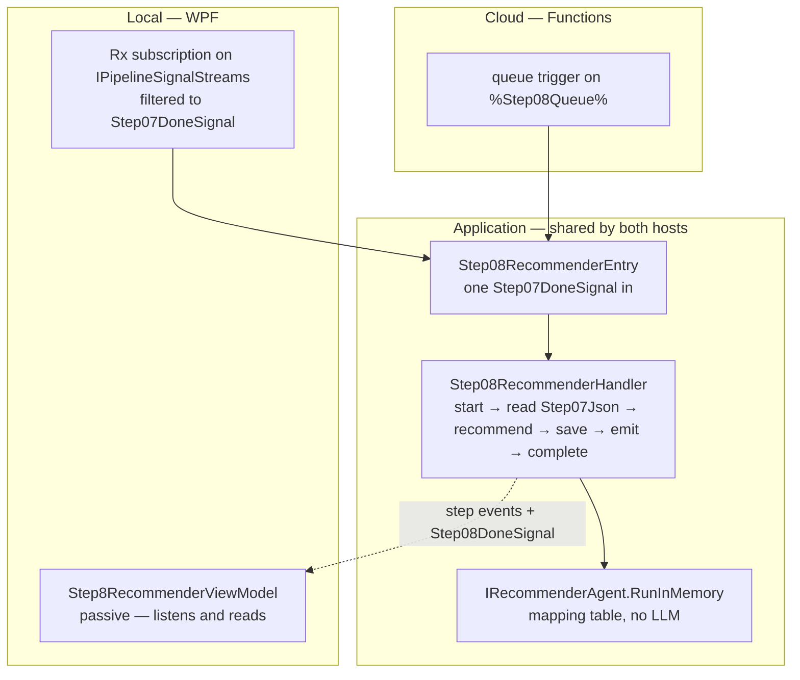
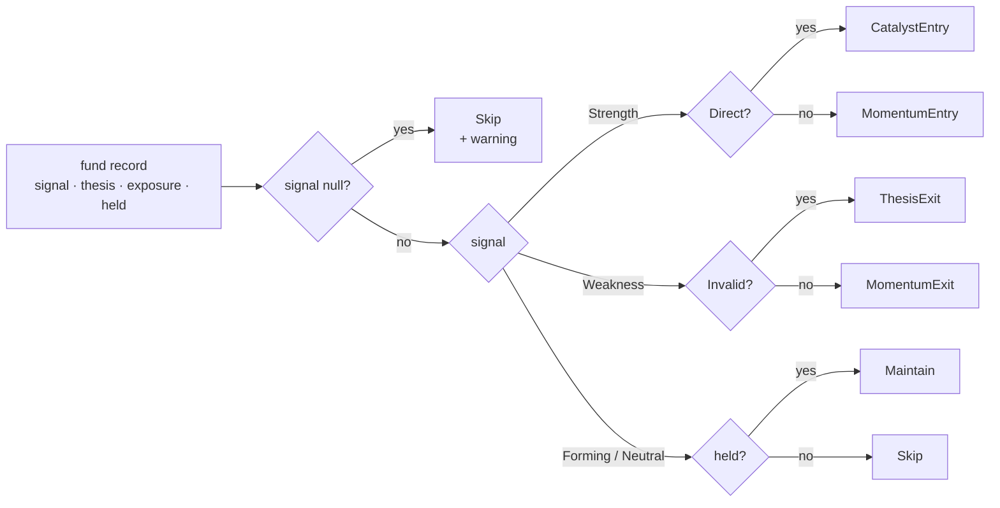
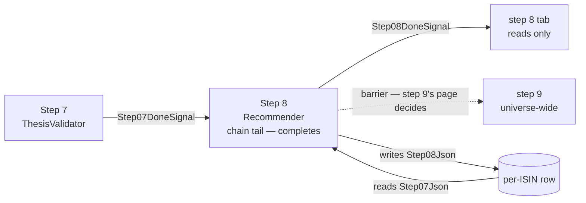

<!--
  Authoring rules: see README.md in this folder.
  STATUS: being built for the local (WPF) host, 2026-10-18 — see the ✅
  marks in "Proposed implementation order". Follows step 7's chain, so the
  trigger and the input column are not new choices. Code-only, so there is
  no LLM client and no client logging row. Decided 2026-10-18, as
  proposed: a synchronous domain-input RunInMemory, as step 4; no rule
  change for Weakness + Valid or Strength + Invalid; step 7 gives up the
  tail in its own commit; the debug button goes through the handler;
  logging in the handler, the agent stays logger-free. The open questions
  are at the end.
-->

# Step 8 — Recommender

> **Related:**
>
> - The cross-cutting design this follows from:
>   [event-driven-orchestration-plan.md](./event-driven-orchestration-plan.md)
> - The step this one follows, and the chain it joins:
>   [07-thesisvalidator.md](./07-thesisvalidator.md)
> - The code-only step whose agent call it copies:
>   [04-signalscorer.md](./04-signalscorer.md)
> - What this step does **today** — the mapping table, the vocabulary,
>   failure modes, test fixtures:
>   [08-recommender.md](../../FikaFinans.InfrastructureV2.Tests/docs/08-recommender.md)

`StepId.Recommender`, implemented by `RecommenderAgent` behind
`IRecommenderAgent`, surfaced in the desktop app as
`Step8RecommenderViewModel`. This page covers only what the move to
signal-driven, per-fund processing changes.

Step 8 is the smallest step in the chain. It has **one input** — the
fund's record from step 7 — and no context, no config, no prompts and
**no LLM**: a switch over four fields picks one of six recommendations.
The work is already per-fund: `PipelineRunner` calls `ProcessFund` once
per fund. It is step 7's handler with the model call taken out, or step
4's with the config taken out.

## What step 8 needs from step 7

### Trigger

[`Step07DoneSignal`](../../FikaFinans.Application/Pipeline/Signals/Step07DoneSignal.cs)
— one per fund, emitted after `Step07Json` is written.

| Field | Step 8 uses it to |
| --- | --- |
| `Isin` | name the fund — log lines, step events, the row `Step08Json` lands on |
| `NavDate` | the week stamped on the output; carry the trading date forward onto its own done-signal |
| `RunId` | read `Step07Json` for this run only — and tell a late signal from a live one |

Not a new choice: the chain is linear (step 3's decision B), and step
7's page named step 8 as its natural consumer. With this page, step 7's
"who consumes it" question is answered.

### Input — `Step07Json` on the fund's row

One `FundRecord`, read back by run id.

| Part of the record | Read | What for |
| --- | --- | --- |
| `Signal` | yes | the switch's first key; null short-circuits to Skip with a warning |
| `ThesisValidity` | yes | splits Weakness into ThesisExit / MomentumExit; named in Strength's reason |
| `Catalyst.ExposureType` | yes | Direct splits Strength into CatalystEntry; Indirect and none fall through |
| `CurrentlyHeld` | yes | splits Forming and Neutral into Maintain / Skip |
| everything else | no | copied through — append-only |

Step 8 writes `Recommendation` and `RecommendationReason`, and nothing
else.

### The portfolio-wide fields

`RecommenderAgent.RunInMemory` copies `FrozenPositions` and
`CashAvailableKr` from its input envelope. **No rule reads them** — they
are carried for step 10, the only reader. A per-fund record never had
them: every domain-input call since step 2 leaves them empty, and the row
stores funds, not the envelope. So step 8 changes nothing here; how step
10 gets them back is step 10's page.

## Names

Every new type carries the step number. All *(new)*:

| Role | Step 7 (exists) | Step 8 *(new)* |
| --- | --- | --- |
| Handler interface | `IStep07ThesisValidator` | `IStep08Recommender` |
| Handler | `Step07ThesisValidatorHandler` | `Step08RecommenderHandler` |
| Entry point | `IStep07ThesisValidatorEntry` + `Step07ThesisValidatorEntry` | `IStep08RecommenderEntry` + `Step08RecommenderEntry` |
| Done-signal | `Step07DoneSignal` | `Step08DoneSignal` |
| Config provider | — | — no config; "None. Pure deterministic mapping." in the contract |
| Context read | — | — |
| LLM client | `IThesisRefinementLlmClient` | — none |
| Agent call | `IThesisValidatorAgent.RunInMemoryAsync` | `IRecommenderAgent.RunInMemory` — **synchronous**, domain inputs; see "Agent work" |
| Cloud function | `Step07ThesisValidatorFunction` *(sketch)* | `Step08RecommenderFunction` |
| Row — start | `StartStep07Async` | `StartStep08Async` |
| Row — complete | `CompleteStep07Async` — **removed** when step 8 takes the tail | `CompleteStep08Async` |
| Row — fail | `FailStep07Async` | `FailStep08Async` |
| Row — orphaned list | `ListOrphanedStep07Async` | `ListOrphanedStep08Async` |

## Sketch — the same step, two hosts

Illustrative only. Names marked *(new)* do not exist yet; queue names are
owned by [backend-nav-sync-plan.md](../backend-nav-sync-plan.md).

### What is the same in both hosts

| Interface | Current | WPF | Cloud |
| --- | --- | --- | --- |
| `IPipelineSignalStreams` | `LocalRxPipelineSignalBus` — steps 2–7's work subscriptions, the tabs' reads | same bus — plus the step 8 subscription | — nothing subscribes |
| `IPipelineSignals` | overloads for steps 1–7 | plus step 8's | queue publisher *(new)* |
| `IIsinProgressStore` | start / fail / orphaned for steps 1–7, complete for step 7 | plus step 8's; step 7 loses its complete | the same class over Tables |
| `IRecommenderAgent` | `Run` (button, runner's single step) and `ProcessFund` (runner) | plus the domain-input `RunInMemory`, called by the handler | same |

No config provider, no context store, no LLM client, no fetch seam.

### Handler shape

Step 7's, with the model call gone:

| Step 7 phase | Step 8 equivalent | Difference |
| --- | --- | --- |
| `BeginProcessingAsync` | start step 8 on the row | none |
| `LoadFundAsync` — `Step06Json` | `Step07Json` by run id | none |
| `AssembleAgentInputAsync` — no-op | no-op | none |
| `RunAgentAsync` — matrix, LLM on conflicting rows | `IRecommenderAgent.RunInMemory` | **synchronous** — wrapped in a completed task, as step 4's |
| `PersistAsync` | `Step08Json` | same store call |
| `EmitDoneAsync` | `Step08DoneSignal` | new signal type, new overload |
| `CompleteAsync` / `FailAsync` | step 8's row methods | the tail moves here |
| `ReadOutputAsync` | same, `StepId.Recommender` | none |
| `ComputeOutputAsync` — the debug run | same, reading `Step07Json` | free — no model call |

### Where the code lives



### Local

```text
// sketch
pipelineSignals.Signals                          // IPipelineSignalStreams
    .OfType<Step07DoneSignal>()
    .Subscribe(done => RunStep08Async(step08Entry, done));   // (new)
```

### Cloud

```text
// sketch
[Function("Step08Recommender")]                  // (new)
public Task Run(
    [QueueTrigger("%Step08Queue%")] Step07DoneSignal signal,
    CancellationToken ct)
    => _step08Entry.HandleAsync(signal, ct);     // IStep08RecommenderEntry (new)
```

## Input trigger

`Step07DoneSignal` — fund identifier, trading date, run id. No payload.

| | Current | WPF | Cloud |
| --- | --- | --- | --- |
| Producer | — no signal; step 8 runs inside `PipelineRunner`'s per-fund block, or from the tab's button | `Step07ThesisValidatorHandler.EmitDoneAsync` → `IPipelineSignals` | the same handler, queue-backed publisher |
| Transport | the fund record, in memory | `LocalRxPipelineSignalBus` | `%Step08Queue%` |
| How the step is reached | `PipelineRunner` calls `ProcessFund` per fund | subscribe, filter to step 7 | **nothing subscribes** — the Functions host invokes per message |

Delivery is at-least-once:

| Arrives | Row says | Action |
| --- | --- | --- |
| Duplicate | same run id, `Step08Json` populated | run again — free, and the same answer every time |
| Late | a different run id | drop it — step 8's start refuses it |

Step 8 is the first step since step 4 where a duplicate is byte-identical
apart from the timestamp: no model, so nothing to answer differently.

### Start, do not claim

Same as steps 2–7: a check and a mark, never a clear. Moves
`CurrentStep` to 8.

### Manual trigger — WPF only

**Proposed, as steps 2–7: the debug button goes through the handler** —
`ComputeOutputAsync` reads `Step07Json` for the run bar's run, runs the
agent, stores nothing.

## Input data — what the step reads

| Input data | Current | WPF | Cloud |
| --- | --- | --- | --- |
| **Step 7's fund record** | the in-memory record (runner) or `07-thesis-…json` (button) | `Step07Json`, by run id | same, Tables |

That closes the item step 7's page left here: `RecommenderAgent.Run`
stops being the way step 8 reads step 7. It keeps reading the file for
the runner's single-step path, the same limitation every earlier step's
file readers have.

## Pre-processing — assemble the agent input

Nothing to assemble. All four keys arrive on the record.

## Agent work

Code only. Contract:
[08-recommender.md](../../FikaFinans.InfrastructureV2.Tests/docs/08-recommender.md).
The mapping table, the null-signal Skip and the reasons do not change.



**Proposed: a domain-input `RunInMemory` on `IRecommenderAgent`, kept
synchronous** — company, week, run id, fund records in; a
`DataLoaderOutput` out. Step 4's shape, not steps 5–7's: the agent awaits
nothing, so an async signature would only wrap a finished result. The
handler wraps it the way step 4's does.

| | Step 4 | Step 7 | Step 8 |
| --- | --- | --- | --- |
| In-memory call | `ISignalScorerAgent.RunInMemory` | `IThesisValidatorAgent.RunInMemoryAsync` | `IRecommenderAgent.RunInMemory` |
| Sync / async | sync | async | **sync** |
| Inputs | company, week, run id, records, config | company, week, run id, records | company, week, run id, records — **no config** |
| Portfolio-wide fields | left empty | left empty | left empty |
| Uses `_paths` | no | no | no — only `Run` does |
| Returns | a one-fund `DataLoaderOutput`, warnings in `DataQuality.Warnings` | same | same |

The existing `RunInMemory(DataLoaderOutput)` on the class stays for `Run`,
which `PipelineRunner` still calls. Two methods named `RunInMemory` on one
class differ only by their parameters — the same as on step 4's agent.

### Where the warnings go

As steps 4–7: the envelope does not reach the row, so **the handler logs
each warning**. Step 8 produces one today — "null signal".

### Logging — in the handler, not the agent

Steps 6 and 7 each spent a row giving their Foundry client a logger
before the chain reached it. Step 8 has no client, so there is no such
row — and no outage path: the step can fail only on a missing record or a
store error. The logging still has to exist, and it lives where step 7's
does:

| Where | Logs | Level |
| --- | --- | --- |
| Handler — every phase | begin / done per phase, as step 7's handler | Debug |
| Handler — the verdict | one line per fund: signal, thesis, exposure, held → recommendation and reason | Debug, as step 7's verdict line |
| Handler — each agent warning | today only "null signal" | Warn |
| Handler — a late signal, an orphaned run failed, the debug run's summary | as step 7's | Info |
| Handler — a phase that throws | with the exception, before `Failed` is reported | Error |
| Entry point's subscription in `MainWindowViewModel` | a handler crash, caught and logged, as `RunStep07Async` | Error |
| `RecommenderAgent` | **nothing** — stays logger-free, a pure mapping like steps 4 and 7's agents; its warnings come back in the output for the handler to log | — |

With no model to trace, the verdict line is the whole audit trail of a
signal-driven run — so it carries the reason string, not only the
label. The handler's logger name starts with `Step0`, so NLog.config
already routes it to `logs/pipeline.log`; no config change.

### Combinations the table does not list

The contract's mapping table says "all combinations are exhaustive", but
step 7 can now produce two pairs it does not list. Both come from the
LLM's one-step move on a conflicting row:

| Pair | How step 7 produces it | What step 8 does today |
| --- | --- | --- |
| Weakness + **Valid** | Weakness, no catalyst, Strong macro → baseline Partial, LLM moves it up one | **MomentumExit**, reason *"Weakness + Partial thesis — …"* — the reason names a thesis the fund does not have |
| Strength + **Invalid** | Strength, catalyst, Partial/None macro → baseline Partial, LLM moves it down one | CatalystEntry or MomentumEntry — an entry on a thesis step 7 called broken; the reason does name it |

Neither is a crash: the switch's fall-throughs catch both. Whether they
are *right* is a rule question for the contract, not for this redesign.
**Proposed: no rule change here** — raised as an open question.

## Post-processing — write and emit

| Written | Current | WPF | Cloud |
| --- | --- | --- | --- |
| This fund's recommended record | `Step08Json` via the gateway's block write (runner), or `08-recommendation-…json` (button) | `SaveStepOutputAsync` with `StepId.Recommender` → `Step08Json` | same — Tables |
| Row freed | once, at the end of the Run All pass | `CompleteStep08Async` / `FailStep08Async` — step 8 becomes the tail | same |

### Complete and fail — the tail moves, and step 7 changes

The same move as every step before — **and it changes step 7's code**:

| Before | After |
| --- | --- |
| `CompleteStep07Async` frees the row and advances the anchor | removed, with step 7's `CompleteAsync`; step 7's entry point stops calling it |
| — | `CompleteStep08Async`, called by step 8's entry point after its emit |
| — | `FailStep08Async` |

Step 7 keeps its done-signal and its `Succeeded` step event; only the row
release moves. **Proposed, as before: that change is its own commit.**

### Orphaned runs

Same rule as steps 1–7, local only: step 8's tab recovers the runs
orphaned at step 8 when first opened in a session. The agent call is
synchronous and finishes in microseconds, so a run orphaned *at* step 8
means the process ended between start and save — rare, but the recovery
costs nothing to keep consistent.

### Emit

`Step08DoneSignal` — fund identifier, trading date, run id, no payload.

### Who consumes it

**Nobody, yet — and this is where the per-fund chain stops.** Step 9
(UniverseEnricher) is a **universe-wide barrier**: it ranks and pairs
across every fund's recommendation, so one fund's signal is not enough
to run it. How step 9 learns that "all funds are in" is step 9's page —
the README already marks its translation unresolved.



So step 8 is likely the **last** tail move: whatever step 9 turns out to
be, it is not one more link that takes a fund's row from step 8.

### Readers of the step 8 file

`UniverseEnricherAgent.RunAsync` and `FundDetailViewModel` read
`08-recommendation-{iso_week}-{run_id}.json` from disk. A signal-driven
run writes no file. Step 9's page owns UniverseEnricher's read — it reads
every fund's record, which is the barrier question again.

## What a frontend reads when the user opens the view

Same as step 7's tab:

| The tab | Does |
| --- | --- |
| Listens to step events | filtered to `StepId.Recommender` |
| Listens to `Step08DoneSignal` | to learn the run id, then reads that run's output |
| Reads | through the step 8 handler's `ReadOutputAsync` |
| Runs | nothing on a signal — only the debug button, through the handler |

`Step8RecommenderViewModel` today holds the agent, `IPathsService` and
`IIsinProgressRepository`, reads through `IsinProgressOutputLoader` with a
disk fallback, and runs `Run` on the button. All of that leaves the tab.
No XAML changes.

## Settled before building

All decided 2026-10-18, as proposed.

| # | Choice | Decided |
| --- | --- | --- |
| 1 | Agent call | a domain-input `RunInMemory` on `IRecommenderAgent`, **synchronous**, as step 4 — not async as steps 5–7 |
| 2 | Weakness + Valid, Strength + Invalid | no rule change; open question for the contract |
| 3 | The tail move | step 7 gives up the tail in its own commit |
| 4 | The debug button | through the handler |
| 5 | Logging | in the handler, step 7's levels, the verdict line carrying the reason; the agent stays logger-free |

## Proposed implementation order

One change per row, each reviewed and committed before the next. Step
7's order minus the client row.

| # | Work | Touches | Blocked on |
| --- | --- | --- | --- |
| 1 | ✅ `Step08DoneSignal` and its overload | `Pipeline/Signals`, `LocalRxPipelineSignalBus` | — |
| 2 | ✅ Domain-input `RunInMemory` onto `IRecommenderAgent` — `ProcessFund` per record, wrapped, warnings into the output, portfolio fields empty. No rule change. Tests in a new file beside `RecommenderAgentTests` | `IRecommenderAgent`, `RecommenderAgent`, a new test file | choice 1 |
| 3 | ✅ `StartStep08Async`, `CompleteStep08Async`, `FailStep08Async`, `ListOrphanedStep08Async` | `IIsinProgressStore`, `RepositoryBackedIsinProgressStore` | — |
| 4 | ✅ `IStep08Recommender` + handler, step 7's shape with a synchronous agent call. Not wired. Logging per "Logging — in the handler": Debug per phase, a Debug verdict line per fund with signal, thesis, exposure, held, recommendation and reason, Warn per agent warning, Error per failed phase; `CompleteAsync`, `ReadOutputAsync`, `ComputeOutputAsync` included | Application, `Pipeline/Steps` | rows 1, 2, 3, choice 5 |
| 5 | ✅ `IStep08RecommenderEntry` + entry point; registration as step 7's | Application, `InfrastructureModule` | row 4 |
| 6a | **Step 7 gives up the tail** — `CompleteStep07Async`, step 7's `CompleteAsync` and the entry's call removed; complete tests move to step 8 | step 7's handler, entry point and tests, `IIsinProgressStore` | row 5, choice 3 |
| 6b | Subscription `Step07DoneSignal` → step 8's entry point, `RunStep08Async` catching and logging as step 7's | `MainWindowViewModel` | 6a |
| 7 | Step 8's tab goes passive, shaped like step 7's | `Step8RecommenderViewModel`, no XAML | row 6b, choice 4 |

Rows 6a and 6b go in back to back: between them a fund's run would
finish at step 7 and step 8 would never be reached — harmless, since
nothing triggers step 8 until 6b.

## Open questions

Raised by this page; they belong in the parent plan's Open Questions,
not settled here.

- **Weakness + Valid and Strength + Invalid.** Step 7's one-step rule
  lets the LLM produce both; the contract's "exhaustive" table lists
  neither. Today the first exits with a reason naming the wrong thesis,
  the second enters on a thesis called broken. A rule question for the
  contract.
- **How step 9 learns that every fund is in.** Step 8's done-signal is
  per fund; step 9 needs the universe. Step 9's page.
- **Where the portfolio-wide fields come back.** No per-fund record
  carries frozen positions or cash; step 10 reads them. Step 10's page.
- **Where the warnings go** once the envelope question on step 2's page
  is answered. Logged until then.
- **Carried over unchanged:** the cloud host, orphaned-run recovery in
  cloud, step outputs too large for Tables, the fresh-handler factory,
  how the envelope is stored — all on step 2's page; step 6's verdict
  instability, which reaches step 8 through step 7's thesis — on step 6's
  and step 7's pages.
