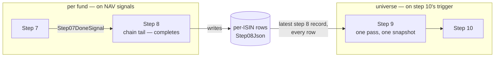

<!--
  Authoring rules: see README.md in this folder.
  STATUS: design, 2026-10-19 — nothing built, and the shape is not settled.
  Step 9 is the first step that cannot be one more link in the per-fund
  chain: most of its work compares a fund with every other fund. This page
  answers the parent plan's barrier question for step 9 the way step 3's
  page answered it for step 3 — by asking what the step actually reads.
  The choices are in "To settle before building"; the open questions are
  at the end.
-->

# Step 9 — UniverseEnricher

> **Related:**
>
> - The cross-cutting design this follows from, and its "barrier steps
>   versus the queue chain" open question:
>   [event-driven-orchestration-plan.md](./event-driven-orchestration-plan.md)
> - The step before it, which stays the per-fund chain's tail if step 9
>   leaves the chain: [08-recommender.md](./08-recommender.md)
> - The other barrier, and how its page settled the same question:
>   [03-macroanalyst.md](./03-macroanalyst.md)
> - The queue layout that draws step 9 as a per-fund hop, and step 10's
>   daily timer: [backend-nav-sync-plan.md](../backend-nav-sync-plan.md)
> - What this step does **today** — the four passes, conviction scoring,
>   rank, alternatives, rotation pairing, failure modes:
>   [09-universeenricher.md](../../FikaFinans.InfrastructureV2.Tests/docs/09-universeenricher.md)

`StepId.UniverseEnricher`, implemented by `UniverseEnricherAgent` behind
`IUniverseEnricherAgent`, surfaced in the desktop app as
`Step9UniverseEnricherViewModel`. This page covers only what the move to
signal-driven, per-fund processing changes — and, for step 9, whether it
moves at all.

Step 9 is hybrid: code scores, pairs and ranks; an LLM writes one-line
differentiators for each Buy's alternatives. Unlike every step before
it, **most of its work needs the other funds**. `PipelineRunner` runs it
once over the whole universe, after the per-fund block.

## What step 9 reads

### The four passes, by scope

The contract runs four passes. Only one of them is about one fund:

| Pass | Needs | Scope |
| --- | --- | --- |
| 1 — rotation pairing | every fund's recommendation and matched theme — a theme pairs when it holds an Exit **and** an Entry | **universe** |
| 2 — alternatives + LLM differentiators | every fund in the Buy's category, ranked by Sharpe 12w | **universe** (peers), one LLM call per Buy |
| 3 — conviction, four of five components | the fund's own signal, metrics, macro alignment, thesis | per fund |
| 3 — conviction, universe context | whether pass 1 paired the fund, or pass 2 found it peers | **universe** |
| 4 — universe rank | every fund with the same recommendation, by conviction | **universe** |

So the per-fund part is four arithmetic components. Everything that
makes step 9 *step 9* — pairs, peers, context, rank — is a statement
about the fund relative to the rest.

### What reads step 9's output

| Reader | Reads |
| --- | --- |
| `PortfolioConstructorAgent` (step 10) | `ConvictionScore` — gates and sizes trades; `RotationPairId` — flags a pair executed on one leg |
| `PortfolioConstructorAgent` | **not** `UniverseRank`, although step 10's contract says step 10 uses it to pick which Buys to fund and which Sell to take; today it scales Buys proportionally |
| `Step9UniverseEnricherViewModel` | the whole output — the signals chart |
| `FundDetailViewModel` | step 9's file, for one fund |

Step 10 is itself universe-wide: it sizes trades against the whole
portfolio's cash. Every consumer of step 9 that acts on it is.

## What "the universe" is under signal-driven runs

Under `PipelineRunner`, the universe is the run: every fund went through
steps 1–8 together, under one run id, for one week. Under signal-driven
processing none of that holds:

| | `PipelineRunner` | Signal-driven |
| --- | --- | --- |
| Run id | one for the universe | one per fund — step 1 mints it |
| Week | one | each fund's own trading date |
| "Every fund is done" | after the per-fund block | **never** — NAV signals arrive one fund at a time, any day |
| A fund mid-run | — | its step 2–8 columns are empty: step 1's claim clears them |
| A fund whose latest run failed | the run halts | its later columns are empty until a retry succeeds |

So the only universe there ever is, is **a snapshot of the rows**: every
fund whose latest run reached step 8, each at its own date, read at some
moment. Which moment is the real question — and it is the same question
step 10 already answers with its daily timer in
[backend-nav-sync-plan.md](../backend-nav-sync-plan.md).

`ReadStepOutputAsync` cannot take that snapshot today: it reads one run's
records by run id, and a universe spans many runs. Any shape below needs
a new read — "the latest step 8 record on every row" *(new)*.

## Four shapes

| | A — per-fund hop, reads the universe | B — split: per-fund 9a, universe 9b | C — leaves the chain, runs with step 10 | D — fan-in barrier |
| --- | --- | --- | --- | --- |
| Triggered by | `Step08DoneSignal`, per fund | 9a: `Step08DoneSignal`; 9b: step 10's trigger | step 10's trigger | "every fund finished step 8" |
| Computes for | the one fund, against the snapshot | 9a: the four per-fund components; 9b: pairs, peers, context, rank | every fund, against one snapshot | every fund |
| Ranks and pairs | **inconsistent** — see below | consistent | consistent | consistent |
| LLM differentiator calls | one per Buy, per Buy's own run | one per Buy, per 9b run | one per Buy, per run | — |
| Chain tail | step 9 | step 9a | **step 8 stays** | — |
| Matches the queue layout | yes — `step08-done` → step 9 as drawn | half | no — `step08-done` has no consumer | no |
| Fits signal-driven runs | yes | yes | yes | **no** — there is never an "every fund" |

D is listed only to rule it out, as step 3's page ruled out its own.

### Why A does not work for step 9

Step 3 could be a per-fund hop because its output depends on the week,
not on the funds. Step 9's output depends on the funds — so computing it
per fund, at each fund's own moment, gives every fund a different
universe:

| Problem | Example |
| --- | --- |
| Ranks collide | fund X runs Monday, ranks 1 of 2 MomentumEntries; fund Y runs Tuesday with higher conviction, ranks 1 of 3. X still says 1. Two "rank 1"s, nothing ever refreshes X |
| Pairs are one-sided | an energy Exit runs Monday with no energy Entry yet — unpaired, universe context 0. The Entry runs Tuesday, sees the Exit, gets a pair id and context 1.0. The Exit never learns it was paired |
| Pair ids clash | `rot_{week}_{letter}` letters are handed out by bucket size across the whole universe; two funds computed on different days can be given the same letter for different themes |
| Conviction drifts with arrival order | universe context is 15% of conviction, so the same fund scores differently depending on who ran before it |

Each of these is a property of the *set*, so no per-fund computation can
fix it. Step 10, reading these records, would ration cash on numbers
that disagree with each other.

### B or C

Both keep the set-wide work in one pass over one snapshot. They differ in
whether anything is left worth doing per fund:

| | B | C |
| --- | --- | --- |
| Per-fund hop | 9a — four arithmetic components, no LLM, no peers | none |
| What 9a saves the universe pass | four switch statements per fund | — |
| Types | two handlers, two signals, two tabs' worth of wiring | one handler |
| Conviction | split across two writes — 9a's partial, 9b's final | one write |

The pipeline-step-flow plan floated the 9a/9b split for streaming's
sake. Under signal-driven runs there is no stream to keep moving: the
per-fund part is too small to earn its own hop.

**Proposed: C.** Step 9 leaves the per-fund chain and runs as one
universe pass over the rows, on the same trigger as step 10. This
answers the parent plan's barrier question for step 9 only — and
disagrees with the queue layout in
[backend-nav-sync-plan.md](../backend-nav-sync-plan.md), which draws
`step08-done` → step 9. That layout predates this analysis; if C is
chosen, that plan is where the change belongs, not here.

**The rest of this page builds on C**, marking where A would differ.

## What C means for the chain

| | Today, after step 8's build | Under C |
| --- | --- | --- |
| Chain tail | step 8 | **step 8 — unchanged**; no tail move, as step 8's page expected |
| `Step08DoneSignal` | consumed by the step 8 tab only | the same — nothing does work on it |
| Step 9's trigger | the Run All button, inside `PipelineRunner` | step 10's — **owned by step 10's page**; see below |
| Step 9's input | the step 8 file, one run | the latest step 8 record on every row |

### The trigger belongs to step 10

Step 9 has nothing to run on except "it is time to look at the whole
universe" — and that moment exists only because step 10 needs it. So
step 9 does not choose its trigger; it runs immediately before step 10,
on whatever step 10's page decides. In cloud that is the daily timer
the backend plan already describes; locally there is no timer today.

Until step 10's page exists, step 9 can be built and run from its tab —
see "Manual trigger" below — but not wired to anything automatic.

## Names

Under C there is no done-signal to consume, so step 9 does not get an
entry point shaped like steps 2–8's. Its handler is universe-scoped.

| Role | Step 8 (exists) | Step 9 under C *(new)* |
| --- | --- | --- |
| Handler interface | `IStep08Recommender` | `IStep09UniverseEnricher` — universe-scoped phases |
| Handler | `Step08RecommenderHandler` | `Step09UniverseEnricherHandler` |
| Entry point | `IStep08RecommenderEntry`, one signal in | — none until step 10's trigger exists; the tab calls the handler |
| Done-signal | `Step08DoneSignal`, per fund | open — see "Emit" |
| Config provider | — | `IStep09ConvictionConfigProvider`, as step 4's — see "Config" |
| Store read | `ReadStepOutputAsync`, by run id | plus "latest step 8 record on every row" |
| Row methods | start / complete / fail / orphaned | — **none**: step 9 claims no fund's row |
| Agent call | `IRecommenderAgent.RunInMemory` | `IUniverseEnricherAgent` — a domain-input universe call |

### No row methods

Every step so far started, completed or failed **one fund's row**. A
universe pass holds no fund's row — the funds it reads are free, between
runs, or mid-run (and then invisible, since their columns are clear). So
there is nothing to start, nothing to free and nothing to orphan. A
failure fails the pass, not a fund: logged, reported as a step event,
and retried on the next trigger.

## Input data — what the step reads

| Input data | Current | Under C, WPF | Under C, cloud |
| --- | --- | --- | --- |
| **Every fund's step 8 record** | `08-recommendation-…json`, one run (button), or the in-memory output (runner) | the latest `Step08Json` on every row *(new read)* | same, Tables — a partition scan |
| **The conviction config** | **never read** — see "Config" | `config-09-conviction.json` through a provider | app settings or a blob — open |
| **Foundry project + model id** | settings, `az login` | unchanged | app settings, managed identity |

### Which records count

| Row | In the snapshot |
| --- | --- |
| Free, latest run finished | yes — its `Step08Json` |
| Free, latest run failed before step 8 | **no** — the claim cleared `Step08Json`, and the failed run never refilled it |
| Processing | **no** — same reason |
| Never run | no |

The same rule the backend plan gives step 10 for `Step09Json`: a fund is
represented by its last *completed* run, or not at all. It also means a
fund that keeps failing quietly drops out of the portfolio's view —
raised as an open question.

### Mixed weeks

Each record carries its own fund's week. The pair id embeds a week
(`rot_{iso_week}_{letter}`): under C, the week of the pass, not of any
one fund. A record from a fund whose last run was weeks ago still pairs
and ranks against this week's records — the backend plan's stated trade
for step 10, inherited here.

## Agent work

Hybrid. Contract:
[09-universeenricher.md](../../FikaFinans.InfrastructureV2.Tests/docs/09-universeenricher.md).
The four passes, the weights check, the scoring rules, the tie-breaks
and the LLM degradation do not change.

`UniverseEnricherAgent.RunInMemoryAsync` already takes a whole
`DataLoaderOutput` and returns one — it is close to what a universe pass
needs, but it copies its envelope (week, run id, family, portfolio
fields) from the input, and under C there is no one input envelope.
**Proposed: a domain-input `RunInMemoryAsync`** — company, week, the
records, the config — stamping the week of the pass, as steps 4–8's
domain-input calls stamp theirs. The current one stays for `RunAsync`.

### Config — the file is never read

`config-09-conviction.json` is seeded at startup and editable from step
9's tab — `HasConfig` is true — but **no code reads it**. Autofac builds
`UniverseEnricherAgent` through its two-argument constructor, which uses
`UniverseEnricherConfig.Default`. An edit to the weights changes nothing.

**Proposed: a config provider, as step 4's** — read per pass, so an edit
takes effect on the next run, and the weights check fails the pass, not
the app. Step 4's page settled the same pattern for `config-04-signals`.

### The LLM client is silent — the same fix as steps 6 and 7

`FoundryDifferentiatorLlmClient` has no logger, as steps 6 and 7's
clients had none before their logging rows. The agent catches its
failures and warns into the output, so an outage leaves empty
differentiators and one warning line per Buy — but no trace of *why*.

**Proposed: the same treatment, as its own row** — Debug per call and
per answer, Warn per failure, the caller's cancellation rethrown. Return
values unchanged.

### The LLM call per run

| | Step 7 | Step 9 |
| --- | --- | --- |
| Calls | 0 or 1 per fund | 1 per Buy with at least one peer, per pass |
| Typical count | small — conflicting rows only | small — Buys are a minority of a normal week |
| Repeats | once per NAV signal | **once per pass, whether or not the Buy changed** — a daily trigger repeats yesterday's calls for unchanged funds |

The repeat is new: earlier steps called the LLM when a fund's own NAV
moved. A cache keyed on (Buy, peers, their metrics) would avoid it — not
proposed; it joins the cache question steps 5–7 already raised.

### Logging

As step 8's page set out, in the handler: Debug per phase; one Debug line
per **ranked** fund — recommendation, conviction, rank, pair id; Warn per
agent warning; Error per failed phase; Info per pass with the snapshot's
size and how many rows were skipped as mid-run or failed. The agent stays
logger-free.

## Output

| Written | Current | Under C |
| --- | --- | --- |
| Each fund's enriched record | `Step09Json` via the gateway's write after the universe pass (runner), or `09-enrichment-…json` (button) | open — see below |
| Rows freed | — step 9 never held one | — |

### Where the output goes

| | Per-row `Step09Json` | Handed to step 10 in memory |
| --- | --- | --- |
| Step 10 reads | the rows — as the backend plan already says | the pass's result |
| A fund's record shows its conviction | yes, on its row — the tab and the fund detail read it there | only through step 10's output |
| Writes per pass | one per fund in the snapshot | none |
| Overwrites | `Step09Json` on rows whose run finished long ago — step 9's column no longer belongs to the row's run | — |

**Proposed: per-row `Step09Json`**, written by the pass for every fund in
the snapshot. It keeps "one row tells you everything about a fund" and
matches what the backend plan has step 10 reading. The overwrite is the
cost: the column is stamped by the pass, not by the fund's run, which
`SaveStepOutputAsync`'s "names the run that produced it" contract does
not describe today — a new save *(new)*, or a decided exception.

### Emit

Under C nothing per fund follows step 9 — step 10 runs straight after,
in the same trigger. A universe-scoped done-signal would have one reader:
step 9's tab. The empty `IStepDoneSignal` marker was left empty for
exactly this case, per the parent plan's 2026-08-25 decision.

**Proposed: decide on step 10's page.** Whether "step 9 is done" is a
signal, a phase inside one daily job, or a queue between two Functions
depends on how step 10 is triggered.

## Manual trigger — WPF only

Every earlier tab's button is a debug run: computes, stores nothing. For
step 9 under C, until step 10 is wired, the button is the **only** way
the step runs at all.

| | Debug, as steps 2–8 | Stored |
| --- | --- | --- |
| Button computes over the snapshot | yes | yes |
| Writes `Step09Json` | no | yes |
| Before step 10 is wired | step 9 never stores anything | step 9 works end to end from the tab |

**Proposed: a stored run from the button, until step 10's page gives
step 9 a trigger** — then the button goes back to debug, as the others.

## What a frontend reads when the user opens the view

| The tab | Today | Under C |
| --- | --- | --- |
| Reads | `Step09Json` by the run bar's run id, disk fallback | the latest `Step09Json` on every row — a universe, not a run |
| Runs | `IUniverseEnricherAgent.RunAsync` over the run bar's step 8 file | the handler's universe pass |
| Chart | signals chart from the funds | unchanged |
| Config editor | edits a file nothing reads | edits the file the provider reads |
| Run bar | picks the run | **does not apply** — step 9 is no longer one run's |

`FundDetailViewModel` reads the step 9 file from disk, as it reads step
8's. Not changed here.

## To settle before building

| # | Choice | Proposed |
| --- | --- | --- |
| 1 | The shape | **C** — step 9 leaves the per-fund chain; one universe pass, on step 10's trigger; step 8 stays the tail |
| 2 | What the universe is | the latest `Step08Json` on every row; mid-run and failed-latest-run funds absent |
| 3 | Config | a provider, as step 4's; the file starts being read |
| 4 | The LLM client | gets steps 6 and 7's logging, as its own row |
| 5 | Agent call | a domain-input universe `RunInMemoryAsync`, stamping the pass's week |
| 6 | Output | per-row `Step09Json`, stamped by the pass |
| 7 | The button | a stored run until step 10 gives step 9 a trigger |
| 8 | Done-signal | decided on step 10's page |

## Proposed implementation order

Only if choice 1 is C. One change per row, each reviewed and committed
before the next.

| # | Work | Touches | Blocked on |
| --- | --- | --- | --- |
| 1 | `IStep09ConvictionConfigProvider` + JSON-backed provider, as step 4's | Application `Pipeline/Configs`, Infrastructure, registration | choice 3 |
| 2 | `FoundryDifferentiatorLlmClient` gets a logger — Debug per call and answer, Warn per failure, cancellation rethrown; return values unchanged | the client, its registration, its integration test's construction | choice 4 |
| 3 | Store read: the latest step 8 record on every row, skipping rows without one; and the save that stamps a pass, not a run | `IIsinProgressStore`, `RepositoryBackedIsinProgressStore` | choices 2, 6 |
| 4 | Domain-input universe `RunInMemoryAsync` on `IUniverseEnricherAgent`, config passed in. No rule change | `IUniverseEnricherAgent`, `UniverseEnricherAgent`, a new test file | choice 5 |
| 5 | `IStep09UniverseEnricher` + handler — read the snapshot, load the config, run, save per row, report; logging as above. Not wired | Application, `Pipeline/Steps`, registration | rows 1, 3, 4 |
| 6 | Step 9's tab calls the handler — stored run, reads the latest `Step09Json` on every row, run bar ignored | `Step9UniverseEnricherViewModel` | row 5, choice 7 |
| — | Automatic trigger | — | **step 10's page** |

No tail move and no subscription — the two rows every earlier step
needed.

## Open questions

Raised by this page; they belong in the parent plan's Open Questions,
not settled here.

- **Step 9's shape — the barrier question.** Proposed C above; until it
  is settled, the parent plan's "barrier steps versus the queue chain"
  stays open for step 9. If C is chosen,
  [backend-nav-sync-plan.md](../backend-nav-sync-plan.md)'s queue layout
  loses `step08-done` and its "step 9 is the per-ISIN terminal step".
- **Step 10 does not read `UniverseRank`.** Its contract says ranks
  decide which Buys are funded first and which Sell is taken; the code
  scales Buys proportionally. Either the contract or the code is wrong —
  step 10's page.
- **Funds that keep failing drop out of the portfolio's view.** A fund
  whose latest run failed has no step 8 record, so neither step 9 nor
  step 10 sees it — even if it is held. A held fund disappearing from
  the trade view is the case that matters.
- **`Step09Json` no longer belongs to the row's run.** Under C the pass
  stamps it. Whether that needs its own column semantics, or step 9's
  output belongs off the per-ISIN row altogether, sits with step 10's
  output question in the backend plan.
- **Repeated LLM calls for unchanged Buys.** Joins the cache question on
  steps 5–7's pages.
- **Where the conviction config lives in cloud.** As for step 4's.
- **The portfolio-wide fields.** Step 9 copies frozen positions and cash
  through for step 10; no per-fund record carries them. Step 10's page,
  as step 8's page said.
- **Carried over unchanged:** the cloud host, step outputs too large for
  Tables, how the envelope is stored — on step 2's page; step 6's verdict
  instability, which now moves conviction and rank — on steps 6, 7 and
  8's pages.
