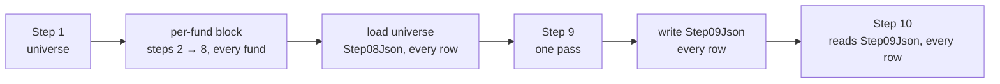
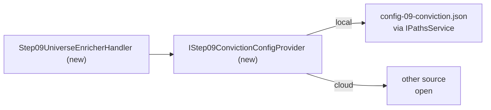

<!--
  Authoring rules: see README.md in this folder.
  STATUS: design, 2026-10-19 — nothing built. Step 9 is a universe-wide
  barrier: its contract takes every fund's step 8 record, and the code
  already runs it that way after the per-fund block. What signal-driven
  runs add is one question — how the barrier knows it has closed. The
  choices are in "To settle before building"; the open questions are at
  the end.
-->

# Step 9 — UniverseEnricher

> **Related:**
>
> - What every step stores and reads — the per-fund row and its
>   `Step01Json` … `Step09Json` columns, the row lifecycle, step
>   configuration: [pipeline-data.md](./pipeline-data.md)
> - The cross-cutting design this follows from, and its "barrier steps
>   versus the queue chain" open question:
>   [event-driven-orchestration-plan.md](./event-driven-orchestration-plan.md)
> - The step before it — the per-fund chain's tail:
>   [08-recommender.md](./08-recommender.md)
> - The queue layout, which draws step 9 as a per-fund hop, and step 10's
>   daily timer: [backend-nav-sync-plan.md](../backend-nav-sync-plan.md)
> - What this step does **today** — the four passes, conviction scoring,
>   rank, alternatives, rotation pairing, failure modes:
>   [09-universeenricher.md](../../FikaFinans.InfrastructureV2.Tests/docs/09-universeenricher.md)

`StepId.UniverseEnricher`, implemented by `UniverseEnricherAgent` behind
`IUniverseEnricherAgent`, surfaced in the desktop app as
`Step9UniverseEnricherViewModel`. This page covers only what the move to
signal-driven processing changes.

## A barrier

Steps 1–8 work on one fund at a time: a fund's record goes from
DataLoader to Recommender without looking at any other fund. Step 3 is
one shared run per week, but it does not depend on other funds either.

Step 9 is the first step that has to **wait for every fund** to get
through steps 1–8 before it can start. Its contract says so throughout:

| The contract | Says |
| --- | --- |
| Inputs | "All per-fund records with full context including recommendation" |
| What it does | starts from "all funds + recommendation" |
| Rotation pairing | a theme pairs when it holds an Exit **and** an Entry — across funds |
| Alternatives | peers in the Buy's category — other funds |
| Universe rank | `of_total_in_recommendation` — a count over the whole set |
| Evaluation rubric | is given "the full universe of fund records" |

Only four of the five conviction components are about one fund. Pairs,
peers, universe context and rank are statements about the set, so step
9 cannot run per fund — and it is not a per-fund hop in the queue sense,
whatever [backend-nav-sync-plan.md](../backend-nav-sync-plan.md)'s
layout draws.

## What the code does today

`PipelineRunner`'s streaming run already treats step 9 as a barrier:

| Piece | Exists as | Does |
| --- | --- | --- |
| The barrier | the runner's order: the per-fund block ends before step 9 starts | — |
| Universe read | `IStreamingPipelineGateway.LoadUniverseFromIsinProgressAsync`, with step 8 as source | reads every progress row's `Step08Json`, in step 1's fund order; **drops funds with no record** — "failed-fund case" |
| The pass | `IUniverseEnricherAgent.RunFromInputAsync` | the four passes over the loaded universe |
| Per-row write | `IStreamingPipelineGateway.WriteIsinProgressStep9Async` | `Step09Json` on every fund's row |
| Step 10 | the same universe read, with step 9 as source | — |

So under the runner: a failed fund does **not** hold the barrier — it is
dropped and step 9 runs on the rest.

### What does not carry over to signal-driven runs

| Piece | Why not |
| --- | --- |
| The barrier | there is no runner: funds arrive one at a time, any day, each with its own run id. Nothing says "the block is over" |
| The universe read's template | it takes the fund list, week, family and portfolio fields from **step 1's universe output**. A signal-driven step 1 writes one fund |
| The per-row write | it writes `State = Processing`, `CurrentStep = 9` and the runner's run id on every row — fine inside the runner, which releases the rows afterwards; under signal-driven runs it would **lock every fund** with nothing to free them |
| The pass's envelope | `RunFromInputAsync` copies week, run id and family from its input envelope; there is no one input envelope |

The agent's four passes carry over unchanged.

## When the barrier closes

The one new design question. Under signal-driven runs, "every fund is
through steps 1–8" has to be read off the rows.

`NavChangeDetector.DescribeAsync` already classifies every fund in the
universe — the company-filtered funds `ILatestNavProvider` returns, the
same set the NAV sync works from — against its row:

| Status | Row says | Through 1–8? |
| --- | --- | --- |
| `UpToDate` | anchor at or past the fund's latest trading date | **yes** — step 8's complete is what moves the anchor |
| `Processing` | in flight | no |
| `Changed` | latest trading date newer than the anchor | not yet — **or** its run failed: fail keeps the anchor |
| `New` | no anchor | never processed |

What the docs already settle:

| Question | Settled by |
| --- | --- |
| Which funds are the universe | `NavSyncOptions.CompanyFilter` — the funds whose company matches it, case-insensitive; empty means every fund. The NAV sync's `NavChangeDetector` and step 3's `IFundMetadataProvider.ListMetadataAsync` both apply it. ([pipeline-plan.md](../../FikaFinans.InfrastructureV2.Tests/docs/pipeline-plan.md)'s glossary still says "defined by `metadata.csv`" — the CSV-era wording of the same thing) |
| Step 9 needs all of it | the same plan, §4.9: "All fund records with recommendations (full universe required)" |
| A failed fund | [pipeline-step-flow-plan.md](../pipeline-step-flow-plan.md) "Error routing", resolved 2026-05-27: failed funds are dropped, "so downstream consumers see a smaller-but-clean universe" — the barrier does not wait for them |

One gap between `DescribeAsync`'s statuses and those rules: **a failed
fund reads `Changed`**, the same as one not yet started, so the status
alone cannot say "finished, failed". The row can — a fail leaves its
`NavDate` at the fund's latest trading date and sets `LastError`.

A fund whose NAV did not move is `UpToDate` already, with its last run's
record — through, matching step 10's rule in
[pipeline-data.md](./pipeline-data.md): a fund is represented by its last
completed run.

### Who checks, and when

**Decided 2026-10-19: two triggers — step 8's done-signal and a timer.**
Step 9 is its own entry point; each trigger checks whether the barrier
has closed and, if so, runs the pass.

| Trigger | Locally | In cloud | Catches |
| --- | --- | --- | --- |
| Step 8 done | `Step08DoneSignal` | the step 8 Function, after its complete | the normal case — the pass runs as soon as the last fund completes |
| Timer | a local timer *(new)*, once a day before step 10; **the Run All button** is the same call — it runs all funds | a timer-triggered Function *(new)*, once a day before step 10's 23:00 timer | barriers that closed **without** a step 8 completion |

**Decided 2026-10-19: the timer fires once a day, shortly before step
10.** It is a safety net for the day's trades: if the last fund fails in
the morning, step 9's output waits until the evening run — but nothing
acts on it before step 10 does. One run a day keeps the repeated LLM
calls to one extra pass at most.

Why the done-signal alone is not enough: `Step08DoneSignal` fires only
when a fund **succeeds** at step 8. A fund that fails at an earlier step,
or whose run is cleared by orphaned-run recovery, ends with no step 8
completion. If it is the last fund to finish, the barrier is closed — a
failed fund counts as finished — but nothing after it checks. The timer
does.

With two triggers, step 9 will often run twice over the same records —
the timer firing after the done-signal already ran it, or two step 8
completions both seeing the barrier closed.

**Decided 2026-10-19: run again and overwrite.** The second run sees the
same records, produces the same conviction, ranks and rotation pairs,
and overwrites `Step09Json` with them — step 10's rule in
[backend-nav-sync-plan.md](../backend-nav-sync-plan.md) §"Failure
handling — daily timer": "idempotent at the day level". No memory of the
last run is kept. The cost, accepted: each run pays every Buy's LLM
differentiator call again, and the differentiator text may differ from
the run before.

## Input data — what the step reads

| Input data | Current | WPF | Cloud |
| --- | --- | --- | --- |
| **Every fund's step 8 record** | `Step08Json` from every row, in step 1's order (runner); the step 8 file (button) | `Step08Json` from every row — the universe read without step 1's template | same, Tables — a partition scan |
| **The universe's fund list** | step 1's universe output | the funds matching `NavSyncOptions.CompanyFilter` — the same set the NAV sync and step 3 use | same, bound from app settings |
| **The conviction config** | **never read** — see "Config through a seam" | `config-09-conviction.json` through `IStep09ConvictionConfigProvider` *(new)* | another source — open, as on [pipeline-data.md](./pipeline-data.md) |
| **Foundry project + model id** | settings, `az login` | unchanged | app settings, managed identity |

## Agent work

Hybrid. Contract:
[09-universeenricher.md](../../FikaFinans.InfrastructureV2.Tests/docs/09-universeenricher.md).
The four passes, the weights check, the scoring rules, the tie-breaks
and the LLM degradation do not change.

`RunInMemoryAsync` takes a whole `DataLoaderOutput` and copies its
envelope through. A signal-driven pass has records but no envelope, so
it needs the domain-input shape steps 4–8 got — company, week, the
records, the config.

The rotation pair id — `rot_{iso_week}_{letter}`, the label step 9 puts
on an Exit and an Entry in the same theme — carries a week. One run can
mix funds whose records come from different weeks. **Decided
2026-10-19: the week the run happens in**, so every pair from one run
shares it. Step 10 only compares the ids for equality.

### Config through a seam

Today `config-09-conviction.json` is seeded at startup and editable from
step 9's tab — "Edit config…", `HasConfig` true — but **no code reads
it**. Autofac builds `UniverseEnricherAgent` through its two-argument
constructor, which uses `UniverseEnricherConfig.Default`. An edit to the
weights changes nothing.

The step reads its config through a provider, never a file — step 2's
pattern, which step 2's page said steps 4, 9 and 10 inherit, and step 4
built.

| Interface | Current | WPF | Cloud |
| --- | --- | --- | --- |
| `IStep09ConvictionConfigProvider` *(new)* — returns `UniverseEnricherConfig`, which exists | none — the agent uses `UniverseEnricherConfig.Default`; the file is never read | `JsonBackedStep09ConvictionConfigProvider` *(new)* — `config-09-conviction.json` via `IPathsService`, read fresh on every run so an edit takes effect on the next one | another source — open, as for steps 2 and 4 |

The weights check — the five weights must sum to 1.0 — stays in the
agent, so a bad edit fails the run, not the app. "Conviction" after the
file's name, as "Signals" is after `config-04-signals.json`.

### The LLM client is silent

`FoundryDifferentiatorLlmClient` takes no logger, as steps 6 and 7's
clients took none before their logging rows. The agent catches its
failures and warns into the output, so an outage leaves empty
differentiators and one warning per Buy — but no trace of *why*.

### Logging

In the handler, as steps 4–8: Debug per phase; one Debug line per ranked
fund — recommendation, conviction, rank, pair id; Warn per agent warning;
Error per failed phase; Info per pass with the universe's size and how
many funds were left out.

The agent logs too, as step 3's: Debug before and after the four passes
— week, fund count, weights; pairs, Buys with alternatives, warnings —
one Debug line per rotation pair with its theme, exits and entries, one
per Buy's peer search, and one per warning. Pairs and peers are decided
inside the agent and nowhere else visible.

## Output

Each fund's enriched record — the five fields step 9 adds, the rotation
pair id among them — lands wherever the record lands:

| | Current | WPF | Cloud |
| --- | --- | --- | --- |
| **Run All button** (`PipelineRunner`) | `Step09Json` on every fund's row in SQLite, through `WriteIsinProgressStep9Async`, **plus** the file `09-enrichment-{iso_week}-{run_id}.json` | **the same as a timer run** — it runs all funds, so step 9 runs over every row; see the timer row | — no button |
| **Step 9 tab's "Run step" button** | the file only — `RunAsync` reads the step 8 file and writes the step 9 file | through the step 9 handler, as steps 2–8's buttons | — no tabs |
| **Done-signal or timer run** | — does not exist | `Step09Json` on every fund's row in SQLite, through a step 9 save *(new)* that leaves `State` and `RunId` alone. **No file**, as steps 2–8's signal-driven runs | `Step09Json` on every fund's row in Azure Tables, the same save |
| **Read by** | step 10 (Run All), from `Step09Json`; the step 9 tab and the fund detail, from `Step09Json` or the file | step 10, from `Step09Json` on every row; the step 9 tab | step 10's daily Function, from `Step09Json` on every row — [pipeline-data.md](./pipeline-data.md) |

Two things in that table are still open: the step 9 save — the existing
`WriteIsinProgressStep9Async` sets `State = Processing` on every row, so
it cannot be reused as is; and whether `Step09Json` fits an Azure Tables
property at all — [pipeline-data.md](./pipeline-data.md) §"Size against
Azure Tables", which applies to every step column.

A fund mid-run when step 9 writes has had its columns cleared by step 1's
start; step 9 has no record for it and writes nothing. Whether the
column then names the fund's run or the pass — [pipeline-data.md](./pipeline-data.md)'s
"whether step 9 stores a pass or a run" — is open.

### Emit

Step 10 runs on its own daily timer and reads the rows, so nothing has to
follow step 9. Whether "step 9 done" is a signal at all is step 10's
page.

## What a frontend reads when the user opens the view

| The tab | Today | Signal-driven |
| --- | --- | --- |
| Reads | `Step09Json` by the run bar's run id, disk fallback | `Step09Json` from every row — a universe, not one run |
| Runs | `IUniverseEnricherAgent.RunAsync` over the run bar's step 8 file | the universe pass, through the handler |
| Chart | signals chart from the funds | unchanged |
| Config editor | edits a file nothing reads | edits the file the provider reads |

**Decided 2026-10-21: the tab's read and its "Run step" button take the
barrier's universe** — the same company-filtered funds the pass runs
over. The rows keep their funds' run ids, so no run id gathers a pass
back. The button runs whether or not the barrier has closed, and stores
nothing.

**Decided 2026-10-21: each pass mints its own run id** through
`IPipelineRunIdFactory` — the per-fund shape with `universe` in place of
the ISIN, dated by the run. It stamps the pass's output and its log
lines; the rows keep their funds' run ids, as the per-row save leaves
them.

## To settle before building

Settled by the docs and code, not choices: the universe is the funds
matching `NavSyncOptions.CompanyFilter`;
step 9 waits for every fund in it to finish steps 1–8; a failed fund
counts as finished and is dropped. See "When the barrier closes".

| # | Still open | Options |
| --- | --- | --- |
| 1 | Config | a provider, step 4's pattern |
| 2 | The LLM client | steps 6 and 7's logging, as its own row |
| 3 | The per-row write | a step 9 save that leaves the row's lock and run alone |

Decided: **the trigger** — step 8's done-signal and a timer, each
checking the barrier; **the timer** — once a day, before step 10; **a
second run over the same records** runs again and overwrites — see "Who
checks, and when"; **the week in the pair ids** — the run's — see
"Agent work".

## Proposed implementation order

One change per row, each reviewed and committed before the next. Every
new name is *(new)*. Logging is part of each row that adds code which
runs, not a row of its own — except the LLM client, as on steps 6 and 7.

| # | Work | Touches | Blocked on |
| --- | --- | --- | --- |
| 1 | `IStep09ConvictionConfigProvider` in Application, `JsonBackedStep09ConvictionConfigProvider` in Infrastructure — step 4's pattern, read fresh on every call; see "Config through a seam" | Application `Pipeline/Configs`, Infrastructure, `InfrastructureModule` | — |
| 2 | `FoundryDifferentiatorLlmClient` gets a logger — Debug per call and answer, Warn per failure, the caller's cancellation rethrown; return values unchanged | the client, its registration, its integration test's construction | — |
| 3 | Store: read `Step08Json` for every fund in the universe, skipping funds without one; and the step 9 save — `Step09Json` on each fund's row, `State` and `RunId` left alone | `IIsinProgressStore`, `RepositoryBackedIsinProgressStore` | — |
| 4 | The barrier check — is every fund matching `CompanyFilter` finished: `UpToDate`, or failed on its latest trading date. Built on what `NavChangeDetector.DescribeAsync` reads; logs which funds still hold it open | Application `Pipeline/Signals` or `Pipeline/Steps` | — |
| 5 | Domain-input universe `RunInMemoryAsync` on `IUniverseEnricherAgent` — company, the run's week, the records, the config. No rule change. Tests in a new file beside `UniverseEnricherAgentTests` | `IUniverseEnricherAgent`, `UniverseEnricherAgent`, a new test file | row 1 |
| 6 | `IStep09UniverseEnricher` + handler — load the universe, load the config, run, save per row, report step events; `ReadOutputAsync`, and `ComputeOutputAsync` for the "Run step" button. No row methods. Not wired | Application, `Pipeline/Steps` | rows 3, 5 |
| 7 | `IStep09UniverseEnricherEntry` + entry point — one call per trigger: check the barrier, run the handler if closed, log either way; registration | Application, `InfrastructureModule` | rows 4, 6 |
| 8 | Subscription `Step08DoneSignal` → step 9's entry point, caught and logged as `RunStep08Async` | `MainWindowViewModel` | row 7 |
| 9 | A local daily timer → step 9's entry point, before step 10 | `MainWindowViewModel` or a host service | row 7 |
| 10 | Run All runs step 9 through the entry point — the same call as the timer — instead of `PipelineRunner`'s own step 9 section | `PipelineRunner` or `MainWindowViewModel` | row 7 |
| 11 | Step 9's tab goes passive, as steps 2–8's: follows step events, reads `Step09Json` from every row; "Run step" goes through the handler | `Step9UniverseEnricherViewModel`, no XAML | rows 6, 7 |

No tail move: step 8 stays the per-fund chain's tail, and step 9 frees
no row.

Row 10 touches the runner every earlier step has left alone; how much of
`PipelineRunner` stays once Run All is a timer call is not decided here.
Row 9's time of day locally is not decided either — there is no local
step 10 timer to sit before yet.

## Open questions

Raised by this page; they belong in the parent plan's Open Questions,
not settled here.

- **The queue layout.** [backend-nav-sync-plan.md](../backend-nav-sync-plan.md)
  draws `step08-done` → step 9 as a per-fund hop and calls step 9 "the
  per-ISIN terminal step". Under this page `step08-done` still reaches
  step 9, but as a barrier check, not per-fund work — and step 9 gains a
  timer beside step 10's. That plan is where the layout changes.
- **Step 10 does not read `UniverseRank`.** Its contract says ranks
  decide which Buys are funded first and which Sell is taken; the code
  scales Buys proportionally. Step 10's page.
- **A held fund that keeps failing** has no step 8 record, so neither
  step 9 nor step 10 sees it — the "smaller-but-clean universe" rule
  drops it, held or not.
- **Repeated LLM calls for unchanged Buys.** Every pass asks again for
  every Buy, whether or not it changed. Joins the cache question on
  steps 5–7's pages.
- **The portfolio-wide fields.** Step 9 copies frozen positions and cash
  through for step 10; no per-fund record carries them —
  [pipeline-data.md](./pipeline-data.md)'s envelope question.
- **Carried over unchanged:** the cloud host, step outputs too large for
  Tables, how the envelope is stored — on step 2's page; step 6's verdict
  instability, which moves conviction and rank — on steps 6, 7 and 8's
  pages.
