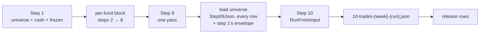
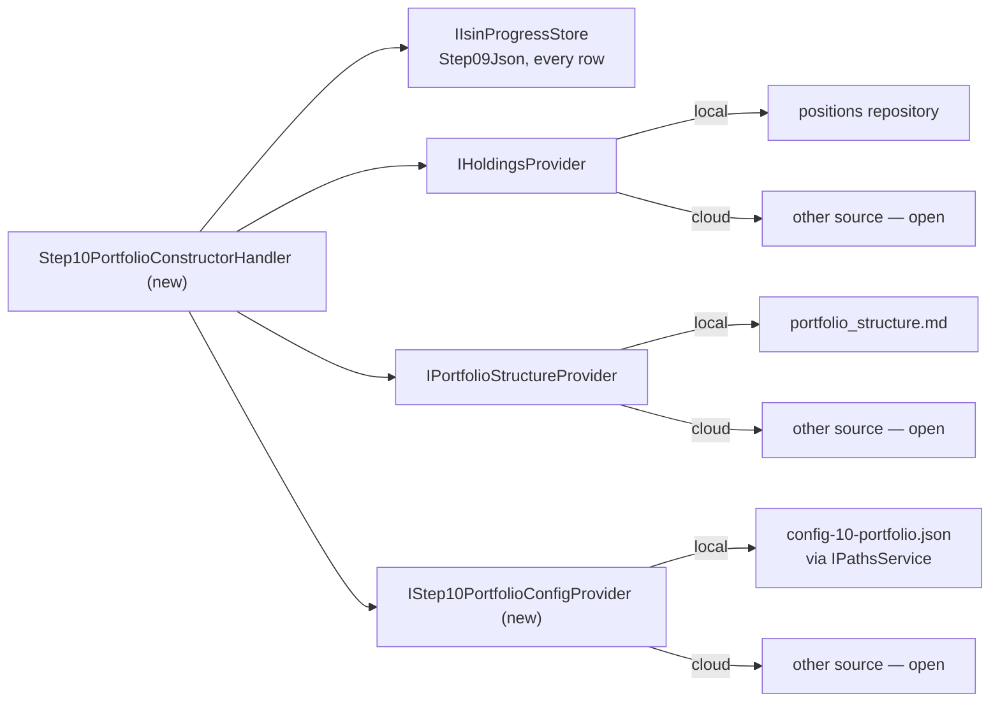

<!--
  Authoring rules: see README.md in this folder.
  STATUS: design, 2026-11-10 — nothing built. Step 10 is the portfolio
  sink: it reads every fund's step 9 record and the portfolio's own state,
  and produces the day's trades. Decided 2026-11-10: two triggers, as step
  9 — step 9's done-signal and a daily timer at 23:00; portfolio state read
  by step 10 itself, through the seams step 1 already uses; the trades
  stored, then emitted as an event the bank side consumes. The choices
  still open are in "To settle before building"; the open questions are
  at the end.
-->

# Step 10 — PortfolioConstructor

> **Related:**
>
> - The step before it — the barrier, its two triggers, the per-pass run
>   id: [09-universeenricher.md](./09-universeenricher.md)
> - What every step stores and reads, and step 10's read across every
>   row: [pipeline-data.md](./pipeline-data.md) §"Step 10 — reads across
>   every row"
> - The cloud timer, its inputs, the two output candidates, day-level
>   idempotency:
>   [backend-nav-sync-plan.md](../backend-nav-sync-plan.md#step-10--daily-portfolio-trades)
> - The positions table and the SendToBank target:
>   [storage-migration-plan.md](../storage-migration-plan.md) §"Step 10 +
>   SendToBank rewiring"
> - The `TradingOrders` key a re-run overwrites:
>   [storage-schema.md](../storage-schema.md)
> - What this step does **today** — the passes, cash policy, conviction
>   gating, sizing, constraint violations, failure modes:
>   [10-portfolioconstructor.md](../../FikaFinans.InfrastructureV2.Tests/docs/10-portfolioconstructor.md)

`StepId.PortfolioConstructor`, implemented by `PortfolioConstructorAgent`
behind `IPortfolioConstructorAgent`, surfaced in the desktop app as
`Step10PortfolioConstructorViewModel`. This page covers only what the move
to signal-driven processing changes.

Step 10 is code-only and deterministic — no LLM, by contract, so the same
inputs give byte-identical trades. It is the only step that knows the
portfolio: cash, positions, weights.

## Portfolio-wide, not per fund

Step 9 is the first step that needs every fund. Step 10 needs every fund
**and** the portfolio around them:

| The contract | Is about |
| --- | --- |
| Cash floor — a share of `portfolio_value_kr` | the whole book: held positions, frozen positions, cash |
| Buy sizing — `max(default_buy_target_pct, 1/N)` of the deployable cash | every Buy in the run |
| Concentration cap — a position against `portfolio_value_kr` | the whole book |
| Sector cap — post-trade exposure per `metadata.category` | every fund in the category |
| Rotation pairs — a Sell whose paired Buy was rejected | both legs, across funds |
| Frozen positions — counted in the portfolio value, never traded | positions with no fund record |

None of these can be answered from one fund's row. Step 10 runs once over
everything, like step 9 — but unlike step 9 it also reads state no row
holds.

## What the code does today

`PipelineRunner`'s streaming run calls step 10 straight after step 9:

| Piece | Exists as | Does |
| --- | --- | --- |
| Universe read | `IStreamingPipelineGateway.LoadUniverseFromIsinProgressAsync`, step 9 as source | reads `Step09Json` off every row; takes week, run id, cash and frozen positions from **step 1's output**; drops funds with no record |
| The run | `IPortfolioConstructorAgent.RunFromInput` | the passes over the loaded universe — `macroRegime` is always null |
| The config | `PortfolioConstructorConfig.Default` | Autofac picks the one-argument constructor on purpose; `config-10-portfolio.json` is seeded and editable from the tab, but **never read** — step 9's old bug |
| Output | a file, `10-trades-{iso_week}-{run_id}.json` | the return value is thrown away; nothing reaches the database |
| After | `ReleaseIsinProgressAsync` | frees the rows and moves the anchors; a step 10 failure keeps them held |
| Tab "Run step" | `IPortfolioConstructorAgent.Run(IsoWeek, RunId)` | reads the step 9 **file** for the run bar's run, writes the step 10 file |
| Readers | the step 10 tab, `FundDetailViewModel` | both read the step 10 file |
| Send to bank | the tab's button → `ISendToBankService.SubmitAsync` | turns the loaded trades into orders |

### What does not carry over to signal-driven runs

| Piece | Why not |
| --- | --- |
| Cash and frozen positions | they come from step 1's whole-portfolio output; a signal-driven step 1 writes one fund, and the row stores the fund record, not the envelope. Step 9's domain-input pass sets cash to 0 and frozen positions to empty |
| Held and current value on the record | each fund's `CurrentlyHeld` and `CurrentValueKr` are as of **its** last step 1 — days old for a fund whose NAV did not move, and blind to anything bought or sold since |
| The run's envelope | there is no one input envelope — week, run id and family came with it |
| The file | signal-driven steps write rows, not files |
| The tab's read | by the run bar's run id; a step 9 pass has its own run id, and the rows keep their funds' |

The agent's passes carry over unchanged.

## Input trigger

**Decided 2026-11-10: two triggers, as step 9 — step 9's done-signal and
a daily timer.** Step 10 is its own entry point; each trigger runs it.

| Trigger | Locally | In cloud | Catches |
| --- | --- | --- | --- |
| Step 9 done | a step 9 done-signal *(new)*, emitted after step 9's save | the step 9 Function, after its save | the normal case — the trades follow the conviction as soon as a pass lands |
| Timer | a local timer *(new)*, daily at **23:00** | the timer-triggered Function at 23:00 CET [backend-nav-sync-plan.md](../backend-nav-sync-plan.md#step-10--daily-portfolio-trades) already plans | a day with no step 9 pass — a barrier that never closed, or a pass that failed |

This answers step 9's "Emit" question: "step 9 done" **is** a signal,
and step 10 is its consumer. It is a pass-level signal, not a per-fund
one — one per step 9 pass, with no ISIN.

**Decided 2026-11-10, the timer: 23:00 local, in-process** — an Rx timer
in the app through `DailyTime`, re-armed after each firing in local time,
as step 9's 22:45. Step 9's constant was "shortly before step 10's
23:00"; this is the 23:00 it was waiting for. It fires only while the app
is open.

### No barrier of its own

Step 9 already waited for every fund. Step 10 does not check again: it
runs on whatever `Step09Json` the rows hold, skipping funds without one —
the rule [pipeline-data.md](./pipeline-data.md) already states: "the day's
trades reflect each fund's last *completed* run, not necessarily its
latest NAV."

### Running twice a day

With two triggers, step 10 will often run twice over the same records —
the done-signal in the evening, then the timer. **Run again and
overwrite**, as step 9: the same records, holdings and config give the
same trades, and the day-level idempotency in
[backend-nav-sync-plan.md](../backend-nav-sync-plan.md#step-10--daily-portfolio-trades)
covers it. Step 10 has no LLM, so a second run costs nothing — and,
being deterministic, it cannot differ unless an input did.

### Manual trigger — WPF only

The tab's "Run step" runs a pass through the handler — see "What a
frontend reads".

## Input data — what the step reads

| Input data | Current | WPF | Cloud |
| --- | --- | --- | --- |
| **Every fund's step 9 record** | `Step09Json` from every row (Run All); the step 9 file (button) | `Step09Json` from every row in step 9's universe, skipping nulls — `IIsinProgressStore.ReadStep09OutputAsync`'s read | same, Tables — a partition scan |
| **Holdings and cash** | step 1's envelope | `IHoldingsProvider` — the positions repository, read at run time | `IHoldingsProvider` — another source, open |
| **Layers — core, writeoff** | step 1, through the portfolio structure | `IPortfolioStructureProvider` — `portfolio_structure.md` | `IPortfolioStructureProvider` — another source, open |
| **The portfolio config** | **never read** — `Default` | `config-10-portfolio.json` through `IStep10PortfolioConfigProvider` *(new)* | another source — open |
| **The macro regime** | never passed — null | open — see "The macro regime" | same |

### Portfolio state through the seams step 1 uses

**Decided 2026-11-10: step 10 reads the portfolio itself, through a seam,
so each host can read its own source.** The seams exist: signal-driven
step 1 reads the whole book through `IHoldingsProvider` — "portfolio-
scoped, not per fund: cash, the frozen list and the downstream weight
calculations are all sums over the whole book" — and the layers through
`IPortfolioStructureProvider`. Step 10 reads the same two.

| Step 10 needs | From |
| --- | --- |
| `cash_available_kr` | the holdings' cash |
| `frozen_positions[]` | holdings in a `writeoff` fund, as step 1 classifies them |
| `currently_held`, `current_value_kr` per fund | the holdings — **overriding** the record's, which date from the fund's last step 1 |
| `layer` per fund | the portfolio structure, as step 1 assigns it |

Read fresh at run time, so a trade the bank settled after a fund's last
run shows. The record's own held and value fields stay as written — the
append-only rule; the override lives only in the agent's input.

Step 2's open question — how the envelope is stored on the row — does not
block step 10: step 10 does not read the envelope back. Step 2's page
raised "which row step 10 trusts for the envelope"; the answer is none.

### Config through a seam

Step 9's pattern, which step 2's page said steps 4, 9 and 10 inherit:
`IStep10PortfolioConfigProvider` *(new)* returns
`PortfolioConstructorConfig`, which exists;
`JsonBackedStep10PortfolioConfigProvider` *(new)* reads
`config-10-portfolio.json` through `IPathsService`, fresh on every run, so
an edit takes effect on the next one. The `config_version` check stays in
the agent, so a bad edit fails the run, not the app. "Portfolio" after the
file's name.

### The macro regime

The agent takes a regime for the cash-floor override; nothing passes one.
`IMacroContextStore.GetNewestAsync` — what steps 5 and 6 read — could
supply the newest context's `MacroRegime`. Two things to know first:

- The override is **off** by default, and the contract explains why —
  every variant lost money against the fixed 5% floor. With it off, the
  regime changes nothing.
- The override table's keys do not match the enum: the table has
  `Risk-on`, the enum `RiskOn`; the enum's `RiskOff` has no row. Passing
  the regime would only ever hit `Crisis`, `Stagflation` and `Mixed`.

To settle: pass it, or keep null until the override is wanted.

## Agent work

Code-only. Contract:
[10-portfolioconstructor.md](../../FikaFinans.InfrastructureV2.Tests/docs/10-portfolioconstructor.md).
The passes, the gates, the sizing, the caps and the violations do not
change.

`RunFromInput` and `Run` take a whole `DataLoaderOutput` and write a file.
A signal-driven run has records and a portfolio, but no envelope, and
writes no file — so it needs the domain-input shape steps 4–9 got: the
records, the portfolio state, the config, the regime. Synchronous, as
step 8's: there is nothing to await inside.

**Week and run id: step 9's per-pass pattern.** Each run mints its own run
id through `IPipelineRunIdFactory` — `universe` in place of the ISIN,
dated by the run — and takes the week the run happens in. It stamps the
output and the log lines.

### Logging

In the handler, as steps 4–9: Debug per phase; one Debug line per trade —
type, amount, reason, pair id; one per rejected recommendation; Warn per
constraint violation; Error per failed phase; Info per run with the
universe's size, the trade count and the capital summary's deployable and
remaining cash. The agent stays logger-free, as step 8's.

## Output, and what follows

**Decided 2026-11-10: store, then emit.** The run saves the day's
`TradesOutput`, then emits a trades event *(new)* carrying it — the same
order steps 1–9 keep: write, then signal.

| | Current | WPF | Cloud |
| --- | --- | --- | --- |
| **Run All button** (`PipelineRunner`) | the file `10-trades-{iso_week}-{run_id}.json` | **unchanged** — `PipelineRunner`'s own step 10, as step 9 left Run All | — no button |
| **Step 10 tab's "Run step" button** | the file — `Run` reads the step 9 file | through the handler, shown but **not stored**, as step 9's | — no tabs |
| **Done-signal or timer run** | — does not exist | stored, then the trades event. **No file** | the same store in Azure Tables, then the event |
| **Read by** | the tab and the fund detail, from the file | the tab, the fund detail, the bank side — from the store or the event | the bank side |

### Where it is stored — open

The two candidates [backend-nav-sync-plan.md](../backend-nav-sync-plan.md#step-10--daily-portfolio-trades)
and [pipeline-data.md](./pipeline-data.md) already lay out:

| | One portfolio entry per day | A `Step10Json` column per fund |
| --- | --- | --- |
| Key | partition `portfolio-trades`, row key the date | the progress row |
| Holds | the whole `TradesOutput` — trades, rejections, capital summary, violations | each fund's trade |
| For | the output is portfolio-wide: the capital summary and most violations belong to no fund | "one row tells you everything" |
| Against | a new table or partition, and a store for it | duplicated storage, a write per fund — and the portfolio-wide half still needs a home |
| Re-run the same day | overwrites the day's entry | overwrites every fund's column |

This page leans to **one entry per day**: half the output is about no
fund at all. Not decided.

### Emit — the bank consumes it

**Decided 2026-11-10: step 10 emits; the bank side handles it.** Step 10
does not call `ISendToBankService`. The trades event *(new)* carries the
day's `TradesOutput`; a bank-side consumer — not built — turns it into
orders. `ISendToBankService` was lifted out of the tab for exactly this
reuse.

Running twice a day emits twice. The consumer must be idempotent — the
`TradingOrders` key in [storage-schema.md](../storage-schema.md),
`(date, isin, side)`, already makes a same-day re-run overwrite its
orders rather than duplicate them.

The rows are not touched: step 10 holds no row and frees none. No tail
move — step 8 stays the per-fund chain's tail.

## What a frontend reads when the user opens the view

| The tab | Today | Signal-driven |
| --- | --- | --- |
| Reads | the step 10 file by the run bar's run id | the last stored trades — a day, not a run |
| Follows | — | step 10's step events; reloads on `Succeeded`, as step 9's tab |
| Runs | `IPortfolioConstructorAgent.Run` over the run bar's step 9 file | a pass through the handler over what is stored now — shown, never stored, whether or not step 9 ran today |
| Config editor | edits a file nothing reads | edits the file the provider reads |
| Send to bank | the button submits the loaded trades | open — see "To settle" |

The fund detail's step 10 section reads the fund's trade from the store
instead of the file.

## To settle before building

| # | Still open | Options |
| --- | --- | --- |
| 1 | Where the trades are stored | one portfolio entry per day — leaned to; or a `Step10Json` column per fund |
| 2 | The macro regime | the newest macro context's regime, through `IMacroContextStore`; or null until the override is wanted. Either way, the table's keys against the enum |
| 3 | The tab's Send to bank button | stays until the bank consumes the event; or goes once it does; or stays as a manual resend |
| 4 | Config | a provider, step 9's pattern |

Decided: **the trigger** — step 9's done-signal and a timer; **the
timer** — 23:00 local, in-process; **a second run the same day** — runs
again and overwrites; **portfolio state** — read by step 10 through
`IHoldingsProvider` and `IPortfolioStructureProvider`; **the output** —
stored, then emitted; **the bank** — consumes the event, step 10 does not
send.

## Proposed implementation order

One change per row, each reviewed and committed before the next. Every
new name is *(new)*. Logging is part of each row that adds code which
runs. No LLM client, so no client logging row.

| # | Work | Touches | Blocked on |
| --- | --- | --- | --- |
| 1 | `IStep10PortfolioConfigProvider` in Application, `JsonBackedStep10PortfolioConfigProvider` in Infrastructure — step 9's pattern, read fresh on every call | Application `Pipeline/Configs`, Infrastructure, `InfrastructureModule` | — |
| 2 | Domain-input `RunInMemory` on `IPortfolioConstructorAgent` — records, portfolio state, config, regime; synchronous, no file. No rule change. Tests in a new file beside `PortfolioConstructorAgentTests` | `IPortfolioConstructorAgent`, `PortfolioConstructorAgent`, a new test file | row 1 |
| 3 | Portfolio state from the seams — cash, frozen positions, the held and value override, layers — from `IHoldingsProvider` and `IPortfolioStructureProvider`, classified as step 1 does | Application `Pipeline/Steps` | — |
| 4 | The trades store — save the day's output, read the last one back | `IIsinProgressStore` or a store of its own, per "To settle" #1 | settle #1 |
| 5 | `IStep10PortfolioConstructor` + handler — load the records, load the portfolio and config, run, save, report step events; `ReadOutputAsync`, and `ComputeOutputAsync` for the "Run step" button. Not wired | Application, `Pipeline/Steps` | rows 2, 3, 4 |
| 6 | A step 9 done-signal *(new)* — one per pass, emitted after step 9's save | `Step09UniverseEnricherHandler` or its entry, `Pipeline/Signals` | — |
| 7 | `IStep10PortfolioConstructorEntry` + entry point — one call per trigger, `Step10Trigger` *(new)*: step 9 done, timer; registration | Application, `InfrastructureModule` | row 5 |
| 8 | Subscription step 9 done-signal → step 10's entry point, caught and logged as `RunStep09Async` | `MainWindowViewModel` | rows 6, 7 |
| 9 | A local daily timer at 23:00 → step 10's entry point | `MainWindowViewModel` | row 7 |
| 10 | The trades event *(new)*, emitted after the save — no consumer yet | Application `Pipeline/Signals`, the handler | row 5 |
| 11 | Step 10's tab goes passive, as step 9's: follows step events, reads the stored trades; "Run step" through the handler; the fund detail reads the store | `Step10PortfolioConstructorViewModel`, `FundDetailViewModel` | rows 5, 7 |

Run All is not changed — `PipelineRunner`'s own step 10, as step 9 left
it. It could not go through the entry point anyway: it holds every row
until after step 10.

## Open questions

Raised by this page; they belong in the parent plan's Open Questions,
not settled here.

- **The queue layout.** [backend-nav-sync-plan.md](../backend-nav-sync-plan.md)
  has step 10 on a timer only. Under this page it also follows step 9's
  done-signal — a `step09-done` hop beside the timer. That plan is where
  the layout changes.
- **The bank consumer.** Who subscribes to the trades event, locally and
  in cloud, and how it reconciles positions after orders settle —
  [storage-migration-plan.md](../storage-migration-plan.md) §"Step 10 +
  SendToBank rewiring".
- **Step 10 does not read `UniverseRank`.** Its contract says ranks decide
  which Buys are funded first and which Sell is taken; the code scales
  Buys proportionally. Carried from step 9's page.
- **A held fund with no step 9 record** — failing every run, or outside
  the company filter. The contract says emit `Hold` and raise
  `held_fund_not_in_universe`; the code does neither. With holdings read
  directly, step 10 can now see such a fund — whether it should is open.
- **23:00 CET and daylight saving** — the cloud timer's question in
  [backend-nav-sync-plan.md](../backend-nav-sync-plan.md); the local
  timer runs in local time.
- **Carried over unchanged:** the cloud host, step outputs too large for
  Tables, where the configs live in cloud — on step 2's and
  [pipeline-data.md](./pipeline-data.md)'s pages.
