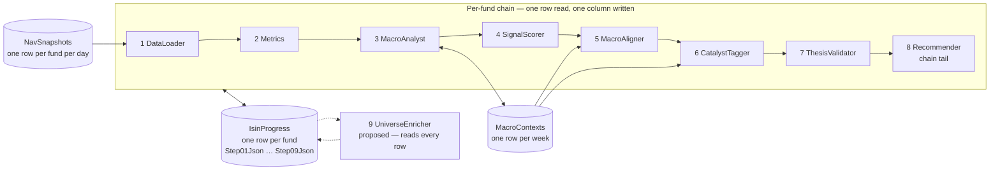
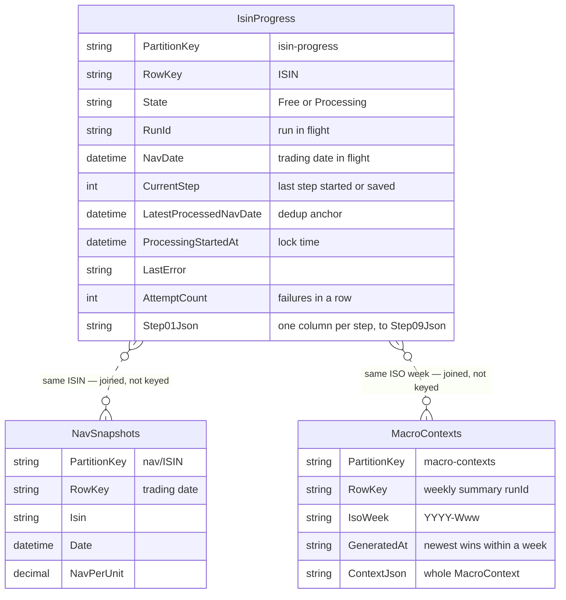
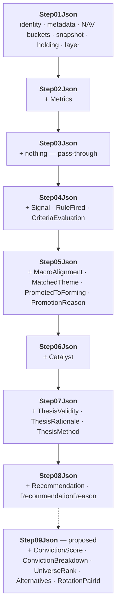
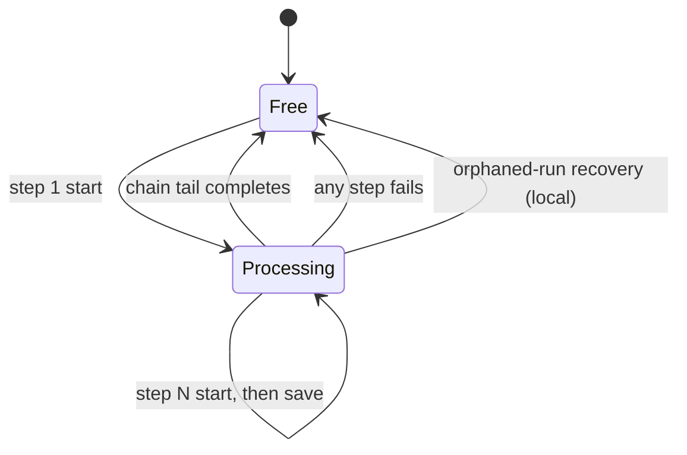
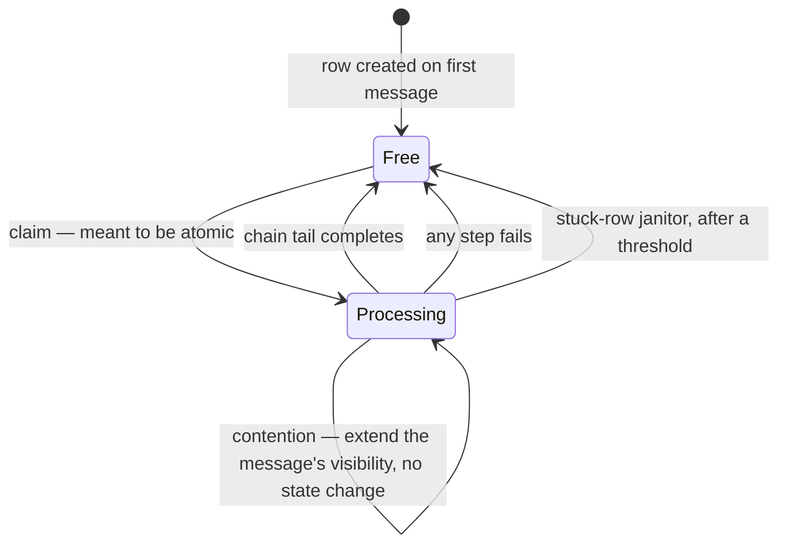

# Pipeline data and configuration

What every step reads and writes outside its own code — the tables the
pipeline keeps between steps (which column, which step writes it, which
step reads it), and the configuration each step reads but never writes.
Written for the steps that read across the chain: step 9 reads every
fund's step 8 record, step 10 every fund's envelope.

## At a glance

Three tables. One row per fund carries the whole per-fund chain; one row
per week carries the macro context; the NAV mirror feeds step 1.

Three facts carry most of the page:

- **Each step reads its predecessor's column and writes its own.** The
  record is append-only, so `Step08Json` already holds everything steps
  1–7 added. No step reads two columns back.
- **The columns hold the latest run only.** Step 1's start clears them
  all.
- **Nothing per week lives on the fund's row.** The macro context has its
  own table; the row does not even say which context its run used.

Everything sits in the app's one database locally (SQLite, or in-memory
per Settings) and in the backend's one Azure table in cloud, where each
table here becomes a partition. All three follow the Tables-shaped
contract in [storage-schema.md](../storage-schema.md): PartitionKey and
RowKey as the natural key, no foreign keys, last write wins.

Steps 1–8 are built for the local (WPF) host; step 9 is proposed, and
marked as such wherever it appears.

## The tables

| Table | PartitionKey | RowKey | Written by | Read by | Lifetime |
| --- | --- | --- | --- | --- | --- |
| `IsinProgress` | `isin-progress` | the ISIN | steps 1–8; step 9 proposed | steps 2–8 by run id; step 9 proposed, every row | row lives forever; step columns latest-only |
| `MacroContexts` | `macro-contexts` | the weekly summary's `runId` | step 3, on a miss | steps 3, 5, 6; step 3's tab | outlives every run |
| `NavSnapshots` | `nav/{isin}` | the trading date, round-trip ISO 8601 | step 1, as a delta | step 1 | append-only |

The dotted links are joins the services make. No row holds a key to
another.

## The progress row — `IsinProgress`

One row per fund, doing two jobs:

| Job | Columns |
| --- | --- |
| In-flight lock and dedup anchor | `State`, `RunId`, `NavDate`, `CurrentStep`, `ProcessingStartedAt`, `LatestProcessedNavDate`, `LastError`, `AttemptCount` |
| Inline step-output store | `Step01Json` … `Step09Json` — one column per step, each one fund's output for the run in `RunId` |

**The dedup rule.** A NAV signal is processed only when its trading date
is strictly newer than `LatestProcessedNavDate`. The anchor moves only
when a run completes, so a crashed or failed run never advances it and
the next signal retries the fund.

<b>Why one row</b> — lock, anchor and outputs together, inline not blobs

An earlier design had a separate "latest-seen" table and a processed
list keyed by `(isin, navDate)`. Both collapsed into this one row per
fund.

On Azure each step is a separate Function invocation, so step outputs
need somewhere durable to land between calls. The progress row takes
them, one column per step, rather than a blob per output:

- **Atomicity.** The step output and the progress state change in one
  row write — no "wrote the blob, crashed before the table" window.
- **One row, one dashboard.** Reading a fund returns its whole pipeline
  state in one round trip; a status view leaves the big columns out with
  `$select`.
- **Fewer moving parts.** The same storage account as the queues; no
  blob container, no extra lifecycle.

That argument rests on the outputs fitting a Tables property — which
the later measurement says they do not. See "Size against Azure Tables".

### What each column adds

Every column holds a `FundRecord`, saved through
`IIsinProgressStore.SaveStepOutputAsync`. Each step adds its fields and
leaves the earlier ones as they were.

| Column | Step | Adds | Next reader | Status |
| --- | --- | --- | --- | --- |
| `Step01Json` | [1 DataLoader](./01-dataloader.md) | identity, metadata, NAV buckets, snapshot, holding, layer | step 2 | built |
| `Step02Json` | [2 MetricsCalculator](./02-metricscalculator.md) | `Metrics` | step 3 | built |
| `Step03Json` | [3 MacroAnalyst](./03-macroanalyst.md) | nothing — its output is per week, in `MacroContexts` | step 4 | built |
| `Step04Json` | [4 SignalScorer](./04-signalscorer.md) | `Signal`, `RuleFired`, `CriteriaEvaluation` | step 5 | built |
| `Step05Json` | [5 MacroAligner](./05-macroaligner.md) | `MacroAlignment`, `MatchedTheme`, `PromotedToForming`, `PromotionReason` | step 6 | built |
| `Step06Json` | [6 CatalystTagger](./06-catalysttagger.md) | `Catalyst` — null when none applies | step 7 | built |
| `Step07Json` | [7 ThesisValidator](./07-thesisvalidator.md) | `ThesisValidity`, `ThesisRationale`, `ThesisMethod` | step 8 | built |
| `Step08Json` | [8 Recommender](./08-recommender.md) | `Recommendation`, `RecommendationReason` | step 9 — every row's latest | built |
| `Step09Json` | [9 UniverseEnricher](./09-universeenricher.md) | `ConvictionScore`, `ConvictionBreakdown`, `UniverseRank`, `Alternatives`, `RotationPairId` | step 10 | **proposed** |

Field names are `FundRecord` members. What each means, and its JSON
shape, is the step's contract in
[`FikaFinans.InfrastructureV2.Tests/docs/`](../../FikaFinans.InfrastructureV2.Tests/docs/).

<b>Row lifecycle</b> — start, save, complete, fail

| Transition | What changes on the row |
| --- | --- |
| Step 1 start | refused if already `Processing`. Otherwise the row is **rewritten from scratch**: `State` Processing, `NavDate` the signal's, `CurrentStep` 1, `ProcessingStartedAt` now. Only `LatestProcessedNavDate` carries over — every step column, `LastError` and `AttemptCount` reset. `RunId` stays null until the fund loads |
| Step N start, N > 1 | a check and a mark, never a clear: refused unless the row is in flight and names the signal's run id; `CurrentStep` moves to N |
| Step N save | `StepNNJson` written; every other column kept |
| Complete — the chain tail only, step 8 today | `State` Free; `LatestProcessedNavDate` takes `NavDate`; `LastError` cleared; `AttemptCount` 0; step columns kept |
| Fail — any step | `State` Free; anchor **not** advanced; `LastError` set; `AttemptCount` + 1; step columns kept — the next signal retries the fund |
| Orphaned-run recovery | local only: a step's tab, first opened in a session, fails the runs left in flight at that step |

Rules from [02-metricscalculator.md](./02-metricscalculator.md)
§"Complete and fail" and [03-macroanalyst.md](./03-macroanalyst.md)
§"Start, do not claim".

The reset at step 1's start is what keeps the row honest: without it,
the previous run's columns would sit beside the in-flight run's, and
`CurrentStep` could no longer say which columns are fresh.

<b>Row lifecycle in cloud</b> — designed, not built: atomic claim, contention, janitor

The cloud host adds three things the local host does not need, because
there several Functions can hold messages for the same fund at once.

| Addition | What it does | Status |
| --- | --- | --- |
| **Atomic claim** | a second worker claiming a row already `Processing` sees it and takes the contention branch | **conflicts** — the design names an ETag (Tables) or a transaction (SQLite), but the storage contract rules out ETags, and the local claim is a read, then an upsert. See "Open questions" |
| **Contention** | a message for a fund in flight is not deleted: its queue visibility is pushed forward past a typical run, and the front-door check runs again when it reappears. If its trading date is by then not newer than the anchor, it is skipped as obsolete | not built — queue only |
| **Stuck-row janitor** | a row `Processing` for longer than a threshold — 15 minutes, past the 10-minute Consumption-plan cap — is reset to `Free`. Covers a crash or a host eviction, which would otherwise leave every retry stuck in contention | not built; placement open |

Why extend visibility rather than re-enqueue: one queue operation, no
risk of a duplicate if a delete-then-add fails halfway, and the dequeue
count survives, so the poison threshold still backstops a genuinely
stuck fund.

#### Stuck-row recovery

A Function crash, an unhandled exception or a Consumption-plan host
eviction can leave a row `Processing` with no live worker. The queue's
visibility timeout returns the message for a retry — but the row is
still locked, so every retry takes the contention branch, forever.

The janitor breaks that: any row whose `ProcessingStartedAt` is older
than a threshold is reset to `Free`. 15 minutes is comfortable — well
past the 10-minute Consumption-plan hard cap, so no live run can still
hold the row.

| Placement | How |
| --- | --- |
| In the front-door check | "if `Processing` but stale, treat as `Free`" — cheap, runs on every message |
| A timer Function of its own | sweeps the partition on a schedule — clean separation, costs almost nothing |

Not chosen; see "Open questions". Locally the same job is done by
orphaned-run recovery — a step's tab, first opened in a session, fails
the runs left in flight at that step.

**Accepted:** two messages for one fund with different trading dates
can both pass the front door if the second arrives just before the
first's claim lands. The result is an occasional duplicate run. The row
is meant to be cheap, dedup-correct on the common path and crash-safe —
not a strict per-fund serializer.

Locally none of this is needed: one process handles a fund's signals in
turn, a claim on a row in flight is simply refused, and orphaned runs
are recovered from the tabs.

<b>What the row does not carry</b> — the envelope, the context used

- **The `DataLoaderOutput` envelope** — frozen positions, cash available,
  run-level data-quality warnings, ISO week, company. Dropped at save
  today. Decided: it goes on the row. How — inside every step column, or
  one envelope column — is open on
  [02-metricscalculator.md](./02-metricscalculator.md) §"How the envelope
  is stored". Step 10 needs it.
- **Which macro context the run used.** Steps 5 and 6 read the newest
  stored up to the fund's week; a reader afterwards can only repeat that
  lookup, which matches unless a newer context has landed since.

## The week's macro context — `MacroContexts`

One row per analytics bundle. Step 3 writes it on a miss and reads it
back for the week's later funds, so the LLM runs once per bundle, not
once per fund. Keyed by the weekly summary's `runId`, so a republished
bundle is a new row; `IsoWeek` sits beside the key for the lookup and
the earlier-week fallback.

| Reader | Takes | Through |
| --- | --- | --- |
| step 3 | the whole context — a hit skips the LLM | `IMacroContextStore`, by `runId`, or newest up to the week |
| step 3's tab | the week's context, for display | the handler's `ReadContextAsync(week)` |
| step 5 | the rotation themes | `IMacroContextStore.GetNewestAsync(week)` |
| step 6 | the catalysts | `IMacroContextStore.GetNewestAsync(week)` |

Decisions on [03-macroanalyst.md](./03-macroanalyst.md) §"What the
context is keyed by", §"Where it is stored" and §"Which week's context a
fund uses".

## The NAV mirror — `NavSnapshots`

One row per fund per trading date. Step 1 adds the rows newer than the
mirror already holds and computes the buckets and snapshot from the
series. No later step reads it — they read the buckets on the record.
See [01-dataloader.md](./01-dataloader.md).

## Step 10 — reads across every row

Not built. Step 10 runs once a day on a timer, outside the per-fund
chain, and reads `Step09Json` from **every** progress row, whatever its
trading date.

| Row says | Step 10 |
| --- | --- |
| `Step09Json` from a run a week ago | uses the week-old view |
| `Step09Json` null — never completed, or mid-run after step 1's start cleared it | skips the fund |

That is the trade the run-boundary reset makes: the day's trades reflect
each fund's last *completed* run, not necessarily its latest NAV.

Where step 10 writes is open:

| | One portfolio row per day | A `Step10Json` column per fund |
| --- | --- | --- |
| Key | PartitionKey `portfolio-trades`, RowKey the date | the progress row |
| For | step 10's output is portfolio-wide by nature | keeps "one row tells you everything" |
| Against | — | duplicated storage, a write per fund |

## Step configuration

What each step reads besides the pipeline's data — config files,
prompts, settings. Read-only to the pipeline; nothing here is written by
a run. Settings shared by several steps sit at the bottom with every
step that reads them.

| Step | Interface | Current | WPF | Cloud |
| --- | --- | --- | --- | --- |
| 1 DataLoader | `NavSyncOptions` — YieldRaccoon DB path, company filter | built from `AppSettings` | unchanged | bound from app settings |
| 2 MetricsCalculator | `IStep02MetricsConfigProvider` | none — the agent's `Run` and `StreamingPipelineGateway.LoadMetricsConfig` each read the file | `JsonBackedStep02MetricsConfigProvider` — `config-02-metrics.json` via `IPathsService` | another source — open |
| 3 MacroAnalyst | `IStep03MacroAnalystPromptsProvider` — system, user template, retry | none — the agent's constructor reads `MacroAnalystPromptsDir` | `FileBackedStep03MacroAnalystPromptsProvider` — same folder, embedded defaults extracted when missing | embedded defaults, app settings or blob — open |
| 3 MacroAnalyst | `NavSyncOptions` — the universe read, same company filter | — | unchanged, through `IFundMetadataProvider` | bound from app settings |
| 4 SignalScorer | `IStep04SignalsConfigProvider` | none — the agent's `Run` and `StreamingPipelineGateway.LoadSignalConfig` each read the file | `JsonBackedStep04SignalsConfigProvider` — `config-04-signals.json` via `IPathsService` | another source — open |
| 5 MacroAligner | adjacency prompt — no config | a constant in `FoundryThemeAdjacencyLlmClient` | unchanged | unchanged |
| 6 CatalystTagger | classification prompt — no config | a constant in `FoundryFundCatalystLlmClient` | unchanged | unchanged |
| 7 ThesisValidator | refinement prompt — no config | a constant in `FoundryThesisRefinementLlmClient` | unchanged | unchanged |
| 8 Recommender | no config — "None. Pure deterministic mapping." | — | — | — |
| 9 UniverseEnricher | `IStep09ConvictionConfigProvider` *(new)* | **never read** — `config-09-conviction.json` is seeded and editable from the tab, but nothing reads it | `config-09-conviction.json` through a provider, step 4's pattern | app settings or a blob — open |
| 9 UniverseEnricher | differentiator prompt — system and retry | constants in `FoundryDifferentiatorLlmClient` | unchanged | unchanged |
| 10 PortfolioConstructor | `config-10-portfolio.json` | in the inputs folder, read by `PortfolioConstructorAgent` | unchanged | open — step 10's page not written |
| 2, 4, 9, 10 | `IPathsService` — the inputs folder the config files live in | settings path, `SettingsBackedPathsService` | unchanged | **no filesystem** — every file row must find another home first |
| 3, 5, 6, 7, 9 | Foundry project + model id | settings, `az login` | unchanged | app settings, managed identity |

Steps 2, 3, 4, 9 and 10 share one open question: what replaces the
file in cloud. Prompts held as constants in an LLM client move with the
build and need nothing.

Sources: each step page's "What is the same in both hosts" and "Input
data" tables, and [01-dataloader.md](./01-dataloader.md) §"Input data"
for the step configs and the inputs folder.

## Edge cases and open questions

<b>Size against Azure Tables</b> — the step columns do not fit

A Tables string property holds 64 KB, about 32 000 characters; a row
holds 1 MiB. SQLite has no cap.

Two measurements disagree:

| When | Corpus | Per fund, per step | Fits |
| --- | --- | --- | --- |
| Original design | the integration-test corpus, `FikaFinans.InfrastructureV2.Tests/stepOutputs` — 16 funds, 9 steps | about 17–19 KiB | yes, about 1.8× headroom; about 162 KiB per row |
| First signal-driven local run | `Step01Json`, `Step02Json` | about 84 000 characters — mostly `NavBuckets` | **no** |

The second is the current shape: step 1 now computes buckets from the
mirrored series, and every later column carries the same `NavBuckets`.

| Column | Fits Tables as is |
| --- | --- |
| `Step01Json`, `Step02Json` | **no** — measured |
| `Step03Json` … `Step09Json` | assume no — not measured, and each only grows |
| `ContextJson` | probably — not measured, expected well under |

Candidates: split the column, gzip and base64 it, or move outputs to
blobs — decided when the cloud store is built. Raised on
[02-metricscalculator.md](./02-metricscalculator.md) §"Open questions".

**Designed, not built — a column size guard.** A runtime check in the
one writer every step goes through, throwing when a serialized output
passes about 30 KiB; and an integration test asserting every per-fund
per-step slice of the corpus stays under it, so drift shows up in review
rather than in production.

<b>Considered and not stored</b> — so nobody looks for them

| What | Raised on | Status |
| --- | --- | --- |
| Theme-adjacency verdicts, per (context, category) | [05-macroaligner.md](./05-macroaligner.md) | no cache, in-process, or a store beside `MacroContexts` — none chosen |
| Catalyst verdicts, per (context, fund) | [06-catalysttagger.md](./06-catalysttagger.md) | same three options — none chosen |
| Step 10's portfolio trades | "Step 10 — reads across every row" above | one row per day or a column per fund — not chosen |
| A SQLite copy refreshed from Azure Tables, for local work against cloud data | [backend-nav-sync-plan.md](../backend-nav-sync-plan.md) §"Acknowledged seams" | not built — only worth it once a Tables environment exists |

<b>Open questions</b> — collected from the step pages, not settled here

- **How the envelope is stored** — step 2's page.
- **Step outputs too large for Tables** — step 2's page.
- **Which macro context a run used** — the row does not say. Step 3's
  page raises it for step 5.
- **Compute once in cloud** — two Functions can both miss on
  `MacroContexts`; the contract has no concurrency token. Step 3's page.
- **Whether step 9 stores a pass or a run**, and what the row's `RunId`
  means once step 9 has written to it — step 9's page.
- **Atomic claim in cloud.** The cloud lifecycle needs one; the storage
  contract has no ETag, and the local claim is a read, then an upsert.
  Accept the duplicate runs the design already accepts, or add a
  concurrency check to the progress row only.
- **Stuck-row janitor placement** — inside the front-door check, or a
  timer Function of its own.
- **Where step 10 writes** — one portfolio row per day, or a column per
  fund.
- **Where the step configs and step 3's prompts live in cloud** — app
  settings, a blob, or embedded defaults; and whether a missing file
  falls back to defaults or fails. Steps 2, 3, 4 and 9's pages.

## Related

- The bank-side tables and the five-rule contract:
  [storage-schema.md](../storage-schema.md)
- The phases that move SQLite to Azure Tables:
  [storage-migration-plan.md](../storage-migration-plan.md)
- Why the progress row exists — the reasoning behind the state machine:
  [backend-nav-sync-plan.md](../backend-nav-sync-plan.md) §"Progress
  Table" and §"Step Outputs"
